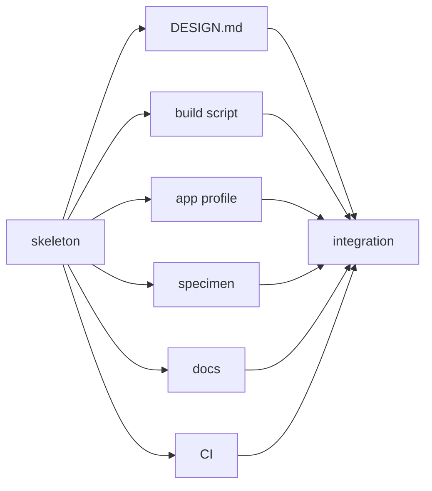

# t128n Design System — canonical repo and tooling

**Goal:** ship a single, lint-clean DESIGN.md source of truth plus the smallest toolchain that makes it consistent across all t128n web apps: generated light/dark CSS, an Application Profile template, a visual specimen, and CI enforcement.
**Architecture:** `DESIGN.md` holds all tokens and prose. `scripts/build.mjs` parses its front matter and emits deterministic `dist/tokens.css`; apps consume that file and the profile template. No component library and no publish step.
**Tech stack:** Node 24, npm, `@google/design.md@0.4.0`, `yaml@2.8.1`, `node:test`, GitHub Actions.
**Spec path:** `DESIGN.md` (all `§` references below).
**Detail:** contracts. **Target-min:** 8. **Orchestrator:** AI.

## Global constraints

- `DESIGN.md` must lint with `0 errors`, `0 warnings`, one `token-summary` info (`§2`). Its front matter is the only token source; `elevation`, `icons`, and `motion` are prose/tables (`§1`).
- Exact palette, typography, spacing, radius, and 68-component matrix are in `§3`–`§6`. Light and dark values are normative there; do not invent tokens.
- CSS contract (`§8`): `--color-<name>`, `--font-<type>`, `--text-<type>-size|weight|line-height|letter-spacing|font-feature`, `--space-<name>`, `--radius-<name>`.
- `:root` holds light values and `color-scheme: light`; it must not expose `--color-dark-*`. `[data-theme="dark"]` and `@media (prefers-color-scheme: dark) { :root:not([data-theme]) }` hold the 28 dark color overrides and `color-scheme: dark`.
- `dist/tokens.css` is generated, committed, and never hand-edited. `npm run check` runs build then `git diff --exit-code -- dist`.
- Node `>=20`; `npm test` is `node --test`. Use `bash $SUPERLITE/skills/subagent-driven-development/scripts/sl run_tests --fast PATHS --background`, then `--wait`.
- Coverage: Light palette, Dark palette, Layout and shapes, `§1`–`§11`.
- Edit only files in your **Owns** line. Never run `git add`, `commit`, `switch`, `checkout`, or `stash`.

Rulings: `Ruling: plain CSS only - user selected it - Tailwind apps can consume var() directly` · `Ruling: add dark state roles - full parity needs readable badges - 28 dark tokens` · `Ruling: 68 component tokens - covers every color and both themes - larger front matter accepted` · `Ruling: no publish - canonical repo + tooling scope - apps pin a commit and vendor dist/tokens.css`

```mermaid
%% schedule
gantt
  title Predicted schedule (mm:ss)
  dateFormat X
  axisFormat %M:%S
  section lane 1
  T0 repo skeleton :t0, 0, 102s
  T1 DESIGN.md :t1, 102, 127s
  T7 Integration and generated CSS :t7, 229, 102s
  section lane 2
  T2 build script :t2, 102, 127s
  section lane 3
  T3 Application Profile template :t3, 102, 102s
  section lane 4
  T4 Specimen :t4, 102, 102s
  section lane 5
  T5 README and changelog :t5, 102, 102s
  section lane 6
  T6 CI workflow :t6, 102, 102s
```





critical path: T0 → T1 → T7 (5.5 min) · peak width 6 · predicted build 5.5 min · predicted total ≈ 9.0 min

## File structure

`DESIGN.md`, `scripts/build.mjs`, `dist/tokens.css`, `app-profile.template.md`, `specimen.html`, `README.md`, `CHANGELOG.md`, `package.json`, `.github/workflows/design.yml`, `tests/*.test.mjs`.

### T0 repo skeleton · Complexity 2 · Est. context 24k
**Owns:** package.json, package-lock.json, .gitignore, .superlite/test-cmd.json, tests/smoke.test.mjs
**Components:** 1
**LOC owned:** 55
**Tests:** fast
**Kind:** mechanical
**Model:** haiku
**Produces:** `npm` scripts `lint` (`designmd lint DESIGN.md`), `build` (`npm run lint && node scripts/build.mjs`), `check` (`npm run build && git diff --exit-code -- dist`), `test` (`node --test`); installed `@google/design.md@0.4.0` and `yaml@2.8.1`.
**Review Focus:** file: `.gitignore` excludes `node_modules/` and `.superlite/`, not `dist/`; protocol: `engines.node` is `>=20`, `type` is `module`, package is `private`. Named test `scripts and dependencies are wired`: reads `package.json`, asserts the four scripts and both dev dependencies; asserts `.superlite/test-cmd.json` parses and uses `npm test -- {files}`.
**Contract:** `test_package_scripts()` reads `package.json`; asserts `scripts.test == "node --test"`, `scripts.build` contains `scripts/build.mjs`, `engines.node == ">=20"`, and `.superlite/test-cmd.json` parses.
**Steps:** 1 write the named test, 2 run: FAIL, 3 scaffold and `npm install`, 4 run: PASS.
**Notes:** `npm install` may create `package-lock.json`; keep the resolved versions.

### T1 DESIGN.md · Complexity 4 · Est. context 43k
**Owns:** DESIGN.md, tests/design.test.mjs
**Components:** 2
**LOC owned:** 720
**Tests:** fast
**Kind:** design
**Model:** sonnet
**Consumes:** `npm` scripts and installed `designmd` (T0).
**Produces:** `DESIGN.md` with 56 colors (28 pairs), 9 typography scales, 8 spacing tokens, 3 radii, 68 components; `tests/design.test.mjs` with the named checks below.
**Review Focus:** encoding: front matter parses as one YAML block; no `` ```yaml `` blocks after it; `version: alpha` and canonical section order. state: every base color has `dark-<name>` and vice versa; every component has a `-dark` counterpart where `§6` requires one. numeric: `designmd lint DESIGN.md` returns `summary.errors === 0 && summary.warnings === 0`; every `{ref}` in prose resolves. protocol: `primary` is `#2E63CC`, `border-control` is `#8A8F9C`, `on-surface-muted` is `#5F6473`, `state-disabled-fg` is `#565B66`, `error` is `#C62839`; 68 components exactly.
**Named tests:** `lint is clean`: parse lint JSON, assert errors 0 and warnings 0. `all refs resolve`: collect `/\{([a-z0-9.-]+)\}/gi` outside fences, walk the YAML tree, assert each path exists. `dark parity`: 28 base names each have `dark-` and 28 dark names each have a base. `sections ordered`: headings equal Overview, Colors, Typography, Layout, Elevation & Depth, Shapes, Iconography, Components, Do's and Don'ts. `token counts`: colors 56, typography 9, spacing 8, rounded 3, components 68.
**Steps:** 1 write failing tests, 2 run: FAIL, 3 write DESIGN.md from `§1`–`§6`, 4 run: PASS.

### T2 build script · Complexity 4 · Est. context 34k
**Owns:** scripts/build.mjs, tests/build.test.mjs
**Components:** 2
**LOC owned:** 260
**Tests:** fast
**Kind:** design
**Model:** sonnet
**Consumes:** installed `yaml` (T0).
**Produces:** `readDesignTokens(markdown: string) -> DesignTokens` · `renderTokensCss(tokens: DesignTokens) -> string` · CLI `node scripts/build.mjs` writes `dist/tokens.css`.
**Review Focus:** encoding: front matter starts at byte 0, `---` fences, CRLF tolerated; values keep their YAML order. state: every base color is written in `:root`; every `dark-*` color becomes a base-name override in both dark selectors; raw `--color-dark-*` never appears. file: output directory is created; a second run is byte-identical. protocol: missing `colors`, `typography`, `spacing`, `rounded`, `components`, an unpaired dark color, or a duplicate variable throws a named error.
**Named tests:** `renders both themes`: fixture with primary `#2E63CC` and dark-primary `#548AF7` yields `--color-primary: #2e63cc;` in `:root`, `--color-primary: #548af7;` in `[data-theme="dark"]` and in the media block; `--space-xs: 4px;`, `--radius-md: 3px;`, `--text-body-md-size: 12px;`, `--font-body-md:` present. `hides raw dark names`: output does not match `/--color-dark-/`. `rejects unpaired dark`: fixture with `dark-primary` but no `primary` throws `/dark-primary.*primary/`. `rejects missing group`: fixture without `spacing` throws `/spacing/`. `deterministic`: render twice, strings equal.
**Steps:** 1 write failing tests, 2 run: FAIL, 3 implement parser/renderer/CLI, 4 run: PASS.

### T3 Application Profile template · Complexity 2 · Est. context 24k
**Owns:** app-profile.template.md, tests/profile.test.mjs
**Components:** 1
**LOC owned:** 110
**Tests:** fast
**Kind:** design
**Model:** sonnet
**Produces:** one-page profile template with header table, records, status vocabulary, transitions, mobile strategy, exceptions, and conformance checklist (`§7`).
**Review Focus:** protocol: every required field in `§7` is present as a table column or labelled field. state: all seven semantic roles are named exactly; the status table maps each local status to one role. encoding: exception row has `rule`, `reason`, `scope`, `owner`, `review date`; mobile strategy offers 1, 2, and 3.
**Named tests:** `profile covers adoption`: read file; assert the seven role strings, the three mobile strategies, the five exception fields, and the checklist items `DESIGN.md`, `200%`, `keyboard`, `exceptions`.
**Steps:** 1 write failing test, 2 run: FAIL, 3 write template, 4 run: PASS.

### T4 Specimen · Complexity 3 · Est. context 28k
**Owns:** specimen.html, tests/specimen.test.mjs
**Components:** 1
**LOC owned:** 340
**Tests:** fast
**Kind:** design
**Model:** sonnet
**Consumes:** CSS variable contract (`§8`).
**Produces:** `specimen.html` linking `dist/tokens.css`, with a working `data-theme` toggle and the sections in `§9`.
**Review Focus:** protocol: table with `<caption>`, `<th scope="col">`, alternating rows, numeric column, seven text badges, `---`; fieldset with `<label for>` on every input; native `<dialog>`. encoding: no `linear-gradient`, `radial-gradient`, `backdrop-filter`, `box-shadow`, or `border-radius` above `3px`; no placeholder-only label. state: toggle switches `document.documentElement.dataset.theme` between `light` and `dark`; both states remain readable.
**Named tests:** `specimen is conformant`: read file; assert `dist/tokens.css`, `<table`, `<fieldset`, `for="`, `data-theme`, `<dialog`, `aria-label`; assert no forbidden CSS regexes; assert all seven role labels appear as text.
**Steps:** 1 write failing test, 2 run: FAIL, 3 write specimen, 4 run: PASS.

### T5 README and changelog · Complexity 2 · Est. context 24k
**Owns:** README.md, CHANGELOG.md, tests/docs.test.mjs
**Components:** 1
**LOC owned:** 220
**Tests:** fast
**Kind:** design
**Model:** sonnet
**Produces:** README sections Purpose, Repository layout, Quick start, Using the tokens, Dark mode, Adopting in an app, Versioning, Enforcement, Contributing; `CHANGELOG.md` at `0.1.0`.
**Review Focus:** protocol: every command in `§10` is documented exactly (`npm ci`, `npm test`, `npm run check`, `npm run build`, `designmd lint DESIGN.md`). encoding: README links `app-profile.template.md`, `DESIGN.md`, `specimen.html`, `dist/tokens.css`. state: dark mode explains `data-theme` and the media-query fallback; adoption says pin a commit and vendor `dist/tokens.css`, never fork values.
**Named tests:** `docs describe the system`: read README; assert the commands, the four file links, `Application Profile`, `Versioning`, and `data-theme`; assert CHANGELOG starts with `0.1.0`.
**Steps:** 1 write failing test, 2 run: FAIL, 3 write docs, 4 run: PASS.

### T6 CI workflow · Complexity 1 · Est. context 31k
**Owns:** .github/workflows/design.yml, tests/ci.test.mjs
**Components:** 1
**LOC owned:** 45
**Tests:** fast
**Kind:** mechanical
**Model:** haiku
**Consumes:** `npm` scripts (T0) · installed `yaml` (T0).
**Produces:** GitHub Actions workflow on push and pull request running `npm ci`, `npm test`, `npm run check` on Node 24.
**Review Focus:** protocol: triggers are push and pull_request; permissions are `contents: read`; `actions/checkout@v4` and `actions/setup-node@v4` with `node-version: 24` and `cache: npm`. file: no publish, deploy, or write permission.
**Contract:** `test_workflow_gates()` parses `.github/workflows/design.yml`; asserts `on.push == true`, `on.pull_request == true`, `permissions.contents == "read"`, and run steps include `npm ci`, `npm test`, `npm run check`.
**Named tests:** `workflow gates the repo`: parse YAML; assert `on.push` and `on.pull_request`, `permissions.contents === "read"`, and the run steps include `npm ci`, `npm test`, `npm run check`.
**Steps:** 1 write failing test, 2 run: FAIL, 3 write workflow, 4 run: PASS.

### T7 Integration and generated CSS · Complexity 3 · Est. context 44k
**Owns:** tests/integration.test.mjs, dist/tokens.css
**Components:** 1
**LOC owned:** 180
**Tests:** fast
**Kind:** design
**Model:** sonnet
**Consumes:** `DESIGN.md` (T1) · `scripts/build.mjs` (T2) · `app-profile.template.md` (T3) · `specimen.html` (T4) · `README.md` (T5) · `.github/workflows/design.yml` (T6).
**Produces:** `dist/tokens.css` generated from the real DESIGN.md; `tests/integration.test.mjs` asserting the assembled repo.
**Review Focus:** file: all seven artifacts exist and `dist/tokens.css` is generated, not hand-written. state: build twice and compare hashes; both dark selectors present; 28 base `--color-*` and 28 dark overrides. encoding: CSS contains `--color-primary: #2e63cc;`, `--color-primary: #548af7;`, `--space-2xl: 24px;`, `--radius-md: 3px;`, `--text-numeric-md-font-feature: 'tnum' 1;`. protocol: specimen links `dist/tokens.css`; README names `npm run check`; workflow runs it.
**Named tests:** `repo is assembled`: run `npm run build`; assert the seven paths and the CSS values above; assert `dist/tokens.css` starts with the generated header; hash before and after a second build and assert equal. `docs and specimen agree`: assert specimen has `--color-surface`, README has `--color-surface`, and profile has all seven roles.
**Steps:** 1 write failing test, 2 run: FAIL, 3 run build to create dist, 4 run: PASS.

## Review Focus

Packages and categories:

- **Static spec and docs (T1, T3, T5):** encoding, protocol, state. Risks: a YAML block that silently drops tokens, a status that maps to two roles, a command that does not exist.
- **Build (T2, T7):** encoding, file, numeric, state. Risks: a dark token leaking into `:root`, non-deterministic output, a missing newline, a broken reference.
- **Web surface (T4):** protocol, encoding, state. Risks: inaccessible labels, forbidden radius/shadow, a theme toggle that leaves unreadable text.
- **CI (T6):** protocol, file. Risks: a workflow that runs on the wrong branch, lacks `npm ci`, or grants write access.
- **Build seam:** pt_review is Python-only; T2 functions are tested by tests/integration.test.mjs.

**Probe entry:** run=npm run check

## Self-review

- Coverage: `§1`–`§11` map to T1–T7; T0 supplies the shared scripts.
- No placeholders; every task has Owns, Components, LOC, Tests, Model, and exact checks.
- No parallel tasks share a file.
- Graph is acyclic and every edge is an execution dependency.
- The build is deterministic and `dist/` is regenerated by T7.
