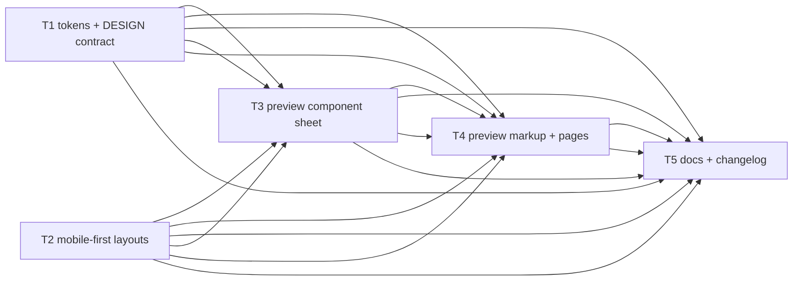

# Mobile-first responsive foundation

**Goal:** Make the design system and its preview treat phones as a first-class viewport: mobile-first layout bases, real page gutters, 44px touch targets, readable table scrolling, and mobile-native dialogs and forms.
**Architecture:** `DESIGN.md` gains a normative mobile contract and one `spacing.touch` token. `layouts.css` becomes a mobile-first base with `min-width` upgrades. The preview consumes those foundations and moves its component geometry to a mobile base plus one desktop override. Docs and tests pin the contract.
**Tech stack:** Bun 1.4, Svelte 5, Vite 8, bits-ui, generated CSS custom properties.
**Spec path:** `docs/specs/2026-10-27-mobile-first-responsive.md`.
**Detail:** tests. **Target-min:** 14. **Orchestrator:** AI.

## Global constraints

- `DESIGN.md` lints `0 errors`, `0 warnings`, one `token-summary` info. Its front matter is the only token source.
- Exact token: `spacing.touch: 44px` -> `--space-touch: 44px`. No new top-level group; unknown groups warn.
- Mobile-first breakpoints, all `min-width`: `640px`, `800px`, `1024px`. No `max-width` media in `layouts.css` or `preview/src/app.css` except `prefers-reduced-motion`.
- Page gutters: `--space-xl` (16px) base; `--space-3xl` (32px) at `800px`; `max()` with `env(safe-area-inset-left|right)`.
- Touch controls: `var(--space-touch)` (44px) base; desktop 28px geometry returns at `800px`.
- Tables stay tables: `.t128n-table-scroll`; first column sticky below `800px`; preview `--t128n-table-min: 52rem`.
- No fluid type, text below `12px`, card grids, shadows, gradients, blur, or radius above `--radius-md`. App shells use `100dvh` plus a `100vh` fallback.
- Never hand-edit `dist/tokens.css`; run `bun run build`.
- Edit only your **Owns** files. Test with `bash $SUPERLITE/skills/subagent-driven-development/scripts/sl run_tests --fast PATHS --background`, then `--wait`. Never `git add`, `commit`, `switch`, `checkout`, or `stash`.

Rulings: `Ruling: AI orchestrator - user selected hands-off - no approval gate` · `Ruling: mobile-first base with min-width upgrades - phones become the default composition - desktop rules move into media blocks` · `Ruling: no mobile type scale - user said the defect is padding and composition, not 14px - one 12px+ scale stays` · `Ruling: 44px lives in spacing.touch - the front matter has no size group and custom groups warn - one extra spacing token` · `Ruling: register stays a table with a pinned identifier - DESIGN.md forbids card grids - horizontal scroll is the mobile behavior`

```mermaid
%% schedule
gantt
  title Predicted schedule (mm:ss)
  dateFormat X
  axisFormat %M:%S
  section lane 1
  T2 Mobile-first layouts :t2, 0, 161s
  T3 Mobile-first preview component sheet :t3, 161, 163s
  T4 Mobile preview markup and pages :t4, 324, 159s
  T5 Mobile docs and changelog :t5, 483, 101s
  section lane 2
  T1 Mobile tokens and DESIGN contract :t1, 0, 126s
```





critical path: T2 → T3 → T4 → T5 (9.7 min) · peak width 2 · predicted build 9.7 min · predicted total ≈ 13.2 min

## File structure

- `DESIGN.md`, `dist/tokens.css` — token source and generated artifact with `--space-touch`.
- `layouts.css` — mobile-first page frame, grids, shell, split, record, form, table scroll.
- `preview/src/app.css`, `preview/src/pages/pages.css` — mobile-first specimen and layout-browser sheets.
- `preview/src/App.svelte`, `preview/src/pages/PageShell.svelte`, `preview/**/index.html` — composition and viewport metadata.
- `README.md`, `CHANGELOG.md`, `tests/{design,layouts,preview,pages,docs}.test.mjs` — docs and pinned contracts.

### T1 Mobile tokens and DESIGN contract · Complexity 3 · Est. context 30k
**Owns:** DESIGN.md, dist/tokens.css, tests/design.test.mjs
**Components:** 2
**LOC owned:** 95
**Tests:** fast
**Model:** sonnet
**Produces:** `spacing.touch: 44px` -> `--space-touch: 44px`; a `### Mobile and touch` subsection under Layout; `t128n-table-scroll` in the Standard Layouts table; updated spacing/count tests.
**Review Focus:** encoding: YAML order and lint 0/0/1. numeric: 9 spacing tokens, `touch` is `44px`, `--space-touch` in `:root`. state: prose names 640/800/1024, 16px gutters, 44px targets, safe-area, `100dvh`, `t128n-table-scroll`. protocol: refs resolve; color/type counts stay.
**Test code (verbatim):**
```js
test('mobile token and contract', async () => {
  const { spacing } = await readTokens();
  assert.equal(spacing.touch, '44px');
  const { body } = splitFrontMatter(await readDesign());
  for (const text of ['### Mobile and touch', '44px', '640px', '800px', '1024px', 'safe-area-inset', 't128n-table-scroll', '100dvh']) {
    assert.ok(body.includes(text), `DESIGN.md is missing ${text}`);
  }
});
```
Update `token counts` to `spacing` length 9 and `layout and shape tokens` to include `touch: '44px'`.
**Steps:** 1 write the failing token/prose test, 2 run: FAIL, 3 edit front matter and prose, 4 `bun run build`, 5 run: PASS.

### T2 Mobile-first layouts · Complexity 4 · Est. context 34k
**Owns:** layouts.css, tests/layouts.test.mjs
**Components:** 3
**LOC owned:** 180
**Tests:** fast
**Model:** sonnet
**Produces:** mobile-first `layouts.css`: `.t128n-page` base gutters 16/safe-area and `max-width: calc(1120px + 2 * var(--space-3xl))`; `.t128n-grid--2/3` base one column; `@media (min-width: 640px)` three-column grids use 2; `@media (min-width: 800px)` page gutters 32, two-column grids, app shell, split, record, and form auto-fit; `@media (min-width: 1024px)` three-column grids use 3; `.t128n-table-scroll` and `.t128n-table-scroll--pin-first`; `100dvh` app shell.
**Review Focus:** encoding: token variables only. numeric: base 1 column, upgrades 640/800/1024, gutters 16/32, table `44rem`, pin resets at 800. state: shell order header/main/nav; split and record stack; form is one column until 800. protocol: all `t128n-*` classes stay; scroll, sticky, overscroll, and safe-area present; no `max-width` query.
**Test code (verbatim):**
```js
test('layouts are mobile-first', async () => {
  const css = await readFile(path.join(root, 'layouts.css'), 'utf8');
  assert.doesNotMatch(css, /@media \(max-width/);
  assert.match(css, /@media \(min-width: 640px\)[\s\S]*?\.t128n-grid--3 \{\s*--t128n-columns: 2;/);
  assert.match(css, /@media \(min-width: 800px\)[\s\S]*?\.t128n-grid--2 \{\s*--t128n-columns: 2;/);
  assert.match(css, /@media \(min-width: 1024px\)[\s\S]*?\.t128n-grid--3 \{\s*--t128n-columns: 3;/);
  assert.match(css, /\.t128n-table-scroll[^}]*overflow-x: auto/);
  assert.match(css, /\.t128n-table-scroll--pin-first[\s\S]*?position: sticky/);
});
```
Keep the existing class-presence test; update its media assertions from `max-width` to `min-width`.
**Steps:** 1 write the failing mobile-first test, 2 run: FAIL, 3 rewrite layouts mobile-first and add table scroll, 4 run: PASS.

### T3 Mobile-first preview component sheet · Complexity 4 · Est. context 38k
**Owns:** preview/src/app.css, tests/preview.test.mjs
**Components:** 3
**LOC owned:** 190
**Tests:** fast
**Model:** sonnet
**Consumes:** `--space-touch` (T1) · `.t128n-table-scroll` (T2).
**Produces:** `preview/src/app.css` with mobile base geometry and one `@media (min-width: 800px)` desktop override: buttons/controls/icon buttons/row buttons 44px base and 28px desktop, table header 44px base and 32px desktop, cell padding 12px base and 6px desktop, sticky first-cell backgrounds, toolbar 2-column grid base and flex desktop, key-value stacked base and two-column at 640, section rhythm 24px base and 16px desktop, bottom-sheet dialog base and centered desktop, mobile nav-safe form actions.
**Review Focus:** encoding: tokens except documented 28px/32px/52rem geometry; no `max-width` media. numeric: base targets `var(--space-touch)`, desktop 28px, table `--t128n-table-min: 52rem`. state: dialog bottom base and centered at 800; actions stack then row; selected first cell uses `--color-selection`. protocol: wrapping without clipping, labelled inputs, no forbidden shadow/gradient/blur, token radii.
**Test code (verbatim):**
```js
test('preview is mobile-first and touch-sized', async () => {
  const css = await readText('preview/src/app.css');
  assert.doesNotMatch(css, /@media \(max-width/);
  assert.match(css, /@media \(min-width: 800px\)/);
  assert.match(css, /\.button \{[\s\S]*?height: var\(--space-touch\)/);
  assert.match(css, /@media \(min-width: 800px\)[\s\S]*?\.button \{[\s\S]*?height: 28px/);
  assert.match(css, /\.table-wrap \{[\s\S]*?--t128n-table-min: 52rem/);
  assert.match(css, /\.toolbar \{[\s\S]*?grid-template-columns: repeat\(2, minmax\(0, 1fr\)\)/);
  assert.match(css, /\.kv-row \{[\s\S]*?grid-template-columns: 1fr/);
  assert.match(css, /\.dialog-content \{[\s\S]*?bottom: 0/);
  assert.match(css, /\.dialog-content \{[\s\S]*?max-height: calc\(100dvh - var\(--space-2xl\)\)/);
});
```
Update the existing `.th-sort`, `.row-button`, and `.icon-button` assertions to the new base touch values and their 800px compact overrides.
**Steps:** 1 extend the failing CSS tests, 2 run: FAIL, 3 rewrite app.css mobile-first, 4 run: PASS.

### T4 Mobile preview markup and pages · Complexity 3 · Est. context 30k
**Owns:** preview/src/App.svelte, preview/src/pages/pages.css, preview/index.html, preview/pages/index.html, preview/pages/{one-column,two-column,three-column,sidebar-main,list-detail,record-detail,register,form,settings,mixed-grid,states}/index.html, tests/pages.test.mjs
**Components:** 3
**LOC owned:** 160
**Tests:** fast
**Model:** sonnet
**Consumes:** `--space-touch` (T1) · mobile-first layouts (T2) · preview CSS (T3).
**Produces:** `App.svelte` table wrapper composes `t128n-table-scroll t128n-table-scroll--pin-first`; `pages.css` mobile-first nav (horizontal scroll, 44px links, wrap at 800), sketch padding, and stacked form actions; every preview HTML file carries `viewport-fit=cover` and `color-scheme: light dark`.
**Review Focus:** encoding: metadata in all 13 HTML files. numeric: nav links 44px base; nav nowrap plus scroll base and wrap at 800; form actions column then row. state: table semantics, caption, sorting, and row actions stay. protocol: no `max-width` media; skip link, `aria-current`, theme switch intact; every page builds.
**Test code (verbatim):**
```js
test('preview pages are mobile-native', async () => {
  const app = await readText('preview/src/App.svelte');
  const css = await readText('preview/src/pages/pages.css');
  assert.match(app, /t128n-table-scroll t128n-table-scroll--pin-first/);
  assert.doesNotMatch(css, /@media \(max-width/);
  assert.match(css, /\.layout-nav \{[\s\S]*?flex-wrap: nowrap/);
  assert.match(css, /\.layout-nav a \{[\s\S]*?min-height: var\(--space-touch\)/);
  assert.match(css, /@media \(min-width: 800px\)[\s\S]*?\.layout-nav \{[\s\S]*?flex-wrap: wrap/);
  for (const file of ['preview/index.html', ...layouts.map((layout) => `preview/pages/${layout.slug}/index.html`)]) {
    const html = await readText(file);
    assert.match(html, /viewport-fit=cover/);
    assert.match(html, /color-scheme: light dark/);
  }
});
```
Keep the existing real-entry and layout-registry tests.
**Steps:** 1 write the failing markup/pages test, 2 run: FAIL, 3 edit markup, pages.css, and HTML metadata, 4 run: PASS.

### T5 Mobile docs and changelog · Complexity 2 · Est. context 26k
**Owns:** README.md, CHANGELOG.md, tests/docs.test.mjs
**Components:** 1
**LOC owned:** 90
**Tests:** fast
**Model:** sonnet
**Produces:** README `### Mobile` subsection under Layouts; token usage mentions `--space-touch`; changelog `Unreleased` entry; docs tests pin the mobile terms.
**Review Focus:** protocol: existing headings and commands stay; new subsection covers 16px gutters, 44px targets, 640/800/1024, safe-area, mobile-first, `t128n-table-scroll`. encoding: `--space-<name>` and `layouts.css` links stay. state: changelog entry avoids a release claim. numeric: documented breakpoints match both CSS files.
**Test code (verbatim):**
```js
test('docs describe mobile-first behavior', async () => {
  const readme = await readText('README.md');
  for (const text of ['### Mobile', 'mobile-first', '44px', '16px', '640px', '800px', '1024px', 'safe-area', 't128n-table-scroll', '--space-touch']) {
    assert.ok(readme.includes(text), `README is missing ${text}`);
  }
  const changelog = await readText('CHANGELOG.md');
  assert.match(changelog, /## \[Unreleased\]/);
  assert.match(changelog, /mobile/i);
});
```
**Steps:** 1 write the failing docs test, 2 run: FAIL, 3 update README and changelog, 4 run: PASS.

## Review Focus

Packages and categories:

- **Tokens and spec (T1):** encoding, numeric, state, protocol. Risks: warning custom group, drifting spacing count, contradiction with the type floor.
- **Layouts (T2):** encoding, file, numeric. Risks: leftover `max-width`, desktop leak into the phone base, unreadable sticky cell, overflowing gutter.
- **Preview sheet (T3):** encoding, protocol, state. Risks: touch geometry on only one control, clipping table, overdrawn dialog, dead wrapped target.
- **Preview markup/pages (T4):** encoding, protocol, state. Risks: missing metadata, off-screen nav, lost table semantics.
- **Docs (T5):** protocol, numeric. Risks: undocumented breakpoint drift, broken README contract.

**Probe entry:** run=bun test

## Self-review

- Coverage: the user's two asks map to tokens/spec (T1), system layouts (T2), preview components (T3), preview pages/markup (T4), and docs (T5).
- No placeholders; every task has Owns, Components, LOC, Tests, Model, and named checks.
- No two parallel tasks share a file.
- Graph is acyclic; every edge is an execution dependency.
- Mobile-first is enforced by `doesNotMatch(@media (max-width))` in both CSS tasks.
- Type scale is untouched; the fix is composition, padding, touch, and scrolling.
