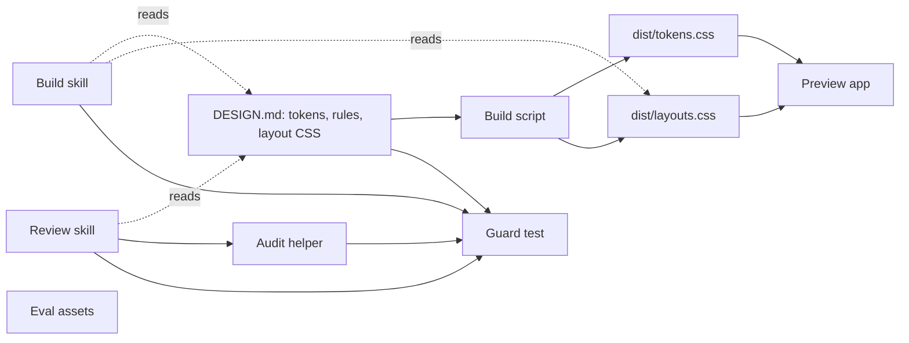
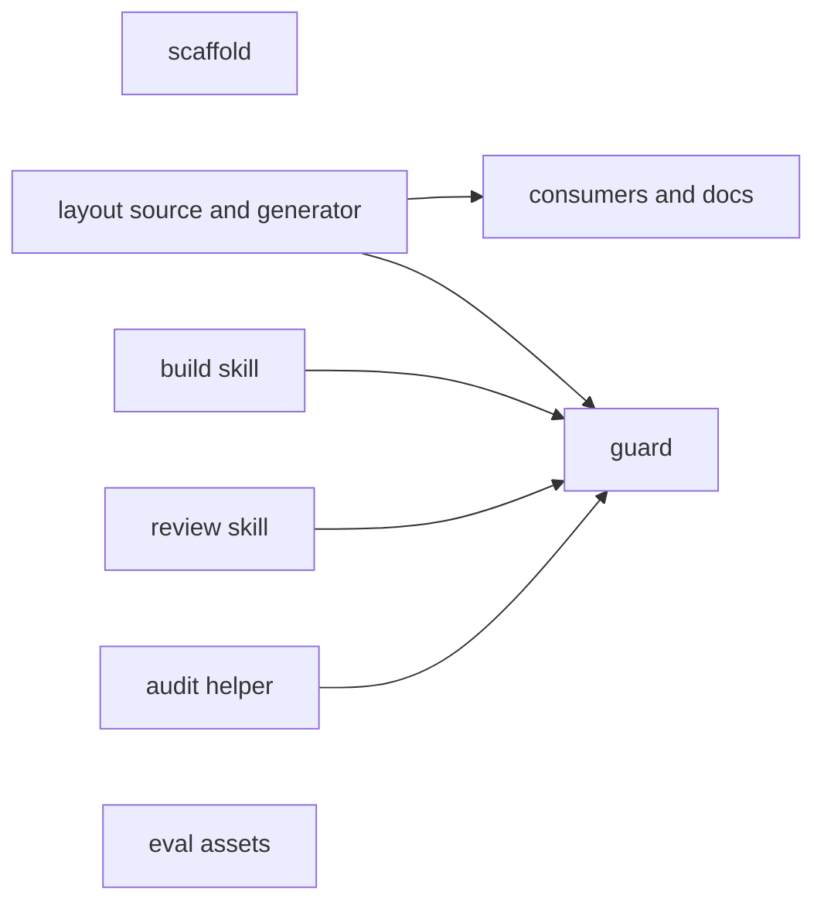

# t128n agent skills

**Goal:** Make `DESIGN.md` the only hand-authored design source, emit both stylesheets under `dist/`, and ship two agent skills that build and review t128n interfaces by referencing the spec and generated artifacts.
**Architecture:** `DESIGN.md` holds tokens, rules, and canonical layout CSS. `scripts/build.mjs` emits `dist/tokens.css` and `dist/layouts.css`; preview and tests consume those artifacts. `skills/t128n-ui` builds; `skills/t128n-ui-review` audits. Skills cite canonical files; a guard test rejects copies.
**Tech stack:** Bun 1.4, Markdown skills, ESM scripts, Svelte 5 preview, `@google/design.md` 0.4.0.
**Spec path:** docs/plans/2026-10-27-t128n-agent-skills.review.md
**Review plan:** docs/plans/2026-10-27-t128n-agent-skills.review.md
**Detail:** contracts
**Target-min:** 20

## Global constraints

- `DESIGN.md` is the only hand-authored design source. Tokens, type scales, spacing, radii, and layout CSS live there; skills and generated files never become a second source.
- The Layout section carries the canonical CSS between `<!-- t128n:layouts:start -->` and `<!-- t128n:layouts:end -->`. The build extracts it verbatim.
- `dist/tokens.css` and `dist/layouts.css` are generated and committed. Root `layouts.css` is deleted. `bun run check` diffs `dist`.
- Skills live in `skills/t128n-ui/` and `skills/t128n-ui-review/`; each `SKILL.md` is under 500 lines and has `name` and a pushy `description`.
- Skills contain no hex colors, token values, or copied CSS. They cite `DESIGN.md`, `dist/tokens.css`, `dist/layouts.css`, and `preview/`.
- `designmd lint DESIGN.md` stays at 0 errors, 0 warnings, 1 info. `bun test`, `bun run check`, and `bun run preview:build` pass.
- Run tests with `bash $SL run_tests --fast PATHS --background`, then `--wait`. Never run a raw suite in the foreground.
- Edit only your **Owns** files. Never run `git add`, `commit`, `switch`, `checkout`, or `stash`.

Spec coverage: What you will get; What will be built; How it fits together; How it gets built; Decisions you can change; Risks; Out of scope; How we will know it works; Rough time and cost.

```mermaid
%% schedule
gantt
  title Predicted schedule (mm:ss)
  dateFormat X
  axisFormat %M:%S
  section lane 1
  T3 build skill :t3, 0, 243s
  T6 source-of-truth guard :t6, 243, 113s
  section lane 2
  T1 fold layouts and generate artifact :t1, 0, 193s
  T2 consumers and docs :t2, 193, 176s
  section lane 3
  T7 eval assets :t7, 0, 191s
  section lane 4
  T4 review skill :t4, 0, 187s
  section lane 5
  T5 audit helper :t5, 0, 138s
  section lane 6
  T0 skill scaffold :t0, 0, 91s
```

critical path: T1 → T2 (6.1 min) · peak width 6 · predicted build 6.1 min · predicted total ≈ 9.6 min (target ✓)

## File structure

`DESIGN.md` — tokens, rules, layout CSS. `scripts/build.mjs` — renderers. `dist/*.css` — generated; root `layouts.css` deleted. `preview/` — consumes both artifacts. `skills/t128n-ui/` — build skill; `skills/t128n-ui-review/` — audit skill, checklist, helper; `skills/evals/` — prompts and fixture; `skills/README.md` — install. `tests/` — all suites.

### T0 skill scaffold · Complexity 1 · Est. context 18k
**Owns:** skills/t128n-ui/.gitkeep, skills/t128n-ui-review/.gitkeep, tests/skills-scaffold.test.mjs
**Components:** 1
**LOC owned:** 24
**Tests:** fast
**Kind:** mechanical
**Model:** haiku
**Produces:** `skills/t128n-ui/` and `skills/t128n-ui-review/` exist, each with `.gitkeep`; a test asserts both directories exist.
**Review Focus:** file: the two skill directories exist and are writable.
**Named tests:** `test_skill_dirs_exist`: `existsSync("skills/t128n-ui") == true` and `existsSync("skills/t128n-ui-review") == true`.
**Steps:** 1 write the test, 2 run: FAIL, 3 create directories and `.gitkeep`, 4 run: PASS.

### T1 fold layouts and generate artifact · Complexity 5 · Est. context 46k
**Owns:** DESIGN.md, scripts/build.mjs, dist/layouts.css, layouts.css, tests/build.test.mjs
**Components:** 3
**LOC owned:** 420
**Tests:** fast
**Kind:** design
**Model:** sonnet
**Produces:** `readLayoutCss(markdown: string) -> string` · `renderLayoutsCss(markdown: string) -> string` · CLI writes `dist/layouts.css`; `DESIGN.md` Layout section carries the canonical CSS between the markers; root `layouts.css` deleted.
e.g. `readLayoutCss(md with one css fence) -> exact fence body`; `renderLayoutsCss(md) -> generated header + that body`.
**Review Focus:** deep: extraction returns exact fence bytes, including trailing newline, and is idempotent. state: a missing marker or more than one block throws a named error; the generator never reads root `layouts.css`. encoding: the artifact starts with the generated header and contains no marker comments. file: the root file is gone.
**Named tests:** `extracts exact block`: fixture returns the fence body byte for byte. `missing markers throw`: markdown without markers throws `/t128n:layouts:start/`. `two blocks throw`: two blocks between markers throws `/ambiguous/`. `writes both artifacts`: `bun run build` leaves both files and the layout header. `artifact matches source`: `readFile("dist/layouts.css") == renderLayoutsCss(readFile("DESIGN.md"))`.
**Steps:** 1 write failing tests, 2 run: FAIL, 3 move CSS into `DESIGN.md`, add extractor and writer, delete root file, 4 run: PASS.

### T2 consumers and docs · Complexity 4 · Est. context 40k
**Owns:** preview/src/app.css, README.md, CHANGELOG.md, skills/README.md, tests/layouts.test.mjs, tests/smoke.test.mjs, tests/preview.test.mjs, tests/docs.test.mjs, tests/skills-docs.test.mjs, tests/integration.test.mjs
**Components:** 3
**LOC owned:** 290
**Tests:** fast
**Kind:** design
**Model:** sonnet
**Consumes:** `renderLayoutsCss(markdown: string) -> string` (T1) · `dist/layouts.css` (T1).
**Produces:** preview imports `../../dist/layouts.css`; README links `dist/layouts.css`; `skills/README.md` explains install, audit, and canonical paths; tests read `dist/layouts.css`; integration compares it with `renderLayoutsCss(DESIGN.md)`; CHANGELOG records the move.
**Review Focus:** protocol: no root `layouts.css` reference remains; install commands are exact. file: `dist/layouts.css` exists, root file does not, and `skills/README.md` names both skills. encoding: every path is exactly `dist/layouts.css`.
**Named tests:** `no root references`: owned files contain no `layouts.css` not preceded by `dist/`. `preview imports generated`: `preview/src/app.css` contains `@import '../../dist/layouts.css';`. `docs link generated`: README contains `[dist/layouts.css](dist/layouts.css)`. `artifact matches source`: import `renderLayoutsCss`, compare with `DESIGN.md`. `skill docs cover install`: `skills/README.md` contains `t128n-ui`, `t128n-ui-review`, `audit-css.mjs`, and `~/.agents/skills`. `preview builds`: `bun run preview:build`.
**Steps:** 1 write failing tests, 2 run: FAIL, 3 repoint imports, docs, and test paths, 4 run: PASS.

### T3 build skill · Complexity 5 · Est. context 44k
**Owns:** skills/t128n-ui/SKILL.md, skills/t128n-ui/references/layouts.md, skills/t128n-ui/references/records.md, skills/t128n-ui/references/forms-and-dialogs.md, tests/skills-build.test.mjs
**Components:** 5
**LOC owned:** 430
**Tests:** fast
**Kind:** design
**Model:** sonnet
**Produces:** `SKILL.md` with `name: t128n-ui` and a pushy description covering building or changing t128n admin consoles, record browsers, audit views, dashboards, tables, forms, and dialogs; three references for layout choice, records and status, forms and dialogs, each citing `DESIGN.md` or `dist/*.css`.
**Review Focus:** encoding: under 500 lines; frontmatter parses. protocol: each rule states its reason and verification; status is text plus one of seven roles; layout choice names the selector. state: no hex colors, `--color-*` values, or full `.t128n-*` CSS block.
**Named tests:** `build skill is scoped`: frontmatter `name == "t128n-ui"`; description includes `admin console`, `record`, `dashboard`, `table`; four files exist and each reference is cited; no `#[0-9a-f]{3,8}` or `box-shadow:`.
**Steps:** 1 write the failing test, 2 run: FAIL, 3 write the skill and references, 4 run: PASS.

### T4 review skill · Complexity 4 · Est. context 40k
**Owns:** skills/t128n-ui-review/SKILL.md, skills/t128n-ui-review/references/checklist.md, tests/skills-review.test.mjs
**Components:** 3
**LOC owned:** 380
**Tests:** fast
**Kind:** design
**Model:** sonnet
**Produces:** `SKILL.md` with `name: t128n-ui-review` and a description covering conformance audits, design review, consistency checks, and accessibility passes; `references/checklist.md` with a pass condition and `DESIGN.md` section pointer for every rule.
**Review Focus:** protocol: fixed ordered workflow; every finding carries severity, evidence, and the spec section. state: the checklist covers the six integrity tells, seven status roles, both themes, keyboard order, and 200% zoom. encoding: no token values or CSS copies; the audit helper is invoked by script path.
**Named tests:** `review skill is actionable`: frontmatter `name == "t128n-ui-review"`; description includes `audit` and `conformance`; checklist contains `shadow`, `card grid`, `color alone`, `radius`, `placeholder`, `dead sort`, `200%`; no hex colors.
**Steps:** 1 write the failing test, 2 run: FAIL, 3 write the skill and checklist, 4 run: PASS.

### T5 audit helper · Complexity 3 · Est. context 32k
**Owns:** skills/t128n-ui-review/scripts/audit-css.mjs, tests/audit-css.test.mjs
**Components:** 2
**LOC owned:** 190
**Tests:** fast
**Kind:** design
**Model:** sonnet
**Produces:** `auditCss(source: string) -> Finding[]` where `Finding = { rule, line, severity, message }` and severity is `error` or `warning`; CLI prints JSON and exits 1 when any error exists.
e.g. `auditCss(".x { box-shadow: 0 1px 2px #000; }") -> no-shadow and no-hardcoded-color at line 1`; `auditCss(".x { border-radius: 3px; }") -> []`.
**Review Focus:** deep: line numbers match the source. numeric: radius above `3px` and font size below `12px` are errors; the boundary values pass. encoding: comments ignored; hex colors, gradients, blur, and shadows are errors; JSON is valid and exit 1 only for errors.
**Named tests:** `flags banned patterns`: fixture with shadow, gradient, blur, `border-radius: 8px`, `font-size: 10px`, and `#123456` returns six findings with the right rules and lines. `allows boundaries`: `border-radius: 3px` and `font-size: 12px` return `[]`. `cli exits`: an error fixture exits 1 with a JSON array.
**Steps:** 1 write failing tests, 2 run: FAIL, 3 implement scanner and CLI, 4 run: PASS.

### T6 source-of-truth guard · Complexity 3 · Est. context 34k
**Owns:** tests/skills-guard.test.mjs
**Components:** 1
**LOC owned:** 180
**Tests:** fast
**Kind:** design
**Model:** sonnet
**Consumes:** the skill files from T3 and T4, the helper from T5, and `dist/layouts.css` from T1.
**Produces:** a guard proving the skills are pointers, not copies: both `SKILL.md` files exist with frontmatter; neither has hex colors, token definitions, or a `.t128n-*` CSS block; no skill file equals `dist/layouts.css`; every canonical path named in a skill exists; `layouts.css` is absent.
**Review Focus:** state: a copied palette or layout block fails. protocol: a missing skill or cited path fails by name. encoding: text and hashes only, no network.
**Named tests:** `skills are pointers`: both names, line counts under 500, no `#[0-9a-f]{3,8}`, no `--color-`, `--space-`, or `--radius-` declarations. `canonical paths exist`: `DESIGN.md`, `dist/tokens.css`, `dist/layouts.css` exist and `layouts.css` does not. `no duplicated artifact`: no skill file equals the layout artifact. `cited references exist`: every backticked `references/` or `scripts/` path resolves under its skill directory.
**Steps:** 1 write failing tests, 2 run: FAIL, 3 add checks and any missing pointer, 4 run: PASS.

### T7 eval assets · Complexity 3 · Est. context 30k
**Owns:** skills/evals/evals.json, skills/evals/fixtures/broken-page.html, skills/evals/README.md, tests/evals.test.mjs
**Components:** 4
**LOC owned:** 220
**Tests:** fast
**Kind:** design
**Model:** sonnet
**Produces:** `evals.json` with five prompts — three build, two review — each with `id`, `prompt`, `expected_output`; a broken page with seven planted violations; a README explaining with-skill and baseline runs; a test asserting the set.
**Review Focus:** protocol: each prompt names a realistic t128n context and a checkable expected output. state: the fixture contains a shadow, card-grid collapse, color-only status, oversized radius, hard-coded color, placeholder-only label, and dead sort control. encoding: JSON parses; ids are unique.
**Named tests:** `eval set is complete`: five evals, three build and two review prompts, unique ids. `fixture is broken`: each of `box-shadow`, `card`, `color-only`, `border-radius: 8px`, `#`, `placeholder=`, and `aria-sort` appears with its marker comment.
**Steps:** 1 write failing tests, 2 run: FAIL, 3 write the eval set, fixture, and README, 4 run: PASS.

## Review Focus

- `layout`: deep, state, encoding, file. Risks: moved bytes lost, a stale root file, a generator reading its own output.
- `build`: encoding, protocol, state. Risks: a skill restating the spec, a missing reference, a rule without its reason.
- `review`: protocol, state, encoding. Risks: an uncheckable checklist, a finding without evidence, color-only status slipping through.
- `audit-css`: deep, numeric, encoding. Risks: wrong line numbers, false positives at the boundaries, exit 0 on errors.
- `guard`: state, protocol, encoding. Risks: a copy that passes, a moved path, a false positive on a legitimate rule value.
- `evals`: protocol, state, encoding. Risks: prompts too easy, a fixture missing a planted violation.
- `readme`: file, encoding. Risks: an install command that fails, a stale path.

**Probe entry:** run=bun run check

## Self-review

- Coverage: every review-plan part maps to T0–T7; the coordinator runs the eval prompts as final verification.
- No placeholders; every task has Owns, Components, LOC owned, Tests, Model, and named checks.
- No two parallel tasks share a file; T0's `.gitkeep` and the skill tasks write different files.
- Every edge is an execution dependency: T2 tests `renderLayoutsCss`; T6 tests the skill files and the layout artifact.
