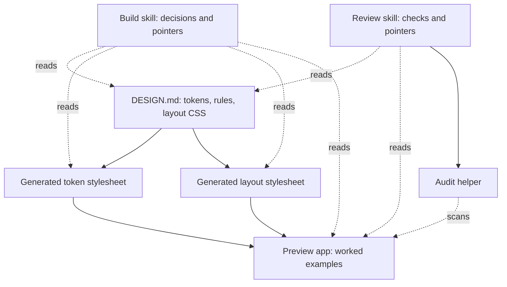
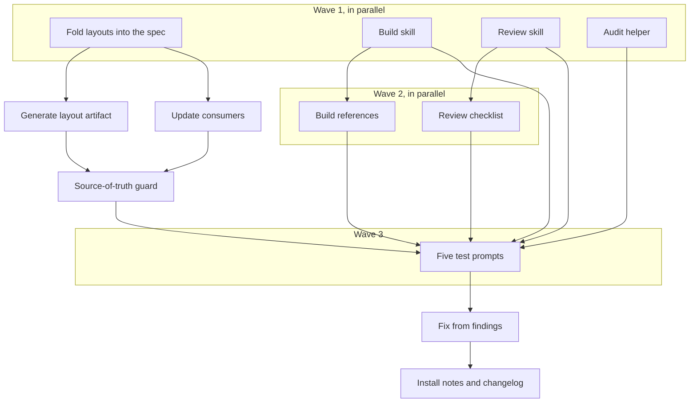

# t128n agent skills: review plan

## Summary

Turn the existing t128n design spec into two agent skills: one that makes an AI build interfaces the t128n way, and one that audits an existing interface against it. First, close the remaining source-of-truth gap: the layout stylesheet is currently hand-written beside the spec, so it moves into `DESIGN.md` and becomes a generated artifact under `dist/` alongside the token stylesheet. The spec then becomes the only hand-authored source; the two stylesheets are build output; the preview app is a worked example. The skills point at those files and never restate or copy them. They teach the decision process — which page skeleton fits the job, how records and statuses work, what to verify — and are tested against realistic prompts so we can see whether they actually change the outcome.

## What you will get

- `DESIGN.md` as the only hand-authored source for tokens **and** layout CSS: the layout grid templates, grid areas, and breakpoints live in its Layout section.
- `layouts.css` removed from the repository root. The build regenerates `dist/tokens.css` and `dist/layouts.css`, and the existing check fails if either drifts from the spec.
- The preview app, README, tests, and integration assertions updated to import the generated layout stylesheet. No consumer links a hand-written CSS file.
- A build skill that activates when an agent creates or changes any t128n interface: admin console, record browser, audit view, dashboard, form, table, or dialog.
- A review skill that activates when someone asks whether an interface conforms, or asks for a design audit, consistency check, or accessibility pass.
- Focused reference material for layout selection, record and status patterns, forms and dialogs, and a concrete review checklist. Each reference cites the spec or the generated artifact instead of repeating values or CSS.
- A small audit helper that catches the CSS shortcuts agents reach for most often: shadows, gradients, blur, radii above 3px, type below 12px, and hard-coded colors.
- A source-of-truth guard: a test that fails if a skill copies token or layout values, duplicates a generated file, or cites a path that no longer exists.
- Realistic test prompts for both skills, run once with the skill and once without, with a written comparison and a browser-based review page.
- Install and usage notes added to the README, plus a changelog entry.

## What will be built

| Part | What it does (one sentence) | Size (S/M/L) | Built by |
|---|---|---|---|
| Fold layouts into the spec | Moves the canonical layout CSS into the Layout section of `DESIGN.md`, marked as the source of the generated artifact. | M | a careful helper |
| Generate the layout artifact | Extracts the layout block during the build, writes `dist/layouts.css`, and fails when the committed artifact differs from the spec. | M | a careful helper |
| Update consumers | Repoints the preview app, README, tests, and integration checks from the root stylesheet to the generated one. | M | a careful helper |
| Build skill | Guides an agent from a request to a conforming t128n view, including layout choice, token use, records, statuses, states, and verification. | L | a careful helper |
| Build references | Three short guides the build skill reads only when needed: choosing a layout, building records, and building forms and dialogs — each citing the spec or the generated artifact. | M | a careful helper |
| Review skill | Runs a fixed audit sequence, grades findings by severity, and produces a stable report an author can act on. | L | a careful helper |
| Review checklist | Turns each design rule into a check with a pass condition, a way to verify it, and a pointer to the governing section of the spec. | M | a careful helper |
| Audit helper | Scans styles and markup for banned visual patterns and obvious token violations as a first pass, not a verdict. | S | a fast helper |
| Source-of-truth guard | Fails if a skill contains copied values or duplicated artifacts, or cites a path that does not exist. | S | a fast helper |
| Test suite | Five realistic prompts — three build, two review — run with and without each skill, then graded against written checks. | M | a careful helper |
| Documentation | Explains what each skill is for, how to install it, and how the generated artifacts are produced. | S | a fast helper |

## How it fits together

`DESIGN.md` is the only hand-authored design source. The two stylesheets are generated from it. The preview is an implementation and example. The skills are a decision layer that reads those files; they add no third copy of the design.

## How it gets built

Wave 1 folds the layout CSS into the spec while both skills and the audit helper are written against the agreed paths. The generator, consumers, and guard follow immediately. Wave 2 fills in the reference guides. Wave 3 runs the prompts, compares with-skill and baseline output, and fixes what the comparison exposes. Documentation lands last because it describes the finished shape.

## Decisions you can change

- Layout source: canonical CSS block inside `DESIGN.md` (default) | keep the hand-written stylesheet | express layouts as structured spec values and render them
- Layout artifact: generated `dist/layouts.css` (default) | generated root `layouts.css` | one combined stylesheet
- Repository shape: only the layout stylesheet moves into the spec and under `dist` (default) | move the preview app into a skill folder | move all derived files into skill folders
- Coupling to canonical files: reference them by path, with nothing copied (default) | bundle snapshots with a parity test | distilled examples only
- Packaging: two skills, one to build and one to review (default) | one combined skill | a third skill for editing the design spec itself
- Stack coverage: framework-agnostic rules with Svelte examples (default) | plain HTML and CSS only | Svelte and bits-ui only
- Review output: severity-graded findings with evidence (default) | a simple pass/fail checklist
- Audit helper: included (default) | review stays fully manual
- Evaluation depth: five prompts with a baseline and one revision pass (default) | quick three-prompt check | build first and defer evaluation

## Risks

- **A broken import path.** Removing the root stylesheet changes what apps and the preview link. The repository is still at version 0.1.0 and every in-repo reference is updated in the same change; external consumers, if any, get a clear changelog note.
- **A fragile extraction.** Pulling CSS out of Markdown can break silently. The block is delimited by explicit markers, the build refuses a missing or ambiguous block, and a test compares the generated file to the spec byte for byte.
- **Drift.** The existing check already fails when a generated file differs from the spec; extending the build to both stylesheets closes the same loop for layouts. The guard test covers the skills separately.
- **A second design document.** A skill that restates all the guidance is bloat and will be ignored. We keep each skill focused on decisions, keep the main file short, and move detail into references read on demand.
- **Stale pointers.** Referencing files by path only works while those files stay put. The guard test checks that every path a skill cites still exists.
- **Weak triggering.** A skill that never activates is wasted, and one that activates on unrelated front-end work is noise. We test realistic prompts and near-miss prompts before calling it done.
- **False confidence in the audit helper.** A static scan cannot judge hierarchy, real content resilience, or keyboard flow. The helper is advisory and the review skill requires evidence for every finding.
- **Evaluation cost.** Running five prompts twice plus grading and revision is the largest part of the work. We do one iteration and only revise from concrete failures, not open-ended polishing.

## Out of scope

- Changing token values, typography scales, spacing, radii, or components.
- Moving the preview app or the token generator into a skill folder.
- Building a component library, a Tailwind preset, or a React port.
- Publishing the skills to npm or a public marketplace.
- Screenshot-based visual regression or automated browser testing.
- Adding the review skill to continuous integration. That can be a follow-up once the review output proves stable.

## How we will know it works

- `DESIGN.md` still lints with zero errors and zero warnings, now with the canonical layout block in place.
- `dist/layouts.css` is generated from the spec, the root `layouts.css` is gone, and `bun run check` fails if either generated stylesheet drifts.
- The preview builds and renders in both themes using only generated stylesheets.
- All five test prompts run, and the with-skill output meets the written checks that the baseline misses.
- The review skill finds every violation planted in a deliberately broken page: a shadow, a card grid that should stay a table, color-only status, an oversized radius, a hard-coded color, a placeholder-only label, and a dead sort control.
- The guard test proves the skills contain no copied token or layout values, duplicate no generated artifact, and cite only paths that exist.
- Both skills trigger on realistic requests and stay quiet on adjacent front-end work that does not use t128n.
- The repository's existing tests pass, and token values are byte-identical afterwards.
- A person can follow the README instructions, install each skill, and invoke it without further explanation.

## Rough time and cost

About 45 to 70 minutes and roughly $7 to $13. These are rough until the machine plan is linted and scheduled.
