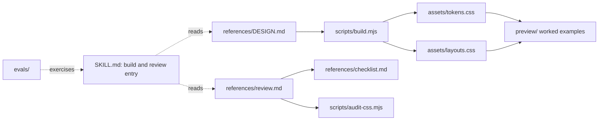
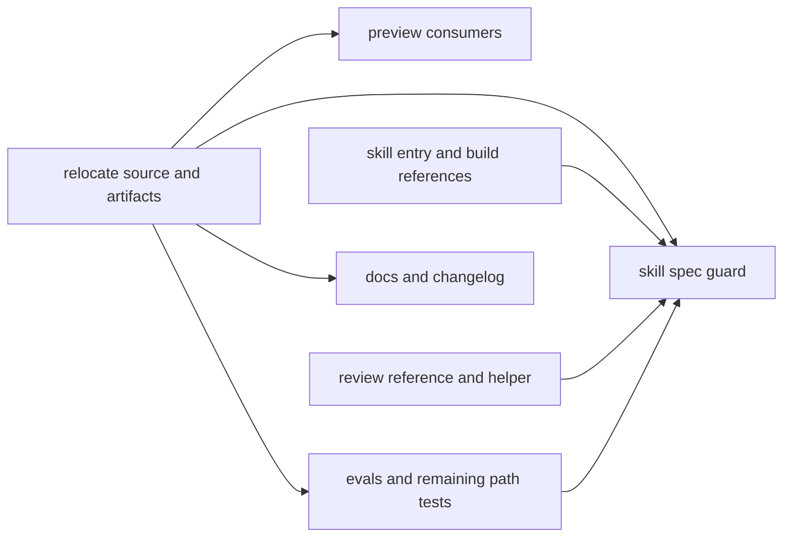

# First-class t128n agent skill

**Goal:** Make this repository a single, self-contained Agent Skill: the repo root is the skill directory, `DESIGN.md` and the generated CSS live inside it, and `npx skills add t128n/design` installs a working skill with no pointers outside the installed folder.
**Architecture:** Root `SKILL.md` routes between building and reviewing a t128n interface. `references/DESIGN.md` is the canonical spec; `references/layouts.md`, `records.md`, `forms-and-dialogs.md`, `review.md`, and `checklist.md` are on-demand detail. `scripts/build.mjs` reads the spec and writes `assets/tokens.css` and `assets/layouts.css`; `scripts/audit-css.mjs` is the review helper. `preview/` is the worked example, `evals/` holds prompts and fixtures, and `tests/` guards the layout.
**Tech stack:** Bun 1.4, ESM, Markdown Agent Skill, Svelte 5 + Vite preview, GitHub Actions.
**Spec path:** docs/plans/2026-10-28-first-class-skill.md
**Detail:** contracts
**Target-min:** 18

## Design

Install is flaky because each `skills/*/SKILL.md` points at repo-root `DESIGN.md` and `dist/`. `skills add` copies only the skill folder, so the pointers dangle; the local symlink recipe points at an ephemeral worktree. The target is one skill installed as `~/.agents/skills/t128n-ui/`, containing `SKILL.md`, `references/`, `assets/`, `scripts/`, `preview/`, and `evals/`. Build and review are modes of that skill; review detail loads on demand. `SKILL.md` stays under 500 lines and cites only paths inside the skill root. Published: `npx skills add t128n/design`; local: `ln -sfn "$PWD" ~/.agents/skills/t128n-ui` (stable checkout).

Ruling: one skill named `t128n-ui` (the installed folder must match the frontmatter; a second skill would duplicate the spec and recreate the pointer problem; cost: the old `t128n-ui-review` install name disappears, so its description terms move into the merged skill).
Ruling: `references/DESIGN.md`, not root `DESIGN.md` (the spec groups detail under `references/`; cost: every citation and the build source path change once).
Ruling: `assets/*.css`, not `dist/` (the spec's static-resource convention; cost: package scripts and preview imports change).
Ruling: keep `tests/`, `docs/`, `.github/`, `preview/`, and `evals/` at the root (maintainer evidence, and the preview is a cited worked example; cost: a larger installed folder, revisitable with an allowlist later).

The spec's name-vs-parent rule is satisfied where it matters: at install time the folder is `t128n-ui`. A guard stages the root as `tmp/t128n-ui/` and validates that shape, so a source checkout named `design` does not hide a frontmatter error.

## Global constraints

- `SKILL.md` frontmatter: `name: t128n-ui`; `description` 1-1024 chars naming building, admin console, record, dashboard, table, audit, conformance, and accessibility; optional `compatibility` 1-500 chars; no field outside the Agent Skills set; body under 500 lines.
- Canonical paths: `references/DESIGN.md`, `assets/tokens.css`, `assets/layouts.css`, `references/layouts.md`, `references/records.md`, `references/forms-and-dialogs.md`, `references/review.md`, `references/checklist.md`, `scripts/build.mjs`, `scripts/audit-css.mjs`.
- No root `DESIGN.md`, no root `layouts.css`, no `dist/`, no `skills/`. No instruction file cites `../` or a path outside the skill root.
- `assets/` is generated and committed. `bun run check` rebuilds and fails on `git diff --exit-code -- assets`.
- Install commands appear verbatim in `README.md`: `npx skills add t128n/design` and `ln -sfn "$PWD" ~/.agents/skills/t128n-ui`.
- `bun test`, `bun run check`, and `bun run preview:build` pass. `bun run lint` is `bunx --bun designmd lint references/DESIGN.md` and reports 0 errors, 0 warnings.
- Skills instructions never restate token values or copy CSS. `references/DESIGN.md` and `assets/` are the only places those bytes live.

## Main diagram

## File structure

`SKILL.md` route and build rules. `references/DESIGN.md` normative spec. `references/*.md` on-demand detail. `assets/*.css` generated. `scripts/*.mjs` generator and audit. `preview/` acceptance. `evals/` prompts and fixture. `tests/` guards. `README.md`, `CHANGELOG.md` docs.

## Task graph

```mermaid
%% schedule
gantt
  title Predicted schedule (mm:ss)
  dateFormat X
  axisFormat %M:%S
  section lane 1
  T4 Review reference and helper :t4, 0, 187s
  T5 Skill spec guard :t5, 373, 123s
  section lane 2
  T1 Relocate source and artifacts :t1, 0, 185s
  T7 Evals and remaining path tests :t7, 185, 188s
  section lane 3
  T3 Skill entry and build references :t3, 0, 174s
  T6 Docs and changelog :t6, 185, 150s
  section lane 4
  T2 Preview consumers :t2, 185, 121s
```

critical path: T1 → T7 → T5 (8.3 min) · peak width 4 · predicted build 8.3 min · predicted total ≈ 11.8 min (target ✓)

### T1 Relocate source and artifacts · Complexity 5 · Est. context 34k
**Owns:** references/DESIGN.md, DESIGN.md, assets/tokens.css, assets/layouts.css, dist/tokens.css, dist/layouts.css, scripts/build.mjs, package.json, tests/build.test.mjs
**Components:** 3
**LOC owned:** 360
**Tests:** fast
**Model:** sonnet
**Consumes:** none
**Produces:** `buildArtifacts(root: string) -> Promise<void>` · `readDesignTokens(markdown: string) -> Tokens` · `renderTokensCss(tokens: Tokens) -> string` · `readLayoutCss(markdown: string) -> string` · `renderLayoutsCss(markdown: string) -> string`
**Review Focus:** file: source at `references/DESIGN.md`, outputs in `assets/`, absent source names the new path. encoding: both headers name `references/DESIGN.md`; artifacts are byte-identical on rerun. deep: front-matter parsing and layout extraction keep their current contracts.
**Named tests:** `writes both artifacts under assets`: temp root with `references/DESIGN.md` yields `assets/tokens.css` and `assets/layouts.css`. `missing source names references/DESIGN.md`: stderr contains that path. `artifact matches source`: committed `assets/layouts.css` equals `renderLayoutsCss(references/DESIGN.md)`. `package paths point at references and assets`: lint, build, and check strings.
**Steps:** 1 adjust tests, 2 run: FAIL, 3 move `DESIGN.md`, `dist/*.css`; update `scripts/build.mjs`, `package.json`, and the `dist/` mention inside the spec, 4 run: PASS.

### T2 Preview consumers · Complexity 3 · Est. context 30k
**Owns:** preview/src/app.css, tests/preview.test.mjs, tests/integration.test.mjs
**Components:** 2
**LOC owned:** 60
**Tests:** fast
**Model:** sonnet
**Consumes:** `assets/tokens.css` (T1) · `assets/layouts.css` (T1)
**Produces:** preview stylesheet imports `../../assets/tokens.css` and `../../assets/layouts.css`; integration constants use the new artifact paths.
**Review Focus:** encoding: no `dist/` or root `layouts.css` remains in preview sources or these tests. file: `bun run preview:build` emits the layout pages.
**Named tests:** `preview imports assets`: app.css contains both asset imports. `repo is assembled`: integration reads `references/DESIGN.md`, `assets/tokens.css`, and `assets/layouts.css`.
**Steps:** 1 adjust tests, 2 run: FAIL, 3 update imports and path constants, 4 run: PASS.

### T3 Skill entry and build references · Complexity 4 · Est. context 36k
**Owns:** SKILL.md, references/layouts.md, references/records.md, references/forms-and-dialogs.md, tests/skill-build.test.mjs, tests/skills-build.test.mjs, skills/t128n-ui/SKILL.md, skills/t128n-ui/.gitkeep, skills/t128n-ui/references/layouts.md, skills/t128n-ui/references/records.md, skills/t128n-ui/references/forms-and-dialogs.md
**Components:** 3
**LOC owned:** 280
**Tests:** fast
**Model:** sonnet
**Consumes:** none
**Produces:** root `SKILL.md` with build procedure and rules, a Sources table, and a review route to `references/review.md`; three build references moved under `references/`.
**Review Focus:** file: `skills/t128n-ui/` is removed; root `SKILL.md` exists. encoding: every citation is `references/...`, `assets/...`, `preview/...`, `scripts/...`, or `evals/...`; none starts `../`. deep: the build procedure, twelve rules, seven roles, and layout table survive the move.
**Named tests:** `skill is scoped`: name `t128n-ui`, description contains admin console, record, dashboard, table, audit, conformance. `build references cite the new canonical paths`: each names `references/DESIGN.md` and an `assets/` artifact. `review routing names references/review.md`: the entry cites the review workflow. `no pointer escapes`: no `../` in `SKILL.md` or build references.
**Steps:** 1 rename and adjust tests, 2 run: FAIL, 3 write `SKILL.md` from the old build skill plus review routing; move the three references and update citations; delete the old build skill files, 4 run: PASS.

### T4 Review reference and helper · Complexity 4 · Est. context 38k
**Owns:** references/review.md, references/checklist.md, scripts/audit-css.mjs, tests/skill-review.test.mjs, tests/skills-review.test.mjs, tests/audit-css.test.mjs, skills/t128n-ui-review/SKILL.md, skills/t128n-ui-review/.gitkeep, skills/t128n-ui-review/references/checklist.md, skills/t128n-ui-review/scripts/audit-css.mjs
**Components:** 3
**LOC owned:** 380
**Tests:** fast
**Model:** sonnet
**Consumes:** none
**Produces:** `references/review.md` with the eight ordered steps, evidence rules, stable report, and hard stops; `references/checklist.md` with R1-R30; `scripts/audit-css.mjs` with the same CLI contract.
**Review Focus:** protocol: helper is invoked as `bun scripts/audit-css.mjs <file.css>` and exits 1 on errors. file: checklist rows cite `references/DESIGN.md`. encoding: no hex colors or copied CSS in review files.
**Named tests:** `workflow is fixed and ordered`: eight steps in `references/review.md`. `helper is invoked by script path`: step 2 names `scripts/audit-css.mjs`. `checklist rows point at references/DESIGN.md`: all 30 rows. `audit helper exits 1 on errors`: CLI behavior unchanged.
**Steps:** 1 adjust tests, 2 run: FAIL, 3 move the review body, checklist, and helper; update citations, 4 run: PASS.

### T5 Skill spec guard · Complexity 5 · Est. context 42k
**Owns:** tests/skill-spec.test.mjs, tests/skills-guard.test.mjs, tests/skills-scaffold.test.mjs, tests/skills-docs.test.mjs, skills/README.md, skills/evals/README.md, skills/evals/evals.json, skills/evals/fixtures/broken-page.html
**Components:** 1
**LOC owned:** 260
**Tests:** fast
**Model:** sonnet
**Consumes:** `SKILL.md` (T3) · `references/review.md` (T4) · `assets/tokens.css` (T1) · `assets/layouts.css` (T1)
**Produces:** `tests/skill-spec.test.mjs` guarding Agent Skills frontmatter, installed folder shape, citation resolution, obsolete trees, and a rebuild inside a staged install copy.
**Review Focus:** deep: backticked path extraction resolves every citation from the skill root. file: staged copy excludes `.git`, `node_modules`, `preview/dist`, `docs`, `tests`, and `.superlite`. state: obsolete `dist/`, `skills/`, and root `DESIGN.md` are absent.
**Named tests:** `frontmatter matches Agent Skills spec`: name regex, 1-64 chars, no leading/trailing/double hyphen, description 1-1024, compatibility 1-500 if present, only the allowed fields. `staged install name matches frontmatter`: copy `SKILL.md` into a temp `t128n-ui/`, assert `name == basename`. `every citation resolves inside the skill`: all backticked relative paths exist, none starts `../` or names `dist/` or root `DESIGN.md`. `install copy rebuilds assets`: after copying the skill to a temp folder, `bun scripts/build.mjs` reproduces both committed artifacts.
**Steps:** 1 write the guard, 2 run: FAIL, 3 fix any layout defects it exposes, 4 delete the three old guard tests, 5 run: PASS.

### T6 Docs and changelog · Complexity 4 · Est. context 30k
**Owns:** README.md, CHANGELOG.md, tests/docs.test.mjs, tests/smoke.test.mjs
**Components:** 2
**LOC owned:** 280
**Tests:** fast
**Model:** sonnet
**Consumes:** `assets/layouts.css` (T1) · `assets/tokens.css` (T1)
**Produces:** README install and usage sections for the root skill; CHANGELOG entry for the restructure.
**Review Focus:** file: install commands match the global constraints. encoding: every README link targets an existing path; no `dist/`, `skills/`, or root `DESIGN.md`. numeric: documented breakpoints still equal the breakpoints in `assets/layouts.css`.
**Named tests:** `docs describe the system`: headings, commands, links, token variables. `install commands are exact`: published command and local symlink. `no root references`: stale `dist/` and `layouts.css` paths absent. `scripts and dependencies are wired`: lint/build/check and artifact paths.
**Steps:** 1 adjust tests, 2 run: FAIL, 3 rewrite README and add the changelog entry, 4 run: PASS.

### T7 Evals and remaining path tests · Complexity 4 · Est. context 32k
**Owns:** evals/README.md, evals/evals.json, evals/fixtures/broken-page.html, tests/evals.test.mjs, tests/design.test.mjs, tests/interaction.test.mjs, tests/layouts.test.mjs
**Components:** 4
**LOC owned:** 200
**Tests:** fast
**Model:** sonnet
**Consumes:** `references/DESIGN.md` (T1) · `assets/layouts.css` (T1)
**Produces:** `evals/` set for the merged skill; design, interaction, and layout tests read the new paths.
**Review Focus:** file: fixture cited as `evals/fixtures/broken-page.html`. encoding: review prompts require a `references/DESIGN.md` rule per finding. state: eval set still has three build and two review prompts.
**Named tests:** `eval set is complete`: five evals, namespaced ids. `fixture is broken`: seven markers unchanged. `readme documents runs`: one skill name plus with-skill and baseline. `layout artifacts are assets/layouts.css`: all layout tests read the new path.
**Steps:** 1 adjust tests, 2 run: FAIL, 3 move `skills/evals` to `evals/`, update prompts, README, and path constants, 4 run: PASS.

## Review Focus

**Package:** file generator + web UI + CLI.
- file: relocated source and artifacts, staged install copy, obsolete trees.
- encoding: relative imports, generated headers, no path escapes, no copied values.
- deep: front-matter parsing, layout extraction, citation resolution.
- protocol: audit helper CLI and preview build.
**Probe entry:** `run=bun scripts/build.mjs · serve=bun run preview:dev`

