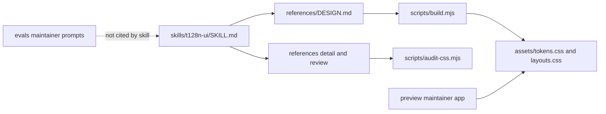
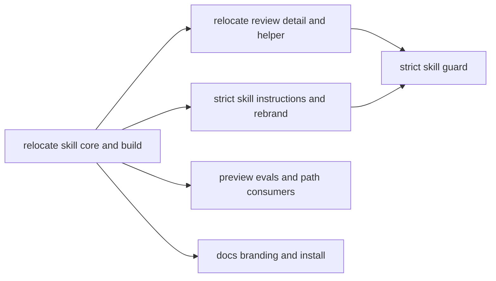

# Strict Agent Skill layout and personal rebrand

**Goal:** Make `skills/t128n-ui/` a strictly spec-compliant Agent Skill (the directory name matches `name`, every reference stays inside it) and rebrand the project from "t128n design system" to "t128n's personal design system".
**Architecture:** The skill owns only `SKILL.md`, `references/`, `assets/`, and `scripts/`. `preview/`, `evals/`, `tests/`, and `docs/` stay at the repo root as maintainer tools and are never cited by the skill. Build output remains committed under `skills/t128n-ui/assets/`. Install is `npx skills add t128n/design`; local development points at `skills/t128n-ui`, never the repo root.
**Tech stack:** Bun 1.4, ESM, Markdown Agent Skill, Svelte 5 + Vite preview, GitHub Actions.
**Spec path:** docs/plans/2026-10-28-strict-personal-skill.md
**Detail:** contracts
**Target-min:** 15

## Design

The merged root-skill layout still fails two strict rules: the source directory is not named `t128n-ui`, and the skill cites repo-level `preview/` and `evals/` paths that are not part of the installed unit. The fix is a real skill directory:

```
skills/t128n-ui/
  SKILL.md
  references/{DESIGN.md,layouts.md,records.md,forms-and-dialogs.md,review.md,checklist.md}
  assets/{tokens.css,layouts.css}
  scripts/{build.mjs,audit-css.mjs}
```

Rules that now bind:

- `name` is `t128n-ui`, which equals both the source folder and the installed folder.
- Every backticked path in `SKILL.md` and `references/*.md` resolves under `skills/t128n-ui/`; no `../`, no `preview/`, no `evals/`, no root `DESIGN.md`, no `dist/`.
- `SKILL.md` cites `references/checklist.md` directly so the chain stays one level from the entry.
- `scripts/build.mjs` resolves its own skill root, not the caller's cwd, and accepts an optional root argument for tests.
- The published install copies ~100 KB of skill files, not the repo's toolchain, docs, tests, preview, or evals.
- Local development uses `npx skills add ./skills/t128n-ui` (copies only the skill folder) or `ln -sfn "$PWD/skills/t128n-ui" ~/.agents/skills/t128n-ui`; never the repo root.

Rebrand: title, descriptions, spec name, preview titles, eval prompts, and docs say **t128n's personal design system** and describe it as a personal system for t128n's own tools, not a product or company design system.

Ruling: preview and evals stay at the repo root (because they are maintainer evidence and would bloat/awkwardly couple the install; cost: the skill loses live worked examples and must rely on `references/layouts.md` plus `DESIGN.md`).
Ruling: keep the skill name `t128n-ui` (because the folder must match the name and the existing trigger is UI work; cost: the brand lives in prose, not the skill identifier).
Ruling: generated CSS stays inside the skill under `assets/` (because a skill must be self-contained and the spec recommends `assets/` for static resources).

## Global constraints

- `skills/t128n-ui/SKILL.md` frontmatter: `name: t128n-ui`; `description` 1-1024 chars covering personal design system, building, admin console, record, dashboard, table, audit, conformance, accessibility; optional `compatibility` 1-500; no field outside `name`, `description`, `license`, `compatibility`, `metadata`, `allowed-tools`; body under 500 lines.
- Skill paths: `references/DESIGN.md`, `references/layouts.md`, `references/records.md`, `references/forms-and-dialogs.md`, `references/review.md`, `references/checklist.md`, `assets/tokens.css`, `assets/layouts.css`, `scripts/build.mjs`, `scripts/audit-css.mjs`.
- No root `SKILL.md`, root `references/`, root `assets/`, or root `scripts/`; no `dist/`; no skill citation of `preview/` or `evals/`.
- `bun run lint` is `bunx --bun designmd lint skills/t128n-ui/references/DESIGN.md`; `bun run build` runs `bun skills/t128n-ui/scripts/build.mjs`; `bun run check` diffs `skills/t128n-ui/assets`.
- `package.json` name is `t128n-personal-design-system`; description names t128n's personal design system.
- Install commands in `README.md`: `npx skills add t128n/design`, `npx skills add ./skills/t128n-ui`, and `ln -sfn "$PWD/skills/t128n-ui" ~/.agents/skills/t128n-ui`.
- Wording: the project is "t128n's personal design system"; avoid "product", "company design system", and "platform design system" in first-party copy.
- `bun test`, `bun run check`, and `bun run preview:build` pass; `designmd lint` reports 0 errors and 0 warnings.

## Main diagram



## File structure

`skills/t128n-ui/` is the installable skill. `preview/` is the visual acceptance app. `evals/` holds prompts and the broken fixture. `tests/` guards the tree. `docs/plans/` records the run. `README.md` and `CHANGELOG.md` describe the personal system.

## Task graph

```mermaid
%% schedule
gantt
  title Predicted schedule (mm:ss)
  dateFormat X
  axisFormat %M:%S
  section lane 1
  T1 Relocate skill core and build pipelin :t1, 0, 193s
  T2 Relocate review detail and helper :t2, 193, 187s
  T6 Strict skill guard :t6, 380, 128s
  section lane 2
  T5 Docs branding and install :t5, 193, 174s
  section lane 3
  T4 Preview evals and path consumers :t4, 193, 164s
  section lane 4
  T3 Strict skill instructions and rebrand :t3, 193, 147s
```





critical path: T1 → T2 → T6 (8.5 min) · peak width 4 · predicted build 8.5 min · predicted total ≈ 12.0 min (target ✓)

### T1 Relocate skill core and build pipeline · Complexity 5 · Est. context 38k
**Owns:** skills/t128n-ui/SKILL.md, skills/t128n-ui/references/DESIGN.md, skills/t128n-ui/references/layouts.md, skills/t128n-ui/references/records.md, skills/t128n-ui/references/forms-and-dialogs.md, skills/t128n-ui/assets/tokens.css, skills/t128n-ui/assets/layouts.css, skills/t128n-ui/scripts/build.mjs, SKILL.md, references/DESIGN.md, references/layouts.md, references/records.md, references/forms-and-dialogs.md, assets/tokens.css, assets/layouts.css, scripts/build.mjs, package.json, tests/build.test.mjs
**Components:** 3
**LOC owned:** 420
**Tests:** fast
**Model:** sonnet
**Consumes:** none
**Produces:** `skills/t128n-ui/scripts/build.mjs` resolves its default root from its own location, accepts an optional root argument, reads `references/DESIGN.md`, and writes both `assets/*.css` artifacts; package scripts lint/build/check point at the skill.
**Review Focus:** file: old root paths are gone; new paths exist. encoding: headers still name `references/DESIGN.md`; artifacts byte-identical. deep: build from another cwd still writes the skill's own assets; a temp root writes temp assets.
**Named tests:** `builds the skill root from any cwd`: running from repo root rebuilds `skills/t128n-ui/assets`. `writes into an explicit temp root`: temp `references/DESIGN.md` yields temp `assets/*.css`. `artifact matches source`: committed skill assets equal the renderer output. `package paths point at the skill`: lint/build/check strings and package name.
**Steps:** 1 update tests, 2 run: FAIL, 3 move the core files, add skill-root resolution, update package scripts, 4 run: PASS.

### T2 Relocate review detail and helper · Complexity 4 · Est. context 30k
**Owns:** skills/t128n-ui/references/review.md, skills/t128n-ui/references/checklist.md, skills/t128n-ui/scripts/audit-css.mjs, references/review.md, references/checklist.md, scripts/audit-css.mjs, tests/skill-review.test.mjs, tests/audit-css.test.mjs
**Components:** 3
**LOC owned:** 380
**Tests:** fast
**Model:** sonnet
**Consumes:** `skills/t128n-ui/references/DESIGN.md` (T1) · `skills/t128n-ui/assets/tokens.css` (T1) · `skills/t128n-ui/assets/layouts.css` (T1)
**Produces:** review workflow and checklist under the skill; audit helper at `scripts/audit-css.mjs`; review cites only skill-internal paths.
**Review Focus:** file: no root review files. encoding: no `preview/` or `evals/` citations; checklist points at `references/DESIGN.md`; no hex/CSS copies. protocol: helper exits 1 on errors.
**Named tests:** `workflow stays ordered`: eight steps in the skill review file. `helper path is skill-internal`: step 2 names `scripts/audit-css.mjs`. `checklist rows cite references/DESIGN.md`: all rows. `audit helper exits 1`.
**Steps:** 1 update tests, 2 run: FAIL, 3 move review/checklist/helper, remove external citations, 4 run: PASS.

### T3 Strict skill instructions and rebrand · Complexity 4 · Est. context 34k
**Owns:** skills/t128n-ui/SKILL.md, skills/t128n-ui/references/DESIGN.md, skills/t128n-ui/references/layouts.md, skills/t128n-ui/references/records.md, skills/t128n-ui/references/forms-and-dialogs.md, tests/skill-build.test.mjs, tests/design.test.mjs, tests/interaction.test.mjs
**Components:** 2
**LOC owned:** 260
**Tests:** fast
**Model:** sonnet
**Consumes:** `skills/t128n-ui/references/DESIGN.md` (T1)
**Produces:** `SKILL.md` whose Sources table cites only skill-internal paths and whose prose says "t128n's personal design system"; `DESIGN.md` with the personal name and introduction.
**Review Focus:** file: no `preview/` or `evals/` in skill instructions. encoding: every cited path resolves inside the skill. deep: build procedure and R1-R12 survive; review route cites `references/review.md` and `references/checklist.md`.
**Named tests:** `skill is scoped`: name, description terms, line budget. `sources are skill-internal`: no `preview/`/`evals/`/`../`, all cited files exist. `personal wording`: SKILL and DESIGN name t128n's personal design system. `design tests read the skill source`.
**Steps:** 1 update tests, 2 run: FAIL, 3 rewrite the sources table and personal wording, 4 run: PASS.

### T4 Preview evals and path consumers · Complexity 4 · Est. context 32k
**Owns:** preview/src/app.css, tests/preview.test.mjs, tests/integration.test.mjs, tests/pages.test.mjs, tests/layouts.test.mjs, tests/evals.test.mjs, evals/README.md, evals/evals.json
**Components:** 3
**LOC owned:** 200
**Tests:** fast
**Model:** sonnet
**Consumes:** `skills/t128n-ui/assets/tokens.css` (T1) · `skills/t128n-ui/assets/layouts.css` (T1) · `skills/t128n-ui/references/DESIGN.md` (T1)
**Produces:** preview imports the skill assets; maintainer tests and eval prompts use skill-relative paths.
**Review Focus:** encoding: preview CSS imports `../../skills/t128n-ui/assets/*`; no `dist/` or root assets. file: preview still builds; eval fixture paths are correct. state: three build and two review prompts remain.
**Named tests:** `preview imports skill assets`: both imports. `repo is assembled`: integration reads skill spec/assets and builds preview. `layout tests read skill assets`. `eval set is complete`: five prompts, fixture intact.
**Steps:** 1 update tests, 2 run: FAIL, 3 update imports, constants, eval paths, 4 run: PASS.

### T5 Docs branding and install · Complexity 4 · Est. context 30k
**Owns:** README.md, CHANGELOG.md, preview/src/App.svelte, preview/src/pages/PageShell.svelte, preview/index.html, tests/docs.test.mjs, tests/smoke.test.mjs, .github/workflows/design.yml
**Components:** 3
**LOC owned:** 280
**Tests:** fast
**Model:** sonnet
**Consumes:** `skills/t128n-ui/assets/layouts.css` (T1)
**Produces:** personal-system README with the three install commands; preview titles and changelog rebranded; docs/smoke tests assert the skill path.
**Review Focus:** file: README links exist and never cite root `SKILL.md`, root assets, or `dist/`. encoding: install commands are exact. numeric: documented breakpoints match skill layouts. wording: personal system, not product.
**Named tests:** `docs describe the personal system`: headings, commands, links. `install commands are exact`: published, local copy, local symlink. `no root skill paths`. `package and assets are wired`: package name, lint/build/check, skill artifacts.
**Steps:** 1 update tests, 2 run: FAIL, 3 rewrite README/CHANGELOG/titles/workflow name, 4 run: PASS.

### T6 Strict skill guard · Complexity 5 · Est. context 40k
**Owns:** tests/skill-spec.test.mjs
**Components:** 1
**LOC owned:** 300
**Tests:** fast
**Model:** sonnet
**Consumes:** `skills/t128n-ui/SKILL.md` (T3) · `skills/t128n-ui/references/review.md` (T2) · `skills/t128n-ui/assets/tokens.css` (T1)
**Produces:** `tests/skill-spec.test.mjs` enforcing the strict Agent Skills layout and install shape.
**Review Focus:** deep: parent name equals frontmatter name; every citation resolves under the skill and none names `preview/`, `evals/`, `../`, `dist/`, or a root skill path. file: a copied skill folder rebuilds both assets. state: root skill trees are absent.
**Named tests:** `frontmatter is strict`: name regex/length, `name == basename`, description 1-1024, compatibility 1-500, allowed fields, body <500 lines. `skill has no external citations`: no preview/evals/../dist/root paths; all cited paths exist. `required components exist` inside the skill. `root skill trees are gone`: no root SKILL.md/references/assets/scripts, no dist. `copied skill rebuilds and audits`: copy the skill to temp `t128n-ui`, build, compare assets, audit exits 1.
**Steps:** 1 rewrite the guard, 2 run: FAIL, 3 fix any real layout defects it exposes, 4 run: PASS.

## Review Focus

**scripts:** file generator + web UI + CLI.
- file: skill directory shape, copied skill, absent root trees.
- encoding: internal citations, preview imports, generated headers.
- deep: parent-name match, citation resolution, build root.
- protocol: audit CLI and preview build.
**Probe entry:** `run=bun skills/t128n-ui/scripts/build.mjs · serve=bun run preview:dev`
