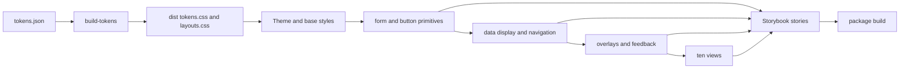
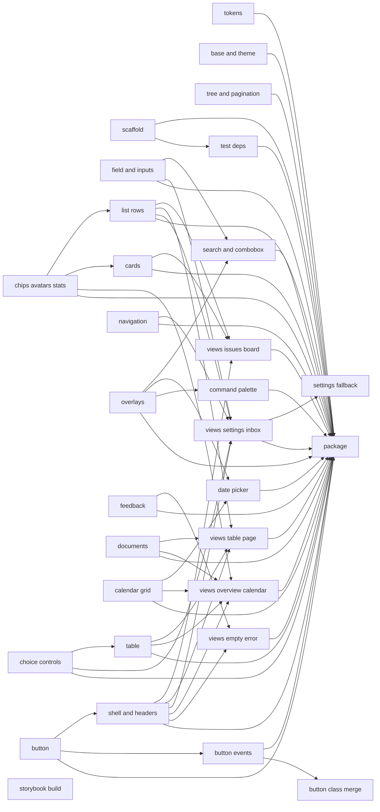

# t128n design system — Svelte 5 + Bits UI + Storybook

**Goal:** one installable package, `@t128n/ui`, that implements every token, component and view in `DESIGN.md`, proven by Storybook stories and automated tests.
**Spec:** `DESIGN.md` (read-only in this pass; the repo's norm).
**Architecture:** `tokens.json` → generated `dist/tokens.css`; semantic tokens as CSS custom properties scoped by `data-theme`, `data-density`, `data-lines`; Svelte 5 runes components with scoped CSS and `t128n-` classes; Bits UI for menu/dialog/popover/combobox/select/tabs behaviour; one story per component and per view.
**Tech stack:** Node ≥20, Svelte ≥5 (runes), Vite ≥6, Storybook ≥9 (`@storybook/svelte-vite` + `@storybook/addon-svelte-csf`), Bits UI ≥2, Vitest ≥3 + jsdom + Testing Library. One package at the repo root.
**Detail:** tests · **Target-min:** 60

## Global constraints

- Only semantic tokens; never `--prim-*` in a component. Only `font: var(--type-*)` for type; no `font-size`, `font-weight`, `letter-spacing`, `text-transform`.
- No raw hex, no raw px outside the ladders in §2.5–2.8, no shadow outside overlays, no radius outside `--radius-xs|md|lg|full`.
- Classes are `t128n-<block>__<element>--<modifier>`; styles stay in each `.svelte` `<style>` and use tokens only.
- Every interactive element defines default/hover/pressed/focus-visible/disabled (§6.1). The Always and Never lists of §10 apply verbatim to every task. Icon-only buttons need `aria-label`; every input gets a `Field` label.
- Status = colour + glyph or text. One primary button per view. No toasts, no motion beyond the 90ms overlay fade.
- Every component ships `X.svelte`, `X.test.ts`, `index.ts`, `src/stories/components/x.stories.svelte` with `argTypes` for every prop and a principles note in `parameters.docs.description.component`. Views ship a story too.
- Definition of done per task: 1 write failing tests, 2 `npm test -- <files>`: FAIL, 3 implement, 4 rerun: PASS, 5 `npm run check` clean for owned files, 6 story renders in `npm run storybook`.
- Tests import components directly; no test imports another component's test. Bits UI needs the `ResizeObserver`/`matchMedia` stubs created in T2.
- Each view task defines its own fixture data inline; `src/lib/views/fixtures.ts` belongs to T21 only.
- Spec coverage: philosophy, tokens, surfaces and text, status and tags, borders, states and tints, radius, spacing and size, density, layout widths, elevation, motion and layering, naming grammar, contrast (measured), typography, icons, shared behavior, states, selection, hover-revealed actions, keyboard, motion, responsive, components, header (the anatomy rule), button, form controls, navigation, data display, feedback, overlays, views, ux patterns, optimistic updates, destructive actions, empty, loading, error, unread and attention, rules for agents, accessibility, decision log, verification checklist.

## Diagram



## File structure

- `src/lib/tokens/tokens.json` — every semantic and primitive value, per theme.
- `scripts/build-tokens.mjs` — renders `src/lib/styles/tokens.css` and copies it, with `layouts.css`, into `dist/`.
- `src/lib/styles/base.css` — reset, body, tabular numerals, focus ring, container attribute scope.
- `src/lib/styles/layouts.css` — `.t128n-page`, `.t128n-app-shell`, `.t128n-split`, `.t128n-record`, `.t128n-register`, `.t128n-grid`, `.t128n-stack`, `.t128n-cluster` skeletons (§8, §2.7).
- `src/lib/utils/cx.ts` — class join. `src/lib/theme/Theme.svelte` — sets `data-theme|density|lines`. `src/lib/icons/Icon.svelte` — 20 inline 16px/1.5 glyphs.
- `src/lib/components/<name>/` — one folder per component: `.svelte`, `.test.ts`, `index.ts`.
- `src/lib/index.ts` — generated barrel (T26); tasks never edit it.
- `src/stories/components/*.stories.svelte`, `src/stories/views/*.stories.svelte` — stories.
- `.storybook/main.ts`, `.storybook/preview.ts` — Storybook + theme/density/lines toolbar.
- `tests/setup.ts`, `tests/tokens.test.ts`, `tests/contrast.test.ts`, `tests/package.test.ts`.
- `docs/layouts.md`, `README.md`.

## Task graph

```mermaid
%% schedule
gantt
  title Predicted schedule (mm:ss)
  dateFormat X
  axisFormat %M:%S
  section lane 1
  T15 Tooltip  Banner  InlineError  EmptyS :t15, 0, 218s
  T10 BoardCard and GalleryCard :t10, 218, 136s
  T21 Issues and Board views :t21, 410, 153s
  T26 Barrel  raw-value lint  build and do :t26, 563, 127s
  section lane 2
  T7 Tag  Badge  Avatar  Progress  StatCar :t7, 0, 216s
  T9 ListRow  GroupHeader  PropertyRow  To :t9, 216, 193s
  T22 Table database and Page views :t22, 410, 153s
  section lane 3
  T14 Menu  Popover  Dialog  SlashMenu :t14, 0, 201s
  T18 SearchField and Combobox :t18, 201, 145s
  T23 Settings and Inbox views :t23, 410, 151s
  T30 Settings switch values fall back saf :t30, 561, 93s
  section lane 4
  T6 Select  Checkbox  Radio  Switch :t6, 0, 199s
  T8 Table :t8, 199, 123s
  T24 Overview and Calendar views :t24, 332, 151s
  section lane 5
  T12 Sidebar  Breadcrumbs  Tabs  Segmente :t12, 0, 197s
  T2 Scaffold :t2, 197, 99s
  T27 Test dependency declaration :t27, 296, 66s
  section lane 6
  T5 Field  Input  Textarea :t5, 0, 169s
  T29 Storybook index and build fixes :t29, 169, 112s
  T19 DatePicker :t19, 284, 114s
  section lane 7
  T16 Chart  CodeBlock  Callout :t16, 0, 166s
  T17 CalendarGrid :t17, 166, 118s
  T25 Empty workspace and Error views :t25, 332, 140s
  section lane 8
  T3 Base styles  layout skeletons  Theme  :t3, 0, 155s
  T28 Button forwards events and attribute :t28, 155, 121s
  T31 Button merges caller classes :t31, 277, 119s
  section lane 9
  T13 Tree and Pagination :t13, 0, 141s
  T1 Token pipeline and contrast guard :t1, 141, 123s
  T20 CommandPalette :t20, 264, 118s
  section lane 10
  T4 Button and IconButton :t4, 0, 137s
  T11 AppShell  Header  Toolbar  SectionHe :t11, 137, 195s
```





critical path: T7 → T9 → T21 → T26 (11.5 min) · peak width 10 · predicted build 11.5 min · predicted total ≈ 15.0 min

`%% schedule` is inserted by `plan_tools prune`.

## 1. Tokens

### T1 Token pipeline and contrast guard · Complexity 4
**Owns:** `src/lib/tokens/tokens.json`, `scripts/build-tokens.mjs`, `src/lib/tokens/tokens.test.ts`, `tests/contrast.test.ts`, `src/lib/styles/tokens.css`
**Components:** 1
**LOC owned:** 260
**Tests:** fast
**Model:** sonnet
**Produces:** `tokens.json` with `prim` and `light`/`dark` maps for every §2 table · `buildTokensCss(theme) -> css string` exporting `:root`, `[data-theme="dark"]`, `@media (prefers-color-scheme: dark)`, `[data-lines]`, `[data-density]`, coarse-pointer density · `dist/tokens.css`
**Review Focus:** `test_all_semantic_tokens_emitted`: every key in tokens.json appears in the generated CSS as `--<key>: value`; `test_dark_overrides_every_color`: each of the 11 §2.1 colours differs between light and dark; `test_contrast_table`: computed ratio for each §3 pair within 0.2 of the documented value; `test_no_alpha_token_used_as_color`: no value ends in `%` outside `--tint*` and `*-alpha`
**Test code:**
```ts
const css = buildTokensCss();
it("emits every token", () => { for (const k of Object.keys({ ...T.light, ...T.dark })) expect(css).toContain(`--${k}:`); });
it("contrast matches DESIGN.md", () => { expect(Math.abs(ratio("#1a1c20", "#ffffff") - 17.1)).toBeLessThan(0.2); expect(Math.abs(ratio("#656c76", "#f5f6f8") - 4.9)).toBeLessThan(0.2); });
```
**Notes:** the eleven §2.1 colours, status, tag, border alpha/tint knobs, radius, space, size, icon, row/control/header/chip heights, widths, shadow, duration, ease, ring and layers. Density values are listed, never derived (§2.6).

### T2 Scaffold · Complexity 2
**Owns:** `package.json`, `vite.config.ts`, `svelte.config.js`, `tsconfig.json`, `vitest.config.ts`, `tests/setup.ts`, `.storybook/main.ts`, `src/lib/index.ts`, `src/lib/index.test.ts`
**Components:** 1
**LOC owned:** 140
**Tests:** fast
**Kind:** mechanical
**Model:** haiku
**Produces:** scripts `dev`, `test`, `check`, `storybook`, `build`, `package`; `@t128n/ui` package with `exports` for `.` and `./styles.css`; jsdom setup with `ResizeObserver` and `matchMedia` stubs
**Review Focus:** `test_package_name`: `expect(pkg.name).toBe("@t128n/ui")`; `test_version_export`: `expect(typeof version).toBe("string")`
**Test code:**
```ts
it("package name", () => { expect(pkg.name).toBe("@t128n/ui"); });
it("version export", () => { expect(typeof version).toBe("string"); });
```
**Notes:** install latest stable of the stack; `npm test` must run Vitest with a JUnit reporter when `--reporter=junit` is appended. `.storybook/main.ts` globs `../src/stories/**/*.stories.svelte`.

## 2. Foundation

### T3 Base styles, layout skeletons, Theme and Icon · Complexity 4
**Owns:** `src/lib/styles/base.css`, `src/lib/styles/layouts.css`, `src/lib/theme/Theme.svelte`, `src/lib/theme/Theme.test.ts`, `src/lib/icons/Icon.svelte`, `src/lib/icons/Icon.test.ts`, `src/lib/utils/cx.ts`, `.storybook/preview.ts`, `src/stories/foundation/theme.stories.svelte`
**Components:** 2
**LOC owned:** 320
**Tests:** fast
**Model:** sonnet
**Produces:** `Theme.svelte` props `theme`, `density`, `lines`, `children` renders a wrapper with `data-theme`, `data-density`, `data-lines` · `Icon.svelte` props `name`, `size` renders an inline `svg` 16×16, `stroke-width 1.5`, `aria-hidden="true"` unless `label` · `cx` in `src/lib/utils/cx.ts` · `.t128n-page`, `.t128n-app-shell`, `.t128n-split`, `.t128n-record`, `.t128n-register`, `.t128n-grid`, `.t128n-stack`, `.t128n-cluster` in layouts.css with container-query collapse at 1060 and 760 · Storybook toolbar globals theme/density/lines
**Review Focus:** `test_theme_attributes`: `<Theme theme="dark" density="compact" lines="none">` gives a wrapper with exactly those three attributes; `test_icon_is_decorative`: `Icon name="check"` renders `svg[aria-hidden="true"][width="16"]`; `test_layout_selectors`: layouts.css contains `.t128n-app-shell` and `.t128n-grid--3`; `test_base_has_no_hex`: base.css and layouts.css match no `#[0-9a-f]{3,8}`
**Test code:**
```ts
it("theme attrs", () => { const { container } = render(Theme, { theme: "dark", density: "compact", lines: "none" }); const el = container.firstElementChild!; expect(el.getAttribute("data-theme")).toBe("dark"); expect(el.getAttribute("data-lines")).toBe("none"); });
it("icon decorative", () => { render(Icon, { name: "check" }); const svg = screen.getByTestId("icon"); expect(svg.getAttribute("aria-hidden")).toBe("true"); expect(svg.getAttribute("viewBox")).toBe("0 0 16 16"); });
```
**Notes:** 20 glyphs: chevron-down/right/left/up, check, search, x, plus, more, alert, info, success, clock, calendar, arrow-up/down/right, trash, command, dot. Grid/collapse rules from §6.6; page inset and widths from §2.7.

### T4 Button and IconButton · Complexity 3
**Owns:** `src/lib/components/button/{Button.svelte,IconButton.svelte,index.ts,Button.test.ts}`, `src/stories/components/button.stories.svelte`
**Components:** 2
**LOC owned:** 180
**Tests:** fast
**Model:** sonnet
**Produces:** `Button.svelte` props `variant: secondary|primary|ghost|danger`, `size: sm|md|lg`, `type`, `disabled`, `href`, `children` · `IconButton.svelte` props `label`, `icon`, `variant`, `disabled` · five states from §6.1, one primary per view is a consumer rule
**Review Focus:** `test_primary_fill`: `variant="primary"` gives class `t128n-btn--primary` and no `--border-control` class; `test_icon_label_required`: `IconButton label="More"` exposes `button` named "More"; `test_anchor`: `href="/x"` renders an `a`, not a `button`; `test_disabled`: disabled button keeps its label and gains `aria-disabled`
**Test code:**
```ts
it("primary", () => { render(Button, { variant: "primary", children: snippet() }); expect(screen.getByRole("button").className).toContain("t128n-btn--primary"); });
it("icon label", () => { render(IconButton, { label: "More", icon: "more" }); expect(screen.getByRole("button", { name: "More" })).toBeTruthy(); });
```
**Notes:** `children` in tests comes from a tiny helper in the test file. Size arithmetic uses `calc(var(--control-h) - 4px)` and `+ 8px` only (§7.2).

### T5 Field, Input, Textarea · Complexity 3
**Owns:** `src/lib/components/field/{Field.svelte,Input.svelte,Textarea.svelte,index.ts,field.test.ts}`, `src/stories/components/field.stories.svelte`
**Components:** 3
**LOC owned:** 240
**Tests:** fast
**Model:** sonnet
**Produces:** `Field.svelte` props `label`, `hint`, `error`, `id`, `children` renders `label` + control slot + hint/error, wires `for`/`id`, `aria-describedby`, `aria-invalid` · `Input.svelte` props `value`, `placeholder`, `disabled`, `invalid`, `type`, `id` · `Textarea.svelte` same plus `rows`, min height `--textarea-min-h`
**Review Focus:** `test_label_wires`: `<Field label="Title" id="title">` makes `getByLabelText("Title")` the input; `test_error_state`: `error="Required"` sets `aria-invalid="true"` and renders the message with a glyph; `test_placeholder_is_text3`: class `t128n-input--placeholder` present; `test_disabled_differs`: disabled uses text-2 class, placeholder text-3
**Test code:**
```ts
it("label wires to control", () => { render(Field, { label: "Title", id: "title", children: inputSnippet({ id: "title" }) }); expect(screen.getByLabelText("Title").id).toBe("title"); });
it("error is announced", () => { render(Field, { label: "Title", id: "title", error: "Required", children: inputSnippet({ id: "title" }) }); expect(screen.getByLabelText("Title").getAttribute("aria-invalid")).toBe("true"); expect(screen.getByText("Required")).toBeTruthy(); });
```
**Notes:** placeholders `--text-3`; disabled text `--text-2` (§2.1). Long-form inputs get `--surface-sunken`.

### T6 Select, Checkbox, Radio, Switch · Complexity 4
**Owns:** `src/lib/components/choice/{Select.svelte,Checkbox.svelte,Radio.svelte,Switch.svelte,index.ts,choice.test.ts}`, `src/stories/components/choice.stories.svelte`
**Components:** 4
**LOC owned:** 280
**Tests:** fast
**Model:** sonnet
**Produces:** `Select.svelte` props `items: {value,label}[]`, `value`, `placeholder`, `disabled` built on Bits Select · `Checkbox.svelte` props `checked`, `indeterminate`, `disabled`, `label` · `Radio.svelte` props `value`, `name`, `checked`, `label` · `Switch.svelte` props `checked`, `disabled`, `label` renders `role="switch"`
**Review Focus:** `test_switch_role`: click flips `aria-checked` from false to true; `test_checkbox_indeterminate`: `indeterminate` sets `aria-checked="mixed"`; `test_select_opens`: click sets `aria-expanded="true"` and shows `role="listbox"`; `test_radio_group_roving`: only the checked radio has `tabindex="0"`
**Test code:**
```ts
it("switch toggles", async () => { render(Switch, { label: "Sync" }); const s = screen.getByRole("switch", { name: "Sync" }); expect(s.getAttribute("aria-checked")).toBe("false"); await userEvent.click(s); expect(s.getAttribute("aria-checked")).toBe("true"); });
it("select opens", async () => { render(Select, { items: [{ value: "a", label: "Alpha" }] }); await userEvent.click(screen.getByRole("combobox")); expect(screen.getByRole("listbox")).toBeTruthy(); });
```
**Notes:** 20px checkbox/radio (`--icon`), switch 32×20 round, accent when on (§7.3).

### T7 Tag, Badge, Avatar, Progress, StatCard · Complexity 3
**Owns:** `src/lib/components/chips/{Tag.svelte,Badge.svelte,Avatar.svelte,Progress.svelte,StatCard.svelte,index.ts,chips.test.ts}`, `src/stories/components/chips.stories.svelte`
**Components:** 5
**LOC owned:** 230
**Tests:** fast
**Model:** sonnet
**Produces:** `Tag.svelte` props `tone: neutral|blue|green|yellow|red|violet`, `children` renders `--chip-h` chip with soft tint and 75% mixed text · `Badge.svelte` props `tone`, `dot`, `children` · `Avatar.svelte` props `name`, `size: 1..5` initials, `aria-hidden` · `Progress.svelte` props `value`, `max`, `label` renders `role="progressbar"` · `StatCard.svelte` props `label`, `value`, `delta`, `trend`
**Review Focus:** `test_tag_is_text`: tag renders its label text and `data-tone`; `test_badge_dot`: `dot` adds a status-coloured dot while the text stays readable; `test_avatar_initials`: "Ada Lovelace" → "AL"; `test_progress_values`: `value=40 max=100` gives `aria-valuenow="40"`; `test_stat_delta_has_text`: delta includes an arrow glyph and a word
**Test code:**
```ts
it("tag keeps text", () => { render(Tag, { tone: "blue", children: text("Bug") }); expect(screen.getByText("Bug").getAttribute("data-tone")).toBe("blue"); });
it("progress", () => { render(Progress, { value: 40, max: 100, label: "Upload" }); expect(screen.getByRole("progressbar").getAttribute("aria-valuenow")).toBe("40"); });
it("avatar initials", () => { render(Avatar, { name: "Ada Lovelace" }); expect(screen.getByTestId("avatar").textContent).toBe("AL"); });
```
**Notes:** tag text is `color-mix(tag 75%, text-1)`; never status meaning in a tag (§2.2). Progress is 4px round on `--surface-subtle`.

## 3. Data display

### T8 Table · Complexity 4
**Owns:** `src/lib/components/table/{Table.svelte,index.ts,table.test.ts}`, `src/stories/components/table.stories.svelte`
**Components:** 1
**LOC owned:** 260
**Tests:** fast
**Model:** sonnet
**Consumes:** Checkbox.svelte from T6 · cx from T3
**Produces:** `Table.svelte` props `columns: {key,label,align,width}[]`, `rows: Record<string,unknown>[]`, `sort: {key,direction}|null`, `selected: string[]`, `onSort`, `onSelect`, `newRow`, `caption`, `cell` snippet renders a semantic `table` with sunken `thead`, `--row-h` rows, `--page-inset` first/last cells, `aria-sort`, row checkbox, trailing New row
**Review Focus:** `test_header_scope`: every `th` has `scope="col"`; `test_sort_aria`: sort `{key:"id",direction:"asc"}` sets `aria-sort="ascending"` on that header; `test_selection`: clicking a row checkbox adds the id to `selected` and sets `aria-selected="true"`; `test_new_row`: `newRow="New issue"` is the last row and is not selectable; `test_numeric_align`: `align:"end"` header and cells share `t128n-table__cell--end`
**Test code:**
```ts
it("sort aria", () => { render(Table, { columns: [{ key: "id", label: "ID" }], rows: [{ id: "T-1" }], sort: { key: "id", direction: "asc" } }); expect(screen.getByRole("columnheader", { name: /ID/ }).getAttribute("aria-sort")).toBe("ascending"); });
it("selection emits", async () => { const onSelect = vi.fn(); render(Table, { columns: [{ key: "id", label: "ID" }], rows: [{ id: "T-1" }], selected: [], onSelect }); await userEvent.click(screen.getAllByRole("checkbox")[1]); expect(onSelect).toHaveBeenCalledWith(["T-1"]); });
```
**Notes:** header row is `--row-h-sm`, `label` role, text-3, sunken fill; one hairline between body rows; no card grid at narrow widths — horizontal scroll (§7.5, t128n-ui R5).

### T9 ListRow, GroupHeader, PropertyRow, Toggle · Complexity 3
**Owns:** `src/lib/components/list/{ListRow.svelte,GroupHeader.svelte,PropertyRow.svelte,Toggle.svelte,index.ts,list.test.ts}`, `src/stories/components/list.stories.svelte`
**Components:** 4
**LOC owned:** 240
**Tests:** fast
**Model:** sonnet
**Consumes:** Avatar.svelte, Tag.svelte from T7 · cx from T3
**Produces:** `ListRow.svelte` props `id`, `title`, `status`, `labels`, `avatar`, `date`, `selected`, `unread`, `onOpen` renders `--row-h`, `--list-inset` gutter, radius md, hover-revealed secondary actions · `GroupHeader.svelte` props `label`, `count`, `status` · `PropertyRow.svelte` props `label`, `icon`, `editable`, `children` at `--row-h-sm` with `--width-label` label column · `Toggle.svelte` props `open`, `title`, `children` borderless row, chevron rotates
**Review Focus:** `test_row_selection`: click calls `onOpen` and sets `aria-selected`; `test_hover_actions_keyboard`: secondary button is reachable by Tab, not only pointer; `test_toggle_expands`: click sets `aria-expanded="false"→"true"` and reveals content; `test_property_label_width`: label cell class uses `--width-label`
**Test code:**
```ts
it("toggle expands", async () => { render(Toggle, { title: "Details", children: text("Body") }); const b = screen.getByRole("button", { name: /Details/ }); expect(b.getAttribute("aria-expanded")).toBe("false"); await userEvent.click(b); expect(b.getAttribute("aria-expanded")).toBe("true"); });
it("row opens", async () => { const onOpen = vi.fn(); render(ListRow, { id: "T-1", title: "Fix login", onOpen }); await userEvent.click(screen.getByRole("row")); expect(onOpen).toHaveBeenCalledWith("T-1"); });
```
**Notes:** ID is `mono` in text-3; title is the only dominant element; no dividers (§7.5). Property value tints on hover only when editable.

### T10 BoardCard and GalleryCard · Complexity 3
**Owns:** `src/lib/components/cards/{BoardCard.svelte,GalleryCard.svelte,index.ts,cards.test.ts}`, `src/stories/components/cards.stories.svelte`
**Components:** 2
**LOC owned:** 170
**Tests:** fast
**Model:** sonnet
**Consumes:** Tag.svelte, Avatar.svelte from T7
**Produces:** `BoardCard.svelte` props `title`, `id`, `tags`, `avatar`, `href` renders panel surface, `--border`, radius lg, hover `--surface-sunken` · `GalleryCard.svelte` props `title`, `caption`, `cover`, `href` renders sunken cover with hairline then title and caption
**Review Focus:** `test_card_title_dominant`: card has exactly one `--type-heading` class and the id is `mono` text-3; `test_hover_surface`: class `t128n-card--interactive` present; `test_gallery_cover`: cover area has class `t128n-gallery__cover` and a caption in text-3; `test_link_semantics`: `href` renders an anchor wrapping the title
**Test code:**
```ts
it("card is a link", () => { render(BoardCard, { title: "Auth flow", id: "T-9", href: "/t/9" }); expect(screen.getByRole("link", { name: /Auth flow/ }).getAttribute("href")).toBe("/t/9"); });
it("gallery caption", () => { render(GalleryCard, { title: "Spec", caption: "2 files" }); expect(screen.getByText("2 files").className).toContain("t128n-caption"); });
```
**Notes:** card padding `--space-2` × `--space-3`; title then id/tag/avatar row (§7.5).

### T11 AppShell, Header, Toolbar, SectionHeader · Complexity 4
**Owns:** `src/lib/components/shell/{AppShell.svelte,Header.svelte,Toolbar.svelte,SectionHeader.svelte,index.ts,shell.test.ts}`, `src/stories/components/shell.stories.svelte`
**Components:** 4
**LOC owned:** 250
**Tests:** fast
**Model:** sonnet
**Consumes:** Button.svelte from T4 · cx from T3
**Produces:** `AppShell.svelte` props `nav`, `children` renders `.t128n-app-shell__nav` on `--surface-app` and `.t128n-app-shell__main` panel with hairline and `--space-2` margin · `Header.svelte` props `context`, `actions`, `id` fixed `--header-h` 48px, `--page-inset` padding, hairline below, optical pull on outermost ghost buttons · `Toolbar.svelte` props `filters`, `search`, `actions` height `--row-h` · `SectionHeader.svelte` props `title`, `actions` height `--row-h-sm`, no hairline
**Review Focus:** `test_header_height`: header root class sets `--header-h`; `test_header_anatomy`: context node is first, actions last, gaps `--space-1`; `test_optical_pull`: outermost ghost icon button has `t128n-header__action--edge`; `test_section_header_no_rule`: SectionHeader root lacks the hairline class; `test_shell_surfaces`: nav uses surface-app, main uses surface-panel
**Test code:**
```ts
it("header anatomy", () => { render(Header, { context: text("Issues"), actions: text("A") }); const root = screen.getByTestId("header"); expect(root.classList.contains("t128n-header")).toBe(true); expect(root.lastElementChild?.className).toContain("t128n-header__actions"); });
it("section header has no rule", () => { render(SectionHeader, { title: "Labels" }); expect(screen.getByTestId("section-header").className).not.toContain("--rule"); });
```
**Notes:** the anatomy rule (§7.1) is the contract every view depends on; one primary action max.

### T12 Sidebar, Breadcrumbs, Tabs, SegmentedControl · Complexity 4
**Owns:** `src/lib/components/nav/{Sidebar.svelte,Breadcrumbs.svelte,Tabs.svelte,SegmentedControl.svelte,index.ts,nav.test.ts}`, `src/stories/components/nav.stories.svelte`
**Components:** 4
**LOC owned:** 270
**Tests:** fast
**Model:** sonnet
**Produces:** `Sidebar.svelte` props `groups: {label,items:{id,label,icon,href}[]}[]`, `active` renders `--row-h-sm` items, active tint + `--type-action`, `aria-current="page"` · `Breadcrumbs.svelte` props `items: {label,href}[]` · `Tabs.svelte` props `tabs: {id,label}[]`, `value`, `onChange` on Bits Tabs with arrow keys, underline accent · `SegmentedControl.svelte` props `options`, `value`, `onChange` panel chip on sunken track, `aria-pressed`
**Review Focus:** `test_sidebar_active`: active id gets `aria-current="page"` and `t128n-nav__item--active`; `test_tabs_keyboard`: ArrowRight moves focus to the next tab and sets `aria-selected`; `test_segmented_pressed`: selected segment has `aria-pressed="true"`; `test_breadcrumb_last_is_current`: last item is text-1 and has `aria-current="page"`
**Test code:**
```ts
it("sidebar marks active", () => { render(Sidebar, { groups: [{ label: "Work", items: [{ id: "inbox", label: "Inbox" }] }], active: "inbox" }); expect(screen.getByRole("link", { name: "Inbox" }).getAttribute("aria-current")).toBe("page"); });
it("tabs arrow keys", async () => { render(Tabs, { tabs: [{ id: "a", label: "A" }, { id: "b", label: "B" }], value: "a" }); await userEvent.click(screen.getByRole("tab", { name: "A" })); await userEvent.keyboard("{ArrowRight}"); expect(screen.getByRole("tab", { name: "B" }).getAttribute("aria-selected")).toBe("true"); });
```
**Notes:** group labels are `label` role in text-3; breadcrumb separators are 12px chevrons (§7.4).

### T13 Tree and Pagination · Complexity 3
**Owns:** `src/lib/components/tree/{Tree.svelte,index.ts,tree.test.ts}`, `src/lib/components/pagination/{Pagination.svelte,index.ts,pagination.test.ts}`, `src/stories/components/tree.stories.svelte`, `src/stories/components/pagination.stories.svelte`
**Components:** 2
**LOC owned:** 210
**Tests:** fast
**Model:** sonnet
**Produces:** `Tree.svelte` props `nodes: {id,label,children?}[]`, `expanded: string[]`, `selected`, `onToggle` renders `--control-h` rows, `--icon` indent per level, `role="treeitem"`, `aria-expanded`, hover add/more · `Pagination.svelte` props `page`, `pages`, `onChange` icon buttons plus numbered buttons, current uses tint and `aria-current="page"`
**Review Focus:** `test_tree_arrow_right`: ArrowRight expands the focused node; `test_tree_indent`: depth 2 row has `padding-left: calc(var(--icon) * 2)` class; `test_pagination_prev_disabled`: on page 1 previous is disabled, not hidden; `test_pagination_current`: current page has `aria-current="page"`
**Test code:**
```ts
it("tree expands", async () => { render(Tree, { nodes: [{ id: "a", label: "Docs", children: [{ id: "b", label: "Runbook" }] }] }); const n = screen.getByRole("treeitem", { name: "Docs" }); n.focus(); await userEvent.keyboard("{ArrowRight}"); expect(n.getAttribute("aria-expanded")).toBe("true"); });
it("pagination current", () => { render(Pagination, { page: 2, pages: 5 }); expect(screen.getByRole("button", { name: "2" }).getAttribute("aria-current")).toBe("page"); });
```
**Notes:** tree hover reveals add and more (§7.4); pagination numbered buttons use `--type-action`.

### T14 Menu, Popover, Dialog, SlashMenu · Complexity 4
**Owns:** `src/lib/components/overlay/{Menu.svelte,Popover.svelte,Dialog.svelte,SlashMenu.svelte,index.ts,overlay.test.ts}`, `src/stories/components/overlay.stories.svelte`
**Components:** 4
**LOC owned:** 300
**Tests:** fast
**Model:** sonnet
**Produces:** `Menu.svelte` props `trigger`, `items: {id,label,shortcut?,destructive?}[]`, `onSelect` at `--layer-menu`, `--control-h` items, destructive last after a separator, Escape closes and returns focus · `Popover.svelte` props `trigger`, `children` at `--layer-popover` · `Dialog.svelte` props `title`, `open`, `onOpenChange`, `children`, `actions` native `dialog`, `--width-dialog`, footer on sunken, `--border-strong` · `SlashMenu.svelte` props `items: {icon,title,caption}[]`, `onSelect` at `--layer-menu`
**Review Focus:** `test_dialog_native`: Dialog renders a native `dialog` element and opens with `showModal`; `test_dialog_escape`: Escape calls `onOpenChange(false)` and focus returns to the trigger; `test_menu_destructive_last`: destructive item is the last `menuitem` and follows `role="separator"`; `test_menu_shortcuts`: shortcut hint is in `kbd`; `test_popover_layer`: class maps to `--layer-popover`
**Test code:**
```ts
it("dialog is native", async () => { render(Dialog, { title: "Delete", open: true }); const d = screen.getByRole("dialog", { name: "Delete" }); expect(d.tagName).toBe("DIALOG"); });
it("menu destructive last", () => { render(Menu, { items: [{ id: "a", label: "Edit" }, { id: "b", label: "Delete", destructive: true }] }); const items = screen.getAllByRole("menuitem"); expect(items.at(-1)?.textContent).toContain("Delete"); });
```
**Notes:** all overlays use surface-panel, `--border-strong`, radius lg and `--shadow-overlay`; only the fade motion (§7.7, §6.5). Native dialog gives focus trapping (t128n-ui R10).

## 4. Feedback and documents

### T15 Tooltip, Banner, InlineError, EmptyState, Skeleton · Complexity 3
**Owns:** `src/lib/components/feedback/{Tooltip.svelte,Banner.svelte,InlineError.svelte,EmptyState.svelte,Skeleton.svelte,index.ts,feedback.test.ts}`, `src/stories/components/feedback.stories.svelte`
**Components:** 5
**LOC owned:** 240
**Tests:** fast
**Model:** sonnet
**Produces:** `Tooltip.svelte` props `content`, `shortcut`, `children` at `--layer-tooltip`, inverse surface, caption role · `Banner.svelte` props `tone: success|warning|danger|info`, `title`, `children`, `action` status tint at `--tint-weak` and `--tint-strong` border, leading glyph · `InlineError.svelte` props `message`, `onRetry` · `EmptyState.svelte` props `title`, `description`, `icon`, `action` · `Skeleton.svelte` props `rows` row-height bars, `aria-hidden`
**Review Focus:** `test_tooltip_on_focus`: focus shows `role="tooltip"` with content; `test_banner_status_text`: banner has a glyph plus its title text; `test_inline_error_retry`: Retry button calls `onRetry`; `test_empty_state_action`: exactly one button; `test_skeleton_hidden`: skeleton root is `aria-hidden="true"`
**Test code:**
```ts
it("inline error retries", async () => { const onRetry = vi.fn(); render(InlineError, { message: "Save failed", onRetry }); await userEvent.click(screen.getByRole("button", { name: "Retry" })); expect(onRetry).toHaveBeenCalledOnce(); });
it("skeleton hidden", () => { render(Skeleton, { rows: 3 }); expect(screen.getByTestId("skeleton").getAttribute("aria-hidden")).toBe("true"); });
```
**Notes:** no toasts (§9.3); loading is silent for 300ms then caption + skeletons (§7.6).

### T16 Chart, CodeBlock, Callout · Complexity 3
**Owns:** `src/lib/components/doc/{Chart.svelte,CodeBlock.svelte,Callout.svelte,index.ts,doc.test.ts}`, `src/stories/components/doc.stories.svelte`
**Components:** 3
**LOC owned:** 220
**Tests:** fast
**Model:** sonnet
**Produces:** `Chart.svelte` props `values: number[]`, `label`, `height` one SVG series, bars at accent `--tint-strong`, last value full accent, baseline only, `role="img"` with `aria-label` · `CodeBlock.svelte` props `code`, `language` sunken fill, hairline, `--type-mono` · `Callout.svelte` props `tone`, `icon`, `title`, `children`
**Review Focus:** `test_chart_one_series`: one `role="img"`, `aria-label` equals label, no legend; `test_chart_last_bar_accent`: last bar has the accent fill class; `test_code_is_mono`: `pre` uses `font: var(--type-mono)` class; `test_callout_is_note`: `role="note"` with a leading icon
**Test code:**
```ts
it("chart is one labelled image", () => { render(Chart, { values: [1, 3, 2], label: "Issues per week" }); expect(screen.getByRole("img", { name: "Issues per week" })).toBeTruthy(); });
it("code is mono", () => { render(CodeBlock, { code: "npm test" }); expect(screen.getByTestId("code").className).toContain("t128n-mono"); });
```
**Notes:** no chart library; gridlines baseline only (§7.5).

### T17 CalendarGrid · Complexity 4
**Owns:** `src/lib/components/calendar/{CalendarGrid.svelte,index.ts,calendar.test.ts}`, `src/stories/components/calendar-grid.stories.svelte`
**Components:** 1
**LOC owned:** 220
**Tests:** fast
**Model:** sonnet
**Produces:** `CalendarGrid.svelte` props `month: Date`, `selected: Date|null`, `today: Date`, `onSelect`, `events` renders a 7-column grid with hairlines, `--calendar-cell-h`, weekday headers, 6×7 cells, `aria-selected`, today ring, soft-tag events
**Review Focus:** `test_grid_shape`: 7 weekday headers and 42 cells; `test_today_ring`: today has `t128n-calendar__day--today` and no accent fill; `test_selected_fill`: selected day has the accent fill class; `test_month_navigation_labels`: each day button's accessible name is a full date; `test_event_tag_text`: event chips contain their label text
**Test code:**
```ts
it("grid shape", () => { render(CalendarGrid, { month: new Date(2026, 9, 1), today: new Date(2026, 9, 30) }); expect(screen.getAllByRole("columnheader")).toHaveLength(7); expect(screen.getAllByRole("gridcell")).toHaveLength(42); });
it("today ring", () => { render(CalendarGrid, { month: new Date(2026, 9, 1), today: new Date(2026, 9, 30) }); expect(screen.getByRole("gridcell", { name: /30/ }).className).toContain("--today"); });
```
**Notes:** today is an `--accent-soft` inset ring; selected is an accent circle; hairlines only between cells.

### T18 SearchField and Combobox · Complexity 4
**Owns:** `src/lib/components/search/{SearchField.svelte,Combobox.svelte,index.ts,search.test.ts}`, `src/stories/components/search.stories.svelte`
**Components:** 2
**LOC owned:** 240
**Tests:** fast
**Model:** sonnet
**Consumes:** Input.svelte from T5 · Menu.svelte from T14
**Produces:** `SearchField.svelte` props `value`, `placeholder`, `hint`, `onInput` leading search glyph, trailing `kbd` hint, `role="searchbox"` · `Combobox.svelte` props `items: {value,label}[]`, `value`, `onChange`, `onCreate` input plus listbox, check on selected, create as last item after a separator
**Review Focus:** `test_search_hint`: trailing `kbd` renders the shortcut text; `test_combobox_filters`: typing "al" leaves only matching options; `test_combobox_check`: selected option shows a check glyph and `aria-selected="true"`; `test_create_last`: create action follows `role="separator"` and is last; `test_escape_closes`: Escape closes the listbox and keeps the typed value
**Test code:**
```ts
it("combobox filters", async () => { render(Combobox, { items: [{ value: "alpha", label: "Alpha" }, { value: "beta", label: "Beta" }] }); await userEvent.type(screen.getByRole("combobox"), "al"); expect(screen.getAllByRole("option").map(o => o.textContent)).toEqual(["Alpha"]); });
it("create is last", () => { render(Combobox, { items: [{ value: "alpha", label: "Alpha" }], onCreate: () => {} }); const opts = screen.getAllByRole("option"); expect(opts.at(-1)?.textContent).toContain("Create"); });
```
**Notes:** combobox uses Bits Combobox; "create" only when `onCreate` is passed (§7.3).

### T19 DatePicker · Complexity 4
**Owns:** `src/lib/components/date-picker/{DatePicker.svelte,index.ts,date-picker.test.ts}`, `src/stories/components/date-picker.stories.svelte`
**Components:** 1
**LOC owned:** 190
**Tests:** fast
**Model:** sonnet
**Consumes:** Popover.svelte from T14 · CalendarGrid.svelte from T17
**Produces:** `DatePicker.svelte` props `value: Date|null`, `onChange`, `label`, `placeholder` trigger button with formatted date, popover at `--layer-popover` holding `CalendarGrid`, selecting a day updates the value and closes
**Review Focus:** `test_trigger_shows_date`: value 2026-10-30 renders "Oct 30, 2026"; `test_opens_popover`: click shows a `dialog`/popover with the grid; `test_select_closes`: clicking a day calls `onChange` with that date and hides the popover; `test_escape_keeps_value`: Escape hides without changing the value
**Test code:**
```ts
it("selects a day", async () => { const onChange = vi.fn(); render(DatePicker, { label: "Due", value: new Date(2026, 9, 30), onChange }); await userEvent.click(screen.getByRole("button", { name: /Due/ })); await userEvent.click(screen.getByRole("gridcell", { name: /October 12/ })); expect(onChange).toHaveBeenCalled(); });
```
**Notes:** selected day uses accent fill, today an `--accent-soft` inset ring (§7.3).

### T20 CommandPalette · Complexity 4
**Owns:** `src/lib/components/command/{CommandPalette.svelte,index.ts,command.test.ts}`, `src/stories/components/command-palette.stories.svelte`
**Components:** 1
**LOC owned:** 220
**Tests:** fast
**Model:** sonnet
**Consumes:** Dialog.svelte from T14
**Produces:** `CommandPalette.svelte` props `open`, `onOpenChange`, `groups: {label,items:{id,label,shortcut}[]}[]`, `onSelect`, `shortcut` at `--layer-palette`, `--header-h` input, grouped actions, right-aligned shortcut hints, ArrowUp/Down move the active item
**Review Focus:** `test_shortcut_opens`: the shortcut opens the palette and focuses the input; `test_groups_render`: group labels appear in order; `test_arrow_moves`: ArrowDown changes the active item's `aria-selected`; `test_escape_closes`: Escape calls `onOpenChange(false)` and restores focus; `test_shortcut_hint_right`: hint cells are `kbd`
**Test code:**
```ts
it("arrow moves selection", async () => { render(CommandPalette, { open: true, groups: [{ label: "Go", items: [{ id: "a", label: "Inbox" }, { id: "b", label: "Issues" }] }] }); await userEvent.keyboard("{ArrowDown}"); expect(screen.getAllByRole("option")[1].getAttribute("aria-selected")).toBe("true"); });
it("shortcut hint", () => { render(CommandPalette, { open: true, groups: [{ label: "Go", items: [{ id: "a", label: "Inbox", shortcut: "G I" }] }] }); expect(screen.getByText("G I").tagName).toBe("KBD"); });
```
**Notes:** the palette is a pattern, not a primitive (§6.4); one global shortcut only, owned by the app.

## 5. Views

### T21 Issues and Board views · Complexity 4
**Owns:** `src/stories/views/issues.stories.svelte`, `src/stories/views/board.stories.svelte`, `src/lib/views/{Issues.svelte,Board.svelte,index.ts,views.test.ts}`, `src/lib/views/fixtures.ts`
**Components:** 2
**LOC owned:** 300
**Tests:** fast
**Model:** sonnet
**Consumes:** AppShell.svelte, Header.svelte, Toolbar.svelte from T11 · ListRow.svelte, GroupHeader.svelte from T9 · BoardCard.svelte from T10 · Tag.svelte, Avatar.svelte from T7
**Produces:** `Issues.svelte` props `issues`, `selectedId`, `onSelect` `.t128n-split` with grouped list, detail pane at `--width-detail`, header actions, one primary · `Board.svelte` props `columns` header + toolbar + horizontally scrolling columns of `BoardCard` · `fixtures.ts` shared fixture data with empty and many-row sets
**Review Focus:** `test_issues_skeleton`: root has `.t128n-split`; detail pane hidden below 1060 by layout class; `test_one_primary`: exactly one accent button per view; `test_select_updates_detail`: clicking a row renders its title in the detail pane; `test_board_columns`: one `list` per column and cards keep their title; `test_header_anatomy_in_view`: each view's header has context first, actions last
**Test code:**
```ts
it("issues one primary", () => { render(Issues, { issues: manyIssues }); expect(screen.getAllByRole("button").filter(b => b.className.includes("--primary"))).toHaveLength(1); });
it("row updates detail", async () => { render(Issues, { issues: manyIssues }); await userEvent.click(screen.getByRole("row", { name: /S-2/ })); expect(screen.getByTestId("detail").textContent).toContain(issues[1].title); });
```
**Notes:** fixtures cover empty, loading and error; issue status maps to the `ListStatus` union exported by ListRow (neutral|success|warning|danger|info), never to colour alone; BoardCard tags are `{ label, tone? }[]`. The story exposes theme/density/lines via globals.

### T22 Table database and Page views · Complexity 4
**Owns:** `src/stories/views/table.stories.svelte`, `src/stories/views/page.stories.svelte`, `src/lib/views/{DatabaseTable.svelte,DocumentPage.svelte}`, `src/lib/views/views-table.test.ts`
**Components:** 2
**LOC owned:** 300
**Tests:** fast
**Model:** sonnet
**Consumes:** Table.svelte from T8 · Header.svelte, Toolbar.svelte from T11 · Toggle.svelte, PropertyRow.svelte from T9 · CodeBlock.svelte, Callout.svelte from T16
**Produces:** `DatabaseTable.svelte` props `rows`, `columns`, `view`, `onView` header + toolbar with view tabs + table + footer count · `DocumentPage.svelte` props `page` header then `.t128n-page` reading column `--width-reading`: icon, display title, properties, blocks (callout, heading, checklist, toggle, code)
**Review Focus:** `test_database_selector`: root has `.t128n-register`; `test_footer_count`: footer renders "142 rows" from the fixture count; `test_page_reading_width`: reading column class sets `--width-reading`; `test_page_blocks`: callout, heading, checklist, toggle and code all render; `test_no_second_primary`: one accent action
**Test code:**
```ts
it("register count", () => { render(DatabaseTable, { rows: manyRows, columns, view: "all" }); expect(screen.getByTestId("count").textContent).toContain(String(manyRows.length)); });
it("document blocks", () => { render(DocumentPage, { page: longPage }); expect(screen.getByRole("note")).toBeTruthy(); expect(screen.getByTestId("code")).toBeTruthy(); });
```
**Notes:** page title uses `--type-display`; properties are `PropertyRow`s (§8).

### T23 Settings and Inbox views · Complexity 4
**Owns:** `src/stories/views/settings.stories.svelte`, `src/stories/views/inbox.stories.svelte`, `src/lib/views/{Settings.svelte,Inbox.svelte}`, `src/lib/views/views-settings.test.ts`
**Components:** 2
**LOC owned:** 290
**Tests:** fast
**Model:** sonnet
**Consumes:** Header.svelte from T11 · Tabs.svelte, Sidebar.svelte from T12 · Switch.svelte from T6 · Field.svelte, Input.svelte from T5 · ListRow.svelte from T9
**Produces:** `Settings.svelte` props `sections`, `active`, `values`, `onChange` header, section nav left, rows of label + description with control right, danger zone framed at `--tint-strong` · `Inbox.svelte` props `items`, `active`, `onRead` header, tabs, unread dot + `--type-action` title, hover swaps time for actions
**Review Focus:** `test_settings_danger_zone`: danger zone border uses the danger tint class; `test_settings_control_right`: each row's control is the last child; `test_inbox_unread_dot`: unread rows have a dot and action type; `test_inbox_hover_actions`: actions are keyboard reachable; `test_one_primary`
**Test code:**
```ts
it("danger zone framed", () => { render(Settings, { sections, active: "general", values: {} }); expect(screen.getByTestId("danger-zone").className).toContain("--danger"); });
it("unread dot", () => { render(Inbox, { items: [{ id: "1", title: "Sync failed", unread: true }] }); expect(screen.getByTestId("unread-1")).toBeTruthy(); });
```
**Notes:** settings rows are label + description, control right, no card grid (§8).

### T24 Overview and Calendar views · Complexity 4
**Owns:** `src/stories/views/overview.stories.svelte`, `src/stories/views/calendar.stories.svelte`, `src/lib/views/{Overview.svelte,CalendarView.svelte}`, `src/lib/views/views-overview.test.ts`
**Components:** 2
**LOC owned:** 290
**Tests:** fast
**Model:** sonnet
**Consumes:** Header.svelte from T11 · StatCard.svelte from T7 · Chart.svelte from T16 · Table.svelte from T8 · CalendarGrid.svelte from T17
**Produces:** `Overview.svelte` props `stats`, `series`, `projects`, `range` header with a range control, stat cards, chart, activity, projects table · `CalendarView.svelte` props `events`, `month`, `onMonth` header with navigation, month grid with events
**Review Focus:** `test_overview_grid`: stat cards sit in `.t128n-grid--3`; `test_range_control_single`: one segmented control in the header; `test_overview_chart_labelled`: the chart has an accessible name; `test_calendar_events_are_tags`: events render as tag text, not bare colour; `test_one_primary`
**Test code:**
```ts
it("stats grid", () => { render(Overview, { stats, series, projects, range: "30d" }); expect(screen.getByTestId("stats").className).toContain("t128n-grid--3"); });
it("calendar event text", () => { render(CalendarView, { events, month: new Date(2026, 9, 1) }); expect(screen.getAllByText("Deploy").length).toBeGreaterThan(0); });
```
**Notes:** chart uses one accent series; calendar cells `--calendar-cell-h` minimum (§7.5, §8).

### T25 Empty workspace and Error views · Complexity 3
**Owns:** `src/stories/views/empty.stories.svelte`, `src/stories/views/error.stories.svelte`, `src/lib/views/{EmptyWorkspace.svelte,ErrorView.svelte}`, `src/lib/views/views-states.test.ts`
**Components:** 2
**LOC owned:** 200
**Tests:** fast
**Model:** sonnet
**Consumes:** Header.svelte from T11 · EmptyState.svelte, Banner.svelte from T15
**Produces:** `EmptyWorkspace.svelte` props `title`, `description`, `onCreate` centered empty state with exactly one primary action · `ErrorView.svelte` props `message`, `onRetry` system banner plus centered empty state with Retry
**Review Focus:** `test_empty_one_action`: exactly one primary button; `test_empty_says_what_is_missing`: description text is rendered; `test_error_banner_and_retry`: banner is present and Retry calls `onRetry`; `test_error_header_absent`: full-bleed error has no header
**Test code:**
```ts
it("empty has one action", () => { render(EmptyWorkspace, { title: "No projects", description: "Create one to start", onCreate: () => {} }); expect(screen.getAllByRole("button")).toHaveLength(1); });
it("error retries", async () => { const onRetry = vi.fn(); render(ErrorView, { message: "Offline", onRetry }); await userEvent.click(screen.getByRole("button", { name: /retry/i })); expect(onRetry).toHaveBeenCalledOnce(); });
```
**Notes:** banner for system conditions only; empty state states what is missing and offers the next action (§9.3).

## 6. Package

### T26 Barrel, raw-value lint, build and docs · Complexity 3
**Owns:** `scripts/build-index.mjs`, `src/lib/index.ts`, `tests/package.test.ts`, `README.md`, `docs/layouts.md`, `CHANGELOG.md`, `.gitignore`, `svelte.config.js`, `package.json`
**Components:** 0
**LOC owned:** 200
**Tests:** slow
**Model:** sonnet
**Produces:** generated `src/lib/index.ts` exporting every component and `version` · `tests/package.test.ts` scanning `src/lib` for raw hex, raw px outside allowed ladders, `--prim-*` use and `font-weight`/`font-size` · `npm run package` emitting `dist/tokens.css`, `dist/layouts.css`, `.svelte` sources and `.d.ts` · README with install, theme/density/lines, component list; `docs/layouts.md` naming every skeleton selector
**Review Focus:** `test_no_raw_hex`: no `#[0-9a-f]{3,8}` in `src/lib` except `tokens.css`; `test_no_raw_px`: px literals only 0, 1, 2, 4, 7, 12, 16, 20, 24, 32, 36, 40, 44, 48, 84, 120, 400, 440, 720, 999; `test_no_primitive_use`: no `--prim-` outside `tokens.css`; `test_barrel_exports`: Button, Table, Dialog, Issues, version all exported; `test_dist_styles`: `npm run package` writes `dist/tokens.css` and `dist/layouts.css`
**Test code:**
```ts
it("no raw hex in components", () => { const files = glob("src/lib/**/*.{svelte,css}").filter(f => !f.endsWith("tokens.css")); for (const f of files) expect(read(f)).not.toMatch(/#[0-9a-f]{3,8}\b/i); });
it("barrel exports", () => { expect(exports).toEqual(expect.arrayContaining(["Button", "Table", "Dialog", "Issues", "version"])); });
```
**Notes:** the pkg test is slow because `npm run package` runs once in `beforeAll`. Do not edit component CSS to satisfy it by adding new values — change `DESIGN.md` and rebuild. Set `svelte.config.js` package exclude to `["**/*.test.*"]` and add `.gitignore` entries for node_modules, dist, .svelte-kit, storybook-static, coverage.

### T27 Test dependency declaration · Complexity 1
**Owns:** `package.json`, `package-lock.json`, `tests/deps.test.ts`
**Components:** 0
**LOC owned:** 20
**Tests:** fast
**Kind:** mechanical
**Model:** haiku
**Produces:** `@testing-library/user-event` declared in `devDependencies` and installed; lockfile updated
**Review Focus:** `test_user_event_declared`: `expect(pkg.devDependencies["@testing-library/user-event"]).toBeDefined()`
**Test code:**
```ts
it("user-event is declared", () => { const pkg = JSON.parse(readFileSync("package.json", "utf8")); expect(pkg.devDependencies["@testing-library/user-event"]).toBeDefined(); });
```
**Notes:** the test suites import `user-event`; it currently resolves only through Storybook's transitive tree.

### T28 Button forwards events and attributes · Complexity 2
**Owns:** `src/lib/components/button/{Button.svelte,IconButton.svelte,Button.test.ts}`
**Components:** 2
**LOC owned:** 60
**Tests:** fast
**Model:** sonnet
**Consumes:** Button.svelte, IconButton.svelte from T4
**Produces:** `Button.svelte` and `IconButton.svelte` spread remaining props (including `onclick`, `aria-*`, `data-*`, `id`) onto their root element, keep every existing test green
**Review Focus:** `test_onclick_forwarded`: `onclick` spy is called once on click; `test_aria_forwarded`: `aria-label="Delete issue"` reaches the root; `test_data_forwarded`: `data-testid="cta"` is on the root
**Test code:**
```ts
it("forwards onclick", async () => { const onclick = vi.fn(); render(Button, { children: text("Save"), onclick }); await userEvent.click(screen.getByRole("button", { name: "Save" })); expect(onclick).toHaveBeenCalledOnce(); });
it("forwards aria-label", () => { render(IconButton, { label: "More", icon: "more", "aria-label": "More actions" }); expect(screen.getByRole("button", { name: "More actions" })).toBeTruthy(); });
```
**Notes:** views currently relay handlers through a wrapper; this fix lets them pass `onclick` directly. Do not change variants, sizes or class names.

### T29 Storybook index and build fixes · Complexity 3
**Owns:** `src/stories/**/*.stories.svelte`, `tests/storybook.test.ts`
**Components:** 0
**LOC owned:** 80
**Tests:** slow
**Model:** sonnet
**Produces:** every story file indexes and compiles; `npx storybook build` exits 0; story export names are valid JavaScript identifiers
**Review Focus:** `test_storybook_builds`: `npx storybook build` exits 0; `test_story_names_valid`: every `name` on a `<Story>` yields a valid export identifier (no leading digit, no spaces); `test_all_stories_indexed`: `storybook-static/index.json` lists a story for every `src/stories/**/*.stories.svelte`
**Test code:**
```ts
it("storybook builds", () => { const r = spawnSync("npx", ["storybook", "build"], { encoding: "utf8" }); expect(r.status).toBe(0); });
it("story names are identifiers", () => { for (const f of storyFiles()) for (const m of read(f).matchAll(/name="([^"]+)"/g)) expect(m[1]).toMatch(/^[A-Za-z_$][\w$ ]*$/); });
```
**Notes:** the failing case today is `name="30 days"` in overview, which the CSF parser turns into the invalid export `30Days`. Rename or add an explicit valid `exportName`; do not change component props or add stories.
### T30 Settings switch values fall back safely · Complexity 2
**Owns:** `src/lib/views/Settings.svelte`, `src/lib/views/views-settings.test.ts`
**Components:** 1
**LOC owned:** 30
**Tests:** fast
**Model:** sonnet
**Consumes:** Switch.svelte from T6
**Produces:** `Settings.svelte` binds every switch to `values[row.id] ?? false`, so a missing key renders an off switch instead of throwing `props_invalid_value`
**Review Focus:** `test_missing_switch_value`: `values: {}` with a switch row renders `role="switch"` with `aria-checked="false"` and no error; `test_existing_value_wins`: `values: { sync: true }` renders `aria-checked="true"`
**Test code:**
```ts
it("missing value renders off", () => { render(Settings, { sections: switchSections, active: "general", values: {} }); expect(screen.getByRole("switch").getAttribute("aria-checked")).toBe("false"); });
it("existing value wins", () => { render(Settings, { sections: switchSections, active: "general", values: { sync: true } }); expect(screen.getByRole("switch").getAttribute("aria-checked")).toBe("true"); });
```
**Notes:** the crash appears when a section declares a switch row that `values` does not populate; never pass `undefined` to `bind:checked` on a prop with a fallback.

### T31 Button merges caller classes · Complexity 2
**Owns:** `src/lib/components/button/{Button.svelte,IconButton.svelte,Button.test.ts}`
**Components:** 2
**LOC owned:** 40
**Tests:** fast
**Model:** sonnet
**Consumes:** Button.svelte, IconButton.svelte from T28
**Produces:** `Button.svelte` and `IconButton.svelte` merge a caller `class` with their own classes through `cx` instead of replacing them
**Review Focus:** `test_class_merged`: `class="extra"` yields a root carrying both `t128n-btn` and `extra`; `test_icon_class_merged`: same for `IconButton`; `test_rest_props_still_forward`: `onclick` and `data-testid` still reach the root
**Test code:**
```ts
it("merges classes", () => { render(Button, { children: text("Save"), class: "extra" }); const b = screen.getByRole("button", { name: "Save" }); expect(b.className).toContain("t128n-btn"); expect(b.className).toContain("extra"); });
```
**Notes:** a spread `class` after the component's class silently drops every style; merge, spread the rest, then place `class` last.
## Review Focus

- tokens: numeric, encoding
- button: encoding, state
- field: encoding, state
- choice: state, protocol
- chips: encoding, numeric
- table: state, numeric
- list: state, encoding
- cards: encoding, state
- shell: protocol, state
- nav: state, protocol
- tree: state, protocol
- overlay: protocol, state, deep
- feedback: protocol, state
- doc: encoding
- calendar: state, numeric, encoding
- search: protocol, state
- date-picker: state, protocol
- command: protocol, state
- views: protocol, encoding, state
- package: encoding, file

Risks to probe: focus restoration after every overlay; selection vs focus never colour-only; status meaning survives greyscale; rows at 32/36/44 and lines none/faint/visible; 390px and 200% zoom; light/dark parity.

**Probe entry:** `call=src/lib/index.ts · serve=npm run storybook`

## Self-review

- Coverage: all 13 spec sections and 7 component families map to tasks; every view in §8 has a story task.
- Placeholders: none; every test names an assertion with a concrete value.
- Interfaces: only `cx` is a parsed signature and it is defined once, in T3; other Consumes lines name files and tasks.
- Graph: edges are component renders and the final build only; no two parallel tasks share a file; the barrel is generated once in T26.
- Review Focus: every package carries categories and the probe entry is present.

## Rulings

- `Ruling: tokens.json is the compiled source and DESIGN.md the norm, guarded by a parity test - parsing prose tables to generate CSS is brittle, while a failing parity test still blocks drift - a token change needs the JSON edit too`
- `Ruling: svelte-package builds dist, Vite runs dev and Storybook - a component library should ship .svelte sources and types, not one opaque bundle - swapping to a Vite lib bundle later is a build-config change`
- `Ruling: hand-built 16px/1.5 stroke icons - §5 specifies stroke 1.5 with round joins and Carbon's SVG set is filled - replacing Icon.svelte paths later is local`
- `Ruling: no axe dependency - role and accessible-name queries fail on missing labels, which is the check that matters here - an axe pass can be added without design change`
- `Ruling: preview/pages HTML is out of scope; the view stories are the reference compositions - duplicating ten views as static HTML in the same pass adds no new information - add preview pages after the views settle`
- `Ruling: DESIGN.md is not edited in this pass - the document is the input being implemented - fold docs/layouts.md back into §8 once the skeletons are proven`
- `Ruling: the plan exceeds the default 15k char cap because verbatim tests were requested - lint with --max-chars 60000 - the prime carries only the sections it is given`
- `Ruling: build against main's DESIGN.md although feat/streamline-tokens renames several tokens - that branch is an unapproved review plan and not merged - after it lands, tokens.json is the only file that needs the rename, and the parity test names every drift`
