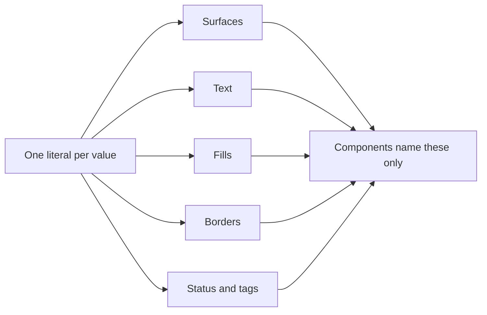

# Token layer streamline: review plan

## Summary

`DESIGN.md` is the normative spec, and its colour layer has drifted from its own rules. This change makes the token layer smaller and truer without adding a single new concept: one surface name stops claiming a depth it does not have, one translucent fill stops calling itself a surface, three duplicate names collapse, ten values stop being copied literals, and the stacking scale drops from five steps to three. Every value that is not called out below stays exactly as it is, so there is no visual change except one: today's ring in the date picker becomes a solid accent line instead of a 12% wash that measures 1.19:1.

## What you will get

- A surface family whose names are true in both themes: `app`, `panel`, `muted`, `inverse`.
- One name for text on a saturated fill, instead of two identical ones.
- Ten tokens declared as aliases of the value they already equal, so a value has one source.
- Three stacking layers instead of five, plus a written rule for overlays opened inside overlays.
- A contrast table with two missing pairs measured (status on its own tint, tag text on tag fill).
- A decision-log row for every change, so the reasoning survives.

## What will be built

| Part | What it does (one sentence) | Size | Built by |
|---|---|---|---|
| Surface family | Renames `sunken` to `muted` and moves `surface-subtle` to `fill-subtle`; values unchanged. | S | me, inline |
| Aliases | Declares icon, chip height, both insets, the ring colour and five tags as aliases of existing tokens. | S | me, inline |
| Deletions | Merges the two text-on-fill tokens, drops the soft accent tint, merges popover into menu and palette into dialog. | S | me, inline |
| Stacking rule | States that an overlay opened inside an overlay uses the native top layer, not a higher z token. | S | me, inline |
| Contrast table | Re-measures every row and adds the two missing pairs. | S | me, inline |
| Decision log | Adds a row per change with the reason, and updates the verification checklist. | S | me, inline |

One file, one chain, no parallel work, so no helpers: the whole change is done in one pass and reviewed as one diff.

## How it fits together

## Decisions you can change

- Surface name: `--surface-muted` (default) | keep `--surface-sunken` and only drop the depth claim from the prose.
- Stacking: three layers, menu 100, dialog 200, tooltip 300 (default) | keep five and add only the nesting rule.
- Today's ring: solid `--accent` (default) | keep a soft tint and accept 1.19:1 against the 3:1 the document claims.
- Tag values: aliases of status and accent (default) | keep six independent literals.

## Risks

- **Dangling names.** 32 references use the four surface tokens. A missed one leaves a token that does not exist. Mitigation: a script that lists every token named in prose and every token declared, and fails on either difference.
- **Stale measurements.** The contrast table is only true if it is recomputed after the change. Mitigation: recompute all rows from the values in the file, not by hand.
- **Downstream drift.** This repo holds the spec only; the generated stylesheet and the stories live elsewhere and are not in this checkout. Mitigation: the change is name-compatible except for the deleted tokens, which are listed in the decision log so the generator update is mechanical.
- **Scope creep.** The layer invites a raised overlay surface, a scrim and seven status roles. All are deliberately excluded.

## Out of scope

- A raised overlay surface, a scrim, per-region aliases, a disabled-text token, a seven-role status layer, collapsing the tag tokens.
- Editing the `t128n-ui` skill, which asks for seven status roles the spec does not have. That is a separate change in a separate repository, recorded here as a follow-up.
- Regenerating `dist/tokens.css` or the stories, which are not in this checkout.

## How we will know it works

- A token cross-check passes: every token named in prose is declared, and every declared token is used at least once.
- No deleted name survives: `surface-sunken`, `surface-subtle`, `text-on-accent`, `text-on-danger`, `accent-soft`, `layer-popover`, `layer-palette` appear zero times.
- The contrast table has a row for every pair the document claims, including the two new ones, and every value is computed from the file.
- The date picker's today ring is `--accent` at 5.0:1 light, 7.7:1 dark.
- Reading §2 start to finish, no token holds two CSS types and no name states a property its uses do not share.

## Rough time and cost

About 15 to 25 minutes, one pass plus one verification run. No model cost estimate until the machine plan is written.
