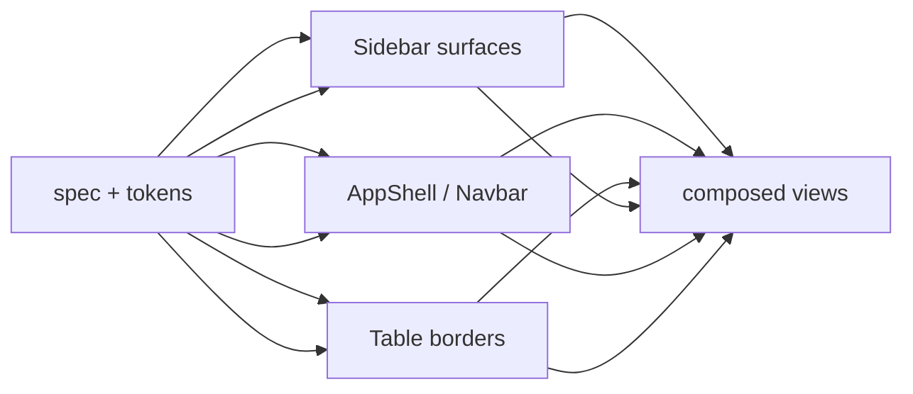

# Application surface hierarchy

**Goal:** Make application workspaces continuous and light-first: white content, subordinate neutral navigation, no segmented dashboard panels.
**Architecture:** Add semantic workspace/navigation tokens, document the hierarchy in `DESIGN.md`, then apply it to AppShell, Sidebar, Navbar, PageHeader, and borderless tables. Composed views follow the same surfaces.
**Tech stack:** Svelte 5, Storybook 10, Vitest + jsdom, Bun.
**Spec:** `DESIGN.md` §§Colors, Typography, Layout, Elevation & Depth, Components, Refusals. Brief: Application surface hierarchy, 2026-10-31.
**Detail:** contracts
**Target-min:** 18

**Global constraints:** Light-first. Preserve IBM Plex Sans/Mono rules, Oxocarbon foundation, accent `#0F62FE`, status colors, spacing/radius scale, Carbon icons, accessibility, and contrast. Do not introduce dark tokens or extra themes. White is the default application workspace. Navigation may use a lighter neutral surface, never a more prominent one than content. Reuse `canvas`, `surface`, and `surface-subtle` where roles match. New colors only: workspace `#FFFFFF`, navigation surface `#F7F8FA`, navigation selected `#E8EBEE`; these are validated below. No large tinted main canvases in app views. No default card wrappers. Remove redundant outer table borders. Avoid one-off CSS overrides that bypass tokens. Keep component APIs small: Sidebar adds `surface?: 'navigation' | 'workspace'`; Table adds `bordered?: boolean` (default false). All existing story names remain; add Sidebar `White surface` and Table `Bordered`.

**Files:** `DESIGN.md` · `styles/tokens.css` · `lib/AppShell.svelte` · `lib/Sidebar.svelte` · `lib/Navbar.svelte` · `lib/Table.svelte` · `stories/{Foundations,Sidebar,Table,PageHeader,Dashboard,Settings,Landing}.stories.svelte` · tests for tokens/contrast/surfaces/tables/views.

```mermaid
%% schedule
gantt
  title Predicted schedule (mm:ss)
  dateFormat X
  axisFormat %M:%S
  section lane 1
  T1 workspace spec  tokens  and contrast :t1, 0, 174s
  T2 Sidebar surface treatment :t2, 174, 142s
  T5 composed workspace views :t5, 317, 265s
  section lane 2
  T4 Borderless tables :t4, 174, 137s
  section lane 3
  T3 AppShell and Navbar workspace integra :t3, 174, 133s
```

critical path: T1 → T2 → T5 (9.7 min) · peak width 3 · predicted build 9.7 min · predicted total ≈ 13.2 min (target ✓)

### T1 workspace spec, tokens, and contrast · Complexity 4 (O-1) · Est. context 34k
**Owns:** `DESIGN.md`, `packages/ui/src/styles/tokens.css`, `packages/ui/tests/tokens.test.ts`, `packages/ui/tests/contrast.test.ts`, `packages/ui/src/stories/Foundations.stories.svelte`
**Components:** 3
**LOC owned:** 280
**Tests:** fast
**Model:** sonnet
**Est. time:** 4.0 min (3 files, about 280 LOC, fast tests)
**Consumes:** none
**Produces:** tokens `--color-workspace: #FFFFFF`, `--color-navigation-surface: #F7F8FA`, `--color-navigation-selected: #E8EBEE`; DESIGN.md application-workspace guidance
e.g. `var(--color-workspace)` -> white primary content region; `var(--color-navigation-surface)` -> quiet sidebar; `var(--color-navigation-selected)` -> neutral selected row
**Review Focus:** `test_workspace_tokens`: exact three tokens plus existing canvas/surface/subtle values; `test_contrast`: primary/secondary text ≥ 4.5 on workspace, nav surface, selected; muted ≥ 4.5 on nav surface; accent focus ≥ 3 on workspace/nav; `test_design_roles`: DESIGN.md distinguishes workspace vs surface vs canvas and navigation surface/selected; `test_design_layout`: contains the "Application workspaces" bullets and `Primary content > navigation > supporting surfaces`; `test_principles`: "Continuous workspaces over segmented dashboards"; `test_component_defaults`: AppShell/Sidebar/Navbar/PageHeader/Table guidance updated; `test_foundations`: swatches include workspace/navigation, control height is 36px.
**Test code (verbatim):** `expect(tokens).toContain('--color-workspace: #FFFFFF')` · `expect(design).toContain('Continuous workspaces over segmented dashboards')` · `expect(design).toContain('Primary content > navigation > supporting surfaces')`
**Notes:** Navigation surface is deliberately lighter than canvas; selected is lighter than border. Preserve every established decision listed in the brief. Update the Status note only to say surfaces are validated.

### T2 Sidebar surface treatment · Complexity 4 (O-1) · Est. context 30k
**Owns:** `packages/ui/src/lib/Sidebar.svelte`, `packages/ui/src/stories/Sidebar.stories.svelte`, `packages/ui/tests/sidebar.test.ts`
**Components:** 2
**LOC owned:** 220
**Tests:** fast
**Model:** sonnet
**Est. time:** 3.0 min (2 components, about 220 LOC, fast tests)
**Consumes:** workspace/navigation tokens (T1)
**Produces:** Sidebar props `surface?: 'navigation' | 'workspace'` (default `navigation`); selected row uses navigation-selected
e.g. `<Sidebar surface="workspace" sections={sections} />` -> white sidebar for comparison
**Review Focus:** `test_surface_default`: `.sidebar` background `--color-navigation-surface`; `test_white_surface`: `surface="workspace"` switches to workspace; `test_selected`: `.item-row.active` background `--color-navigation-selected`, primary text, medium; `test_badge_contrast`: active-row badge uses secondary text; `test_hover`: hover uses `--color-surface-subtle` and active remains selected; `test_mobile`: trigger row blends with workspace (transparent background), drawer panel is navigation surface; `test_stories`: existing five names plus `White surface`; no blue bar, no text-transform.
**Test code (verbatim):** `expect(sidebar).toContain("surface = 'navigation'")` · `expect(active).toContain('background: var(--color-navigation-selected)')` · `expect(activeBadge).toContain('color: var(--color-text-secondary)')`
**Notes:** Do not change row geometry, drawer behavior, or nested disclosure; only surface semantics and the comparison story.

### T3 AppShell and Navbar workspace integration · Complexity 4 (O-1) · Est. context 28k
**Owns:** `packages/ui/src/lib/AppShell.svelte`, `packages/ui/src/lib/Navbar.svelte`, `packages/ui/tests/app-shell.test.ts`, `packages/ui/tests/navbar.test.ts`
**Components:** 2
**LOC owned:** 150
**Tests:** fast
**Model:** sonnet
**Est. time:** 3.0 min (2 components, about 150 LOC, fast tests)
**Consumes:** workspace/navigation tokens (T1)
**Produces:** AppShell root/content `--color-workspace`; Navbar `--color-workspace`; no seams or extra borders between regions
**Review Focus:** `test_shell_workspace`: `.app-shell` background workspace, not canvas; `test_content`: main/content remains workspace; `test_navbar_workspace`: navbar background workspace; no border-bottom; `test_no_double_borders`: AppShell has no region borders; `test_pageheader_untouched`: PageHeader still has no background/card; `test_tokens`: no raw hex, tokens only; existing structure/a11y tests stay green.
**Test code (verbatim):** `expect(shell).toContain('background: var(--color-workspace)')` · `expect(shell).not.toContain('background: var(--color-canvas)')` · `expect(navbar).toContain('background: var(--color-workspace)')`
**Notes:** Keep Sidebar's surface in T2. Do not make Navbar navigation-surface; it must merge with content.

### T4 Borderless tables · Complexity 4 (O-1) · Est. context 28k
**Owns:** `packages/ui/src/lib/Table.svelte`, `packages/ui/src/stories/Table.stories.svelte`, `packages/ui/tests/table.test.ts`
**Components:** 2
**LOC owned:** 180
**Tests:** fast
**Model:** sonnet
**Est. time:** 2.5 min (2 components, about 180 LOC, fast tests)
**Consumes:** workspace/surface tokens (T1)
**Produces:** Table props `{ columns: Column[]; caption?: string; bordered?: boolean } -> HTMLElement`; default borderless, row separators retained
e.g. `<Table {columns}>…</Table>` on white -> no outer border; `<Table bordered>` -> bordered surface container
**Review Focus:** `test_default_borderless`: wrapper has no outer border, radius, or surface fill; `test_bordered`: `bordered` restores border/radius/surface; `test_rows`: row bottom separators remain; last row border removed; `test_caption`: caption remains; `test_focus`: no new focus behavior; `test_stories`: `Default` borderless and `Bordered`; `test_views_unaffected`: existing Table usage compiles.
**Test code (verbatim):** `expect(table).toContain('bordered = false')` · `expect(borderless).not.toContain('border: var(--border-width)')` · `expect(bordered).toContain('border: var(--border-width)')`
**Notes:** Keep horizontal overflow on the table wrapper. Do not remove row separators.

### T5 composed workspace views · Complexity 5 (O-1) · Est. context 36k
**Owns:** `docs/plans/2026-10-31-application-surfaces.md`, `packages/ui/src/stories/Dashboard.stories.svelte`, `packages/ui/src/stories/Settings.stories.svelte`, `packages/ui/src/stories/Landing.stories.svelte`, `packages/ui/src/stories/PageHeader.stories.svelte`, `packages/ui/src/stories/AppShell.stories.svelte`, `packages/ui/tests/views.test.ts`, `packages/ui/tests/stories.test.ts`
**Components:** 5
**LOC owned:** 320
**Tests:** slow
**Model:** sonnet
**Est. time:** 4.0 min (5 stories, about 320 LOC, slow build)
**Consumes:** Sidebar surface (T2) · AppShell/Navbar workspace (T3) · borderless Table (T4)
**Produces:** composed stories on workspace surfaces: Dashboard, Settings, AppShell, PageHeader; Landing stays on canvas
e.g. Dashboard -> white workspace, borderless recent-projects table, metrics with no cards
**Review Focus:** `test_dashboard`: AppShell workspace white; metrics not cards; recent Table no outer border; `test_settings`: sidebar-only; Cards retained only for independent settings groups; workspace white; active Settings; `test_landing`: canvas background retained for public page, Navbar workspace, borderless footer, no cards in features; `test_appshell`: top/sidebar/combined surfaces correct; combined Navbar white, Sidebar neutral; no seams; `test_pageheader`: story wrapper uses workspace, header has no background/card, Projects table borderless; `test_story_contracts`: existing names plus Sidebar `White surface` and Table `Bordered`; `test_build`: `bun run build-storybook` exits 0.
**Test code (verbatim):** `expect(dashboard).toContain('background: var(--color-workspace)')` · `expect(settings).toContain('max-width: var(--layout-form-width)')` · `expect(landing).toContain('background: var(--color-canvas)')` · `expect(stories).toContain('name="White surface"')`
**Notes:** Do not add background overrides to individual page content; let AppShell own the workspace. Remove only outer borders that duplicate row separators.

## Review Focus
packages/ui: encoding, protocol — App type web UI. Encoding covers surface contrast, border seams, and visual hierarchy; protocol covers component surface APIs and composed story behavior.
Watch for inverted navigation/content prominence; a white sidebar over a tinted main canvas; double borders at region joins; outer table borders duplicating row lines; new near-duplicate tokens; cards around ordinary content; dark-theme inventions.
**Probe entry:** `serve=storybook dev -p 6006`

## Self-review
- Coverage: T1 spec/tokens, T2 sidebar surfaces, T3 frame surfaces, T4 tables, T5 composed views. DESIGN.md sections Colors, Typography, Layout, Elevation & Depth, Shapes, Components, Refusals, plus the established decisions, are preserved.
- No placeholders; each Owns path is unique; T2/T3/T4 start after T1; T5 waits for all.
- APIs: Sidebar `surface`, Table `bordered`; no other API changes. Existing story names retained; two comparison stories added.
- Sizes: 2.5–4.0 min; predicted 11 min critical path.
