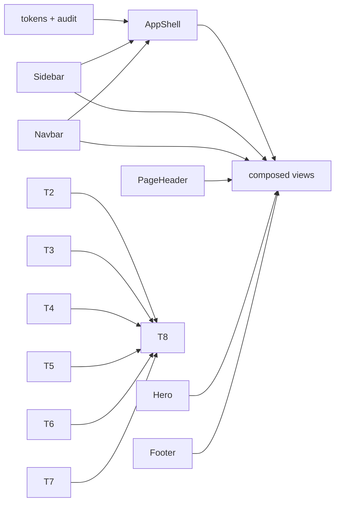

# Layout system refinement

**Goal:** Make App Shell, Sidebar, Navbar, Page Header, Hero, and Footer conform to `DESIGN.md` as a quiet, content-first layout system, with realistic Storybook examples.
**Architecture:** Svelte 5 components keep their responsibilities; simplify structure first, then typography/spacing, then stories. AppShell makes both navigation regions optional; Sidebar and Navbar stay independent.
**Tech stack:** Svelte 5, Bits UI where interaction warrants it, Storybook CSF, Vitest + jsdom, Bun.
**Spec:** `DESIGN.md` §§Colors, Typography, Layout, Elevation & Depth, Shapes, Components, Refusals. Task list from the 2026-10-31 layout brief.
**Detail:** contracts
**Target-min:** 12

**Global constraints:** Light theme. IBM Plex Sans scale from `tokens.css`. Sentence case everywhere: no `text-transform`, no letter-spacing above `0.02em`. Accent `#0F62FE` only for selected states, primary actions, meaningful links, focus. One active-navigation cue: accent indicator plus primary text, never tint + bar + accent text together. Semantic tokens only; no raw hex under `lib/`; border and layout widths from tokens. Radii `sm`/`md`/`lg` (max 6px). No decorative shadows, gradients, fixed positioning outside the skip link, or `100vh` inner-scroll shells. Preserve skip link, `id="main-content"`, `tabindex="-1"`, `aria-current`, visible `:focus-visible`, reduced motion. API additions only: Sidebar `toggleLabel` + nested `children`, Footer `bordered`. No new dependencies. `bun run test` and Storybook a11y pass.

**Files:** `styles/tokens.css` layout/border tokens · `lib/AppShell.svelte` optional regions, content measure, skip link · `lib/Sidebar.svelte` sentence-case labels, one active cue, nesting, disclosure · `lib/Navbar.svelte` text brand, primary nav, neutral tabs · `lib/PageHeader.svelte` optional crumbs, action hierarchy · `lib/Hero.svelte` optional eyebrow, controlled type, aligned aside · `lib/Footer.svelte` optional boundary, hierarchy, stack · `stories/*.stories.svelte` isolated + composed cases · `tests/*.test.ts` contracts.

```mermaid
%% schedule
gantt
  title Predicted schedule (mm:ss)
  dateFormat X
  axisFormat %M:%S
  section lane 1
  T3 Sidebar :t3, 0, 153s
  T8 composed views and story contracts :t8, 153, 221s
  section lane 2
  T2 AppShell structure :t2, 0, 145s
  section lane 3
  T6 Hero :t6, 0, 145s
  section lane 4
  T4 Navbar :t4, 0, 142s
  section lane 5
  T5 PageHeader :t5, 0, 142s
  section lane 6
  T7 Footer :t7, 0, 137s
  section lane 7
  T1 layout tokens and design audit :t1, 0, 100s
```

critical path: T3 → T8 (6.2 min) · peak width 7 · predicted build 6.2 min · predicted total ≈ 9.7 min (target ✓)

### T1 layout tokens and design audit · Complexity 3 (O-1) · Est. context 24k
**Owns:** `DESIGN.md`, `packages/ui/src/styles/tokens.css`, `packages/ui/tests/design-audit.test.ts`
**Components:** 1
**LOC owned:** 80
**Tests:** fast
**Model:** sonnet
**Est. time:** 2.0 min (1 component, about 80 LOC, fast tests)
**Consumes:** none
**Produces:** tokens `--layout-content-width: 72rem`, `--layout-reading-width: 65ch`, `--layout-form-width: 48rem`, `--layout-sidebar-width: 13.5rem`, `--border-width: 1px`, `--border-width-emphasis: 2px`
**Review Focus:** `test_spec_committed`: `DESIGN.md` contains the Refusals table and sentence-case rule; `test_no_uppercase_transform`: no `text-transform` in `src/lib/*.svelte`; `test_letter_spacing_budget`: every `letter-spacing` is at most `0.02em`; `test_radius_within_lg`: no `border-radius` at or above `8px`; `test_no_raw_hex_in_lib`: no `#[0-9a-f]{3,8}` in `src/lib`; `test_focus_visible_coverage`: AppShell, Sidebar, Navbar, Breadcrumbs, Footer each contain `:focus-visible`; `test_no_fixed_outside_skip_link`: only AppShell has `position: fixed`.
**Test code (verbatim):** `expect(libSource).not.toMatch(/text-transform/i)` · `expect(tokens).toContain('--layout-content-width: 72rem')`

### T2 AppShell structure · Complexity 5 (O-1) · Est. context 30k
**Owns:** `packages/ui/src/lib/AppShell.svelte`, `packages/ui/src/stories/AppShell.stories.svelte`, `packages/ui/tests/app-shell.test.ts`
**Components:** 2
**LOC owned:** 240
**Tests:** fast
**Model:** sonnet
**Est. time:** 3.0 min (2 components, about 240 LOC, fast tests)
**Consumes:** Navbar props (T4) · Sidebar props (T3) · PageHeader props (T5)
**Produces:** AppShell props `{ sidebar?: Snippet; navbar?: Snippet; children?: Snippet } -> HTMLElement`
e.g. `<AppShell {navbar}>…</AppShell>` -> one-column frame, no sidebar column
e.g. `<AppShell {sidebar}>…</AppShell>` -> sidebar column at 800px and wider, stacked below
**Review Focus:** `test_shell_has_one_main`: exactly one `<main id="main-content" tabindex="-1">`; `test_nav_regions_optional`: both regions behind `{#if}`, no `minmax(200px, 240px)`; `test_sidebar_class`: root has `class:with-sidebar`; `test_content_measure`: `.content-inner` uses `var(--layout-content-width)`; `test_skip_link_preserved`: `href="#main-content"` and `:focus-visible`; `test_stories_cover_modes`: Top navigation, Sidebar navigation, Combined navigation, Narrow screen; combined story has Navbar utilities and Sidebar destinations, never shared labels.
**Test code (verbatim):** `expect(shell).toContain('id="main-content"')` · `expect(shell).toContain('class:with-sidebar')` · `expect(shell).not.toContain('minmax(200px, 240px)')`
### T3 Sidebar · Complexity 5 (O-1) · Est. context 34k
**Owns:** `packages/ui/src/lib/Sidebar.svelte`, `packages/ui/src/stories/Sidebar.stories.svelte`, `packages/ui/tests/sidebar.test.ts`
**Components:** 2
**LOC owned:** 300
**Tests:** fast
**Model:** sonnet
**Est. time:** 3.5 min (2 components, about 300 LOC, fast tests)
**Consumes:** none
**Produces:** Sidebar props `{ sections: Section[]; header?: Snippet; footer?: Snippet; label?: string; toggleLabel?: string } -> HTMLElement`; `Section = { label?: string; items: Item[] }`; `Item = { label: string; href?: string; active?: boolean; badge?: string; children?: Item[] }`
e.g. `sections=[{label:'Workspace',items:[{label:'Projects',active:true,badge:'12'}]}]` -> sentence-case heading, 36px row, one accent left bar
**Review Focus:** `test_section_labels_sentence_case`: no uppercase/letter-spacing on `.section-label`; `test_single_active_cue`: `.item.active` sets only border-left-color and primary text, no background or accent text; `test_nested_items`: recursive `children` with `aria-current`; `test_mobile_disclosure`: button has `aria-expanded`, `aria-controls`, nav id, click toggles; `test_long_labels`: `overflow-wrap: anywhere`, badge `flex: none`; `test_stories_cover_cases`: Flat, Grouped, Nested, Selected, Focus; no group heading in Flat.
**Test code (verbatim):** `expect(sidebar).toContain('aria-expanded={open}')` · `expect(sidebar).toContain('aria-controls={navId}')` · `expect(sidebar).not.toMatch(/text-transform/i)`
### T4 Navbar · Complexity 4 (O-1) · Est. context 28k
**Owns:** `packages/ui/src/lib/Navbar.svelte`, `packages/ui/src/stories/Navbar.stories.svelte`, `packages/ui/tests/navbar.test.ts`
**Components:** 2
**LOC owned:** 220
**Tests:** fast
**Model:** sonnet
**Est. time:** 2.5 min (2 components, about 220 LOC, fast tests)
**Consumes:** none
**Produces:** Navbar props `{ brand?: string; links?: NavLink[]; actions?: Snippet; label?: string } -> HTMLElement`; `NavLink = { label: string; href?: string; active?: boolean }`
**Review Focus:** `test_brand_is_text_only`: no `.mark` and no accent background on brand; `test_one_selected_indicator`: `.link.active` sets accent bottom border and primary text, no accent text; `test_inactive_neutral`: links use `--color-text-secondary`; `test_actions_are_utilities`: no New project or Export in `actions`; `test_narrow_row`: full-width scrollable links row, no clipping; `test_long_labels`: nowrap inside scroll; `test_stories_cover_cases`: Basic, Account utilities, Narrow screen, Long labels.
**Test code (verbatim):** `expect(navbar).not.toContain('.mark')` · `expect(navbar).toContain('aria-current={link.active')` · `expect(navbar).toContain('overflow-x: auto')`

### T5 PageHeader · Complexity 4 (O-1) · Est. context 26k
**Owns:** `packages/ui/src/lib/PageHeader.svelte`, `packages/ui/src/stories/PageHeader.stories.svelte`, `packages/ui/tests/page-header.test.ts`
**Components:** 2
**LOC owned:** 220
**Tests:** fast
**Model:** sonnet
**Est. time:** 2.5 min (2 components, about 220 LOC, fast tests)
**Consumes:** Breadcrumbs props (existing)
**Produces:** PageHeader props `{ title: string; description?: string; breadcrumbs?: Crumb[]; actions?: Snippet; meta?: Snippet } -> HTMLElement`
**Review Focus:** `test_breadcrumbs_optional`: no `<Breadcrumbs>` when empty; `test_actions_at_top`: `.row` uses `align-items: flex-start`; `test_long_title_wraps`: `overflow-wrap: anywhere` and `min-width: 0`; `test_description_measure`: max `var(--layout-reading-width)`; `test_no_container`: no card/border wrapper; `test_projects_story_realistic`: Table rows and contextual actions; `test_stories_cover_cases`: Title only, With description, Breadcrumbs and actions, Long title, Projects page.
**Test code (verbatim):** `expect(header).toContain("align-items: flex-start")` · `expect(header).not.toContain('border: var(--border-width)')` · `expect(header).toContain('breadcrumbs?.length')`
### T6 Hero · Complexity 4 (O-1) · Est. context 28k
**Owns:** `packages/ui/src/lib/Hero.svelte`, `packages/ui/src/stories/Hero.stories.svelte`, `packages/ui/tests/hero.test.ts`
**Components:** 2
**LOC owned:** 240
**Tests:** fast
**Model:** sonnet
**Est. time:** 2.5 min (2 components, about 240 LOC, fast tests)
**Consumes:** Card props (existing)
**Produces:** Hero props `{ eyebrow?: string; title: string; description?: string; actions?: Snippet; aside?: Snippet; align?: 'left' | 'center' } -> HTMLElement`
e.g. `{eyebrow:'Workspace', title:'Welcome back', aside}` -> sentence-case eyebrow, left copy + top-aligned aside
**Review Focus:** `test_eyebrow_sentence_case`: no uppercase/letter-spacing, `font-size: var(--font-size-body-sm)`; `test_eyebrow_optional`: renders only when supplied; `test_type_measure`: h1 max 18ch left/22ch centered, description max `var(--layout-reading-width)`; `test_aside_top_aligned`: `align-items: start`, no equal heights; `test_no_vertical_centering`: no `min-height`/`align-content`; `test_stories_cover_cases`: Centered, With aside, Without eyebrow, Long content, Stacked; aside is useful next steps/activity.
**Test code (verbatim):** `expect(hero).not.toMatch(/text-transform/i)` · `expect(hero).toContain('align-items: start')` · `expect(hero).not.toContain('align-content: center')`

### T7 Footer · Complexity 3 (O-1) · Est. context 24k
**Owns:** `packages/ui/src/lib/Footer.svelte`, `packages/ui/src/stories/Footer.stories.svelte`, `packages/ui/tests/footer.test.ts`
**Components:** 2
**LOC owned:** 180
**Tests:** fast
**Model:** sonnet
**Est. time:** 2.0 min (2 components, about 180 LOC, fast tests)
**Consumes:** none
**Produces:** Footer props `{ brand?: string; links?: Link[]; note?: string; bordered?: boolean } -> HTMLElement`
e.g. `{links:[{label:'Docs',href:'#'}], note:'© 2026 Stellar', bordered:false}` -> borderless footer inside a composed page
**Review Focus:** `test_border_optional`: `class:bordered={bordered}`, default true; `test_link_list_semantics`: links in `nav > ul > li`; `test_hierarchy`: brand primary/medium, links secondary, note muted; `test_focus_visible`: link focus ring; `test_responsive_stack`: under 640px column layout, note loses `margin-left: auto`; `test_stories_cover_cases`: Minimal, Utility links, Complete page, Stacked.
**Test code (verbatim):** `expect(footer).toContain('class:bordered={bordered}')` · `expect(footer).toContain('<nav aria-label="Footer">')` · `expect(footer).toContain('flex-direction: column')`

### T8 composed views and story contracts · Complexity 5 (O-1) · Est. context 51k
**Owns:** `docs/plans/2026-10-31-layout-system-refinement.md`, `packages/ui/src/stories/Dashboard.stories.svelte`, `packages/ui/src/stories/Settings.stories.svelte`, `packages/ui/src/stories/Landing.stories.svelte`, `packages/ui/tests/views.test.ts`, `packages/ui/tests/stories.test.ts`
**Components:** 3
**LOC owned:** 360
**Tests:** slow
**Model:** sonnet
**Est. time:** 4.0 min (3 components, about 360 LOC, slow tests)
**Consumes:** AppShell props (T2) · Sidebar props (T3) · Navbar props (T4) · PageHeader props (T5) · Hero props (T6) · Footer props (T7)
**Produces:** composed stories `Views/Dashboard`, `Views/Settings`, `Views/Landing` -> rendered pages
e.g. Dashboard -> Sidebar-only frame, no duplicated destination in a navbar
e.g. Landing -> Navbar-only frame, Hero with aside, borderless Footer
**Review Focus:** `test_dashboard_single_nav`: Dashboard renders Sidebar and no `<Navbar`; `test_settings_single_nav`: Settings renders Sidebar and no `<Navbar`; `test_landing_top_nav`: Landing renders Navbar, no Sidebar, plus Footer; `test_no_nested_cards`: Dashboard metrics are plain rows, no Card around a single number; `test_story_contracts`: all required story names from T2–T7 exist; `test_a11y_build`: `bun run build-storybook` exits 0.
**Test code (verbatim):** `expect(dashboard).not.toContain('<Navbar')` · `expect(landing).toContain('<Footer')` · `expect(story).toContain("name=\"Top navigation\"")`
## Review Focus
**Package:** `packages/ui` — **App type:** web UI. **Categories:** protocol (Storybook composition, navigation ownership), encoding (ARIA, focus, overflow).
**Risks:** duplicate destinations; stacked active treatments; uppercase labels; crumbs repeating the title/nav; page-level horizontal scroll; clipped focus rings; card-around-metric and nested surfaces; `100vh` inner scroll; examples implying a mandatory shell.
**Probe entry:** `serve=storybook dev -p 6006`

## Self-review
- Coverage maps every scope section to T1–T8, including DESIGN.md §§Colors, Typography, Layout, Elevation & Depth, Shapes, Buttons and controls, Selection and overlay controls, Layouts and views, Iconography — concrete choice, Motion and interaction, Feedback and state, Layout and density, Color and status, Chrome, copy, ethics, System governance, Budgets, Mechanically checkable, Validation backlog. T1 covers Iconography, chrome copy, governance, and motion; T2–T7 cover component rules; T8 covers views.
- No placeholders; each Owns path is unique; T8 is the only consumer with edges and intentionally waits for all producers.
- APIs: T8 Consumes match T2–T7 Produces. Story headings in task text are quoted in `test_story_contracts`.
- Sizes: all tasks 2.0–4.0 min; T8 owns three stories and is scheduled last.
