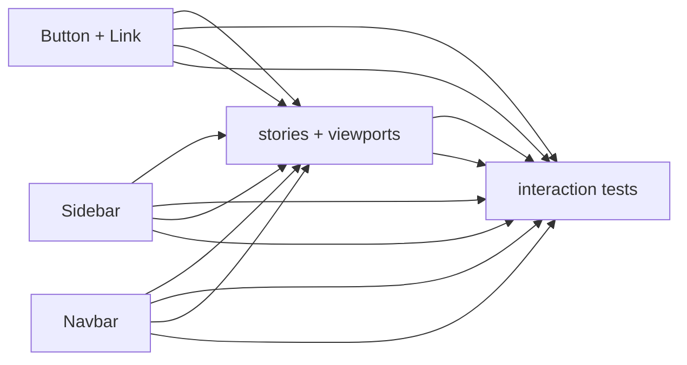

# Navigation polish

**Goal:** Raise Sidebar and Navbar to production interaction quality: coherent row states, independent nested disclosure, ghost utilities, and overflow-free narrow navigation in a drawer/menu.
**Architecture:** Keep AppShell composition. Sidebar owns application navigation and a narrow drawer (Bits UI Dialog); Navbar owns global navigation with a content-fit overflow menu (Bits UI Popover); Button gets `ghost`/`link` variants and a semantic Link component is added. Storybook viewports are real iframe constraints, not fixed-width fragments.
**Tech stack:** Svelte 5, Bits UI 2.20, Carbon icons (`carbon-icons-svelte`), Storybook 10 built-in viewport, Vitest + jsdom with browser conditions.
**Spec:** `DESIGN.md` §§Typography, Layout, Elevation & Depth, Shapes, Components, Refusals. Brief: Navigation polish, 2026-10-31.
**Detail:** contracts
**Target-min:** 22

**Global constraints:** Light theme. IBM Plex Sans scale; sentence case; no `text-transform`; no letter-spacing above `0.02em`. Accent `#0F62FE` for focus and meaningful emphasis only; Sidebar active state is a subtle neutral background plus primary text, never a blue bar. Semantic tokens only; no raw hex; no new arbitrary tokens. Radii ≤ 6px. No decorative shadows outside overlay layers. No page-level horizontal overflow; do not use `overflow-x: auto` as global nav fallback. Semantic links for destinations, buttons for disclosure/actions. Use Carbon icons only: `ChevronRight`, `ChevronDown`, `Menu`, `Close`. Bits UI supplies focus trapping, Escape, dismissal, and focus restoration. Preserve public APIs except documented additions: Button `ghost|link`; new Link (`default|ghost|link`); Sidebar nested `children` and `toggleLabel`; Navbar unchanged. No new dependencies (Carbon icons and Storybook viewport already available). All existing story names remain. `bun run test` and `bun run build-storybook` stay green.

**Files:** `lib/Button.svelte` variants · `lib/Link.svelte` new semantic anchor · `lib/Sidebar.svelte` rows, nesting, drawer · `lib/Navbar.svelte` content-fit menu · `stories/{Button,Link,Sidebar,Navbar}.stories.svelte` · `stories/{AppShell,Dashboard,Settings,Landing}.stories.svelte` viewports/utilities · `.storybook/preview.ts` viewport presets · `vitest.config.ts` browser conditions · `tests/setup.ts` DOM polyfills · interaction tests.

```mermaid
%% schedule
gantt
  title Predicted schedule (mm:ss)
  dateFormat X
  axisFormat %M:%S
  section lane 1
  T2 Sidebar navigation polish :t2, 0, 193s
  T4 Storybook viewports and composed stor :t4, 193, 238s
  T5 Interaction tests and harness :t5, 430, 292s
  section lane 2
  T3 Navbar content-fit menu and quiet uti :t3, 0, 160s
  section lane 3
  T1 Button and Link variants :t1, 0, 142s
```

critical path: T2 → T4 → T5 (12.0 min) · peak width 3 · predicted build 12.0 min · predicted total ≈ 15.5 min (target ✓)

### T1 Button and Link variants · Complexity 4 (O-1) · Est. context 30k
**Owns:** `packages/ui/src/lib/Button.svelte`, `packages/ui/src/lib/Link.svelte`, `packages/ui/src/index.ts`, `packages/ui/src/stories/Button.stories.svelte`, `packages/ui/src/stories/Link.stories.svelte`, `packages/ui/tests/controls.test.ts`
**Components:** 2
**LOC owned:** 220
**Tests:** fast
**Model:** sonnet
**Est. time:** 3.0 min (2 components, about 220 LOC, fast tests)
**Consumes:** none
**Produces:** Button props `{ variant?: 'primary'|'secondary'|'ghost'|'link'; disabled?: boolean; loading?: boolean } & HTMLButtonAttributes -> HTMLButtonElement` · Link props `{ href: string; variant?: 'default'|'ghost'|'link' } & HTMLAnchorAttributes -> HTMLAnchorElement`; `index.ts` exports Link
e.g. `<Button variant="ghost">Account</Button>` -> transparent 36px button, no border, hover `--color-surface-subtle`
e.g. `<Link variant="ghost" href="/help">Help</Link>` -> native anchor, quiet padded text
**Review Focus:** `test_button_variants`: union has primary/secondary/ghost/link; ghost has `border: 0`, transparent background, hover surface-subtle; link variant uses accent text and underline on hover; `test_link_is_anchor`: Link renders `<a {href}>`, no click handler; `test_link_variants`: default accent text, ghost padded quiet anchor, link persistent underline; `test_focus_and_disabled`: token focus ring on both; Button disabled/loading unchanged; `test_exports`: Link exported.
**Test code (verbatim):** `expect(button).toContain("variant?: 'primary' | 'secondary' | 'ghost' | 'link'")` · `expect(link).toContain('<a')` · `expect(link).not.toContain('onclick')`
**Stories:** Button Primary, Secondary, Ghost, Link, Disabled, Loading, All states. Link Default, Ghost, Link, All variants. Realistic prose labels.

### T2 Sidebar navigation polish · Complexity 5 (O-1) · Est. context 38k
**Owns:** `packages/ui/src/lib/Sidebar.svelte`, `packages/ui/src/stories/Sidebar.stories.svelte`, `packages/ui/tests/sidebar.test.ts`
**Components:** 3
**LOC owned:** 420
**Tests:** fast
**Model:** sonnet
**Est. time:** 4.0 min (3 components, about 420 LOC, fast tests)
**Consumes:** Carbon icons `ChevronRight`, `Menu`, `Close` (installed) · Bits UI `Dialog` (existing)
**Produces:** Sidebar props `{ sections: Section[]; header?: Snippet; footer?: Snippet; label?: string; toggleLabel?: string } -> HTMLElement`; `Section = { label?: string; items: Item[] }`; `Item = { label: string; href?: string; active?: boolean; badge?: string; children?: Item[] }`
e.g. parent `{label:'Projects', href:'#projects', children:[{label:'Orbit'},{label:'Atlas',active:true}]}` -> separate Projects link + expander; Atlas active and ancestry automatically open
**Review Focus:** `test_row_geometry`: 36px rows, 8px inline padding, radius `--radius-md`, no gaps inside a group, 24px between groups; `test_active_background`: `.item-row.active` uses `--color-surface-subtle` + primary text, no `border-left`/accent bar; `test_nested_disclosure`: children render a Carbon `ChevronRight` button with `aria-expanded`/`aria-controls`; parent link and expander are separate; `test_active_ancestry`: active descendant opens its ancestors by default; `test_long_labels`: ellipsis + `title` with full label; `test_mutation_states`: row hover, active, focus are distinct without layout shift; `test_drawer`: mobile trigger uses Carbon `Menu`, Dialog title/description, overlay, close button, drawer nav duplicates the tree with unique ids; desktop nav stays visible, trigger hidden; `test_scroll`: desktop sidebar is sticky with its own overflow; `test_stories`: Flat, Grouped, Nested, Selected, Focus; Nested includes href parents and an active child.
**Test code (verbatim):** `expect(sidebar).toContain('aria-expanded={isOpen(id, item)}')` · `expect(sidebar).toContain('import ChevronRight')` · `expect(sidebar).not.toContain('border-left: var(--border-width-emphasis)')` · `expect(sidebar).toContain('text-overflow: ellipsis')`
**Notes:** No icon-only desktop rail; the drawer is the collapse strategy because destinations have no icon language.

### T3 Navbar content-fit menu and quiet utilities · Complexity 5 (O-1) · Est. context 38k
**Owns:** `packages/ui/src/lib/Navbar.svelte`, `packages/ui/src/stories/Navbar.stories.svelte`, `packages/ui/tests/navbar.test.ts`
**Components:** 2
**LOC owned:** 360
**Tests:** fast
**Model:** sonnet
**Est. time:** 4.0 min (2 components, about 360 LOC, fast tests)
**Consumes:** Button ghost and Link ghost (T1) for stories · Carbon `Menu`, `Close` (installed) · Bits UI `Popover`
**Produces:** Navbar props `{ brand?: string; links?: NavLink[]; actions?: Snippet; label?: string } -> HTMLElement`; compact menu when natural link width exceeds available width
e.g. 6 long labels in 320px -> brand + Menu trigger + utilities; menu lists every destination with `aria-current` and full labels
**Review Focus:** `test_content_fit`: hidden measurement row + `ResizeObserver/check()` toggles `compact`; no `overflow-x: auto`; `test_structure`: brand, nav slot, spacer, utilities; `test_compact_trigger`: visible Menu icon + `aria-label` including current destination, `aria-expanded`, `aria-controls`; `test_menu_links`: Popover nav lists all links, active has `aria-current` and subtle background, link click closes; `test_keyboard`: Escape closes and focus returns to trigger; `test_desktop_active`: one accent underline + primary text, inactive secondary; `test_no_border`: no navbar border-bottom; `test_stories`: Basic, Account utilities (ghost Link/Button only), Narrow screen (320 viewport), Long labels (768 viewport); no outlined adjacent utilities.
**Test code (verbatim):** `expect(navbar).toContain('new ResizeObserver')` · `expect(navbar).not.toContain('overflow-x: auto')` · `expect(navbar).toContain("import { Popover } from 'bits-ui'")` · `expect(navbar).toContain('aria-controls={menuId}')`
**Notes:** Utilities are snippet-owned, but stories must use Link ghost for navigation and Button ghost for a menu action. Keep `New project` out of Navbar.

### T4 Storybook viewports and composed stories · Complexity 4 (O-1) · Est. context 34k
**Owns:** `docs/plans/2026-10-31-navigation-polish.md`, `.storybook/preview.ts`, `packages/ui/src/stories/AppShell.stories.svelte`, `packages/ui/src/stories/Dashboard.stories.svelte`, `packages/ui/src/stories/Settings.stories.svelte`, `packages/ui/src/stories/Landing.stories.svelte`, `packages/ui/tests/app-shell.test.ts`, `packages/ui/tests/views.test.ts`
**Components:** 4
**LOC owned:** 300
**Tests:** slow
**Model:** sonnet
**Est. time:** 4.0 min (4 stories, about 300 LOC, slow build)
**Consumes:** Link/Button variants (T1) · Sidebar drawer (T2) · Navbar compact menu (T3)
**Produces:** viewport presets `narrow320`, `narrow375`, `tablet768`, `desktop1280` in `preview.parameters.viewport.options`; stories set `globals: { viewport: { value: <key> } }`
e.g. AppShell Narrow screen at `narrow375` -> real 375px iframe with Sidebar trigger, no fixed-width wrapper
**Review Focus:** `test_viewport_presets`: four keys with px styles; `test_real_constraints`: Navbar Narrow uses `narrow320`, Navbar Long labels `tablet768`, AppShell Narrow `narrow375`; no `.narrow-frame`/fixed-width story wrapper remains; `test_appshell_scope`: Top navigation desktop; Sidebar navigation desktop; Combined desktop uses Navbar brand/utilities only + Sidebar destinations; Narrow uses combined with Sidebar drawer and no duplicate menu; `test_ghost_utilities`: Help/Account/Sign in are Link ghost or Button ghost, no secondary outlined buttons in navbar actions; `test_views`: Dashboard/Settings sidebar active matches title; Landing uses Link ghost Sign in, plain feature sections, borderless Footer; `test_story_build`: `bun run build-storybook` exits 0.
**Test code (verbatim):** `expect(preview).toContain("narrow320")` · `expect(appShell).toContain("viewport: { value: 'narrow375' }")` · `expect(appShell).not.toContain('narrow-frame')` · `expect(appShell).not.toContain('variant="secondary">Help')`
**Notes:** Storybook 10 viewport is built in; no addon dependency. Remove the old constrained wrappers from Navbar and AppShell stories.

### T5 Interaction tests and harness · Complexity 5 (O-1) · Est. context 36k
**Owns:** `vitest.config.ts`, `packages/ui/tests/setup.ts`, `packages/ui/tests/controls-semantics.test.ts`, `packages/ui/tests/sidebar-interactions.test.ts`, `packages/ui/tests/navbar-interactions.test.ts`, `packages/ui/tests/stories.test.ts`
**Components:** 6
**LOC owned:** 340
**Tests:** slow
**Model:** sonnet
**Est. time:** 4.5 min (6 test/config files, about 340 LOC, slow suite)
**Consumes:** Button/Link (T1) · Sidebar (T2) · Navbar (T3) · viewports/stories (T4)
**Produces:** jsdom browser harness `resolve.conditions: ['browser']`, `setupFiles`, ResizeObserver/matchMedia polyfills; real component interaction tests
e.g. `render(Sidebar, { sections })` -> click Navigation -> dialog -> Escape -> focus restored
**Review Focus:** `test_harness`: full existing suite stays green with browser conditions; `test_link_semantics`: Link is an anchor with href; Button is a button; `test_sidebar_drawer`: open, focus inside, Escape closes, focus returns to trigger; `test_nested_interaction`: active ancestry open; expand/collapse toggles children; parent link is independent; `test_navbar_compact`: mocked widths make compact true; menu opens, lists all links, Escape closes, focus returns; `test_story_contracts`: every required title/name still present, Link story title added, viewport globals/presets asserted; no redundant `overflow-x` fallback.
**Test code (verbatim):** `expect(link.tagName).toBe('A')` · `expect(screen.getByRole('dialog')).toBeInTheDocument()` · `await user.keyboard('{Escape}')` · `expect(trigger).toHaveFocus()`
**Notes:** Polyfill ResizeObserver in setup; if a Bits UI focus assertion is unstable, assert the dialog closes and the trigger remains the active element after a tick.

## Review Focus
packages/ui: protocol, encoding — App type web UI. Protocol covers menu/drawer open-close, focus restoration, and navigation semantics; encoding covers no overflow, accessible names, ARIA state, and truncation.
**Risks:** active state stacking signals; duplicated nav in drawer and page; menu/drawer focus leaks; clipped labels; page-level overflow; outlined utilities; icons used decoratively; API variants that blur link/button semantics.
**Probe entry:** `serve=storybook dev -p 6006`

## Self-review
- Coverage: P0 overflow (T3/T4), P1 sidebar (T2), P2 variants/utilities (T1/T4), P3 validation (T4/T5); App Shell integration T4. DESIGN.md coverage: Colors, Typography, Layout, Elevation & Depth, Shapes, Buttons and controls, Selection and overlay controls, Layouts and views, Iconography — concrete choice, Motion and interaction, Feedback and state, Layout and density, Color and status, Motion, Chrome, copy, ethics, System governance, Budgets, Mechanically checkable, Validation backlog. T1 covers controls and iconography; T2–T3 cover layout, motion, and chrome; T4–T5 cover views and validation.
- No placeholders; each Owns path is unique; T4 waits on T1–T3, T5 on T1–T4.
- APIs: T4/T5 Consumes match T1–T3 Produces. All existing story names retained.
- Sizes: 3.0–4.5 min; predicted 14 min critical path.
