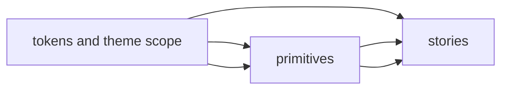

<!--
SPDX-FileCopyrightText: 2026 t128n

SPDX-License-Identifier: MIT
-->

# v0.1 Svelte primitives

**Goal:** Implement the current light-first `DESIGN.md` primitives and make them visible in Storybook.
**Architecture:** semantic CSS tokens feed small Svelte components; stories compose and document each public export.
**Tech stack:** Svelte 5, Bits UI available for later composite controls, Storybook, Vitest, Bun.
**Spec:** `DESIGN.md` §§Colors, Typography, Layout, Elevation & Depth, Shapes, Buttons and controls, Iconography, Motion and interaction.
**Detail:** tests
**Global constraints:** current `DESIGN.md` is authoritative; light mode only; use semantic tokens, IBM Plex stacks, one blue accent, Carbon-compatible icon slots, 40px controls, visible focus, reduced motion, and no decorative shadows.

Ruling: ship only tokens, Button, Input, and Card because these are the explicit v0.1 component defaults; do not invent the superseded dark theme, status palette, overlays, or reference views.

```mermaid
%% schedule
gantt
  title Predicted schedule (mm:ss)
  dateFormat X
  axisFormat %M:%S
  section lane 1
  T1 tokens and theme scope :t1, 0, 134s
  T2 primitives :t2, 134, 193s
  T3 stories :t3, 328, 173s
```

critical path: T1 → T2 → T3 (8.4 min) · peak width 1 · predicted build 8.4 min · predicted total ≈ 11.9 min

### T1 tokens and theme scope · Complexity 4 (O-1) · Est. context 28k
**Owns:** `packages/ui/src/styles/tokens.css`, `packages/ui/src/styles/index.css`, `packages/ui/src/lib/ThemeScope.svelte`, `packages/ui/tests/tokens.test.ts`
**Components:** 2
**LOC owned:** 160
**Tests:** fast
**Model:** sonnet
**Est. time:** 3.0 min
**Produces:** ThemeScope props `{class?: string}` -> Snippet
e.g. `<ThemeScope>content</ThemeScope>` -> light semantic-token scope
**Review Focus:** `test_semantic_tokens_exist`; `test_no_dark_or_status_tokens`; `test_reduced_motion_disables_transitions`.
**Test code (verbatim):** `expect(tokens).toContain('--color-accent: #0F62FE')`

### T2 primitives · Complexity 5 (O-1) · Est. context 34k
**Owns:** `packages/ui/src/lib/Button.svelte`, `packages/ui/src/lib/Input.svelte`, `packages/ui/src/lib/Card.svelte`, `packages/ui/src/index.ts`, `packages/ui/tests/primitives.test.ts`
**Components:** 4
**LOC owned:** 240
**Tests:** fast
**Model:** sonnet
**Est. time:** 4.5 min
**Consumes:** ThemeScope props `{class?: string}` -> Snippet (T1)
**Produces:** Button props `{variant?: "primary"|"secondary", disabled?: boolean, loading?: boolean}` -> HTMLButtonElement · Input props `{label: string, error?: string}` -> HTMLInputElement · Card props `{title?: string}` -> HTMLElement
e.g. `<Button variant="primary">Save changes</Button>` -> 40px primary button
**Review Focus:** `test_button_focus_and_disabled`; `test_input_has_label_and_error_aria`; `test_card_uses_surface_and_border_tokens`; `test_public_exports_compile`.
**Test code (verbatim):** `expect(screen.getByLabelText('Project name')).toHaveAttribute('aria-invalid','true')`

### T3 stories · Complexity 4 (O-1) · Est. context 30k
**Owns:** `packages/ui/src/stories/Foundations.stories.svelte`, `packages/ui/src/stories/Primitives.stories.svelte`, `packages/ui/tests/stories.test.ts`
**Components:** 2
**LOC owned:** 180
**Tests:** slow
**Model:** sonnet
**Est. time:** 3.5 min
**Consumes:** Button props `{variant?: "primary"|"secondary", disabled?: boolean, loading?: boolean}` -> HTMLButtonElement · Input props `{label: string, error?: string}` -> HTMLInputElement · Card props `{title?: string}` -> HTMLElement (T2)
**Produces:** Storybook story `{title: string}` -> RenderedStory
e.g. `{title:"Primitives/Button"}` -> primary and secondary button states
**Review Focus:** `test_foundations_story_is_discovered`; `test_primitives_story_is_discovered`; `test_storybook_build`.
**Test code (verbatim):** `expect(storyTitles).toContain('Primitives/Button')`
