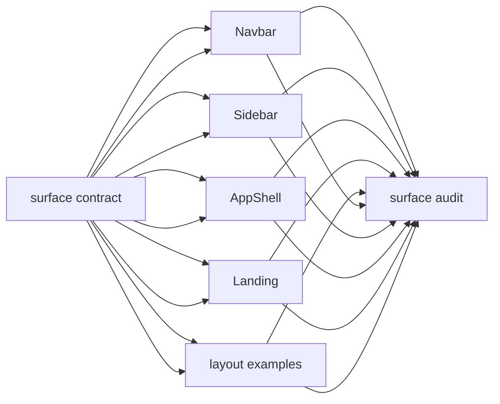

<!--
SPDX-FileCopyrightText: 2026 t128n Torben Haack

SPDX-License-Identifier: MPL-2.0

This Source Code Form is subject to the terms of the Mozilla Public
License, v. 2.0. If a copy of the MPL was not distributed with this
file, You can obtain one at https://mozilla.org/MPL/2.0/.
-->

# Surface continuity and structural borders

**Goal:** Make Navbar, Sidebar, main content, and Landing default to one continuous white surface, separated by single-owner 1px borders.
**Architecture:** Document hierarchy and border ownership in `DESIGN.md`, then let each layout component own one structural edge. Views stop tinting page backgrounds; one cross-cutting test audits the examples.
**Tech stack:** Svelte 5, Storybook CSF, Vitest + jsdom, Bun.
**Spec:** `DESIGN.md` §§Colors, Layout, Elevation & Depth, Components.
**Detail:** contracts
**Target-min:** 12

**Global constraints:** Light-first. Reuse existing tokens; add no colors or near-white values. White `#FFFFFF` is the default for Navbar, main content, Landing, workspaces, and persistent Sidebars. Keep `--color-canvas: #F2F4F8` only for subdued public or empty contexts, selected backgrounds, or genuine differentiation; never as an application page background. Keep `--color-navigation-surface: #F7F8FA` only for an explicitly requested navigation variant. Structural borders use `--border-width` and `--color-border`. Ownership: Navbar bottom, Sidebar right, Footer optional top, PageHeader none, AppShell none. A shared edge gets exactly one border. Preserve responsive navigation, skip link, focus rings, `aria-current`, reduced motion, status tokens, content hierarchy, and story names unless a task adds one. No `!important`, raw hex under `lib/`, extra cards, shadows, gradients, or dependencies.

```mermaid
%% schedule
gantt
  title Predicted schedule (mm:ss)
  dateFormat X
  axisFormat %M:%S
  section lane 1
  T1 surface contract :t1, 0, 105s
  T6 layout examples audit :t6, 105, 210s
  T7 cross-cutting surface audit :t7, 315, 107s
  section lane 2
  T3 Sidebar white default :t3, 105, 136s
  section lane 3
  T2 Navbar white surface :t2, 105, 133s
  section lane 4
  T5 Landing continuous white page :t5, 105, 133s
  section lane 5
  T4 AppShell continuous white content :t4, 105, 101s
```

critical path: T1 → T6 → T7 (7.0 min) · peak width 5 · predicted build 7.0 min · predicted total ≈ 10.5 min (target ✓)

### T1 surface contract · Complexity 3 (O-1) · Est. context 26k
**Owns:** `DESIGN.md`, `packages/ui/tests/tokens.test.ts`
**Components:** 1
**LOC owned:** 120
**Tests:** fast
**Model:** sonnet
**Est. time:** 2.5 min
**Consumes:** none
**Produces:** documented surface hierarchy and border ownership; `tokens.test.ts` assertions for the new wording
**Review Focus:** `test_default_surfaces`: white defaults for Navbar, content, Landing, workspaces, Sidebars; `test_canvas_scope`: canvas limited to subdued, selected, or genuinely distinct contexts; `test_navigation_surface_scope`: optional explicit variant only; `test_surface_principles`: shared background + selective borders + whitespace over contrasting backgrounds + boxed sections + repeated dividers; `test_border_ownership`: Navbar bottom, Sidebar right, Footer optional top, PageHeader none, AppShell none; `test_existing_tokens`: tokens unchanged.
**Test code (verbatim):** `expect(design).toContain('### Border ownership')` · `expect(design).toContain('Navbar owns its bottom border')` · `expect(design).toContain('Sidebar owns its right border')` · `expect(design).toContain('AppShell arranges regions without drawing their borders')` · `expect(tokens).toContain('--color-canvas: #F2F4F8')`
**Steps:** 1 test, 2 run: FAIL, 3 implement, 4 run: PASS
**Notes:** Replace "Do not add seams or additional borders between regions". Keep front-matter values, Refusals tables, and the neutral selected row.

### T2 Navbar white surface · Complexity 4 (O-1) · Est. context 28k
**Owns:** `packages/ui/src/lib/Navbar.svelte`, `packages/ui/src/stories/Navbar.stories.svelte`, `packages/ui/tests/navbar.test.ts`
**Components:** 2
**LOC owned:** 150
**Tests:** fast
**Model:** sonnet
**Est. time:** 3.0 min
**Consumes:** documented surface contract (T1)
**Produces:** Navbar props `{ brand?: string; links?: NavLink[]; actions?: Snippet; label?: string } -> HTMLElement`; `.navbar` white with `border-bottom: var(--border-width) solid var(--color-border)`
**Review Focus:** `test_default_surface`: `.navbar` uses workspace and no off-white fill; `test_structural_border`: one edge, `border-bottom` with border tokens; no top/left/right structural border; `test_lightweight_controls`: links transparent, regular; active accent underline plus primary, no background; `test_menu_surface`: popover stays `--color-surface` with overlay border; `test_responsive_preserved`: ResizeObserver, `scrollWidth`, compact menu, aria, viewports; `test_stories`: Basic, Account utilities, Narrow screen, Long labels, ghost utilities.
**Test code (verbatim):** `expect(blockFor(navbar, '.navbar')).toContain('background: var(--color-workspace)')` · `expect(blockFor(navbar, '.navbar')).toContain('border-bottom: var(--border-width) solid var(--color-border)')` · `expect(blockFor(navbar, '.navbar')).not.toContain('border-top')` · `expect(blockFor(navbar, '.link.active')).toContain('border-bottom-color: var(--color-accent)')`
**Steps:** 1 test, 2 run: FAIL, 3 implement, 4 run: PASS
**Notes:** The active underline is a selected cue, not a structural border. No wrapper or height change.

### T3 Sidebar white default · Complexity 4 (O-1) · Est. context 30k
**Owns:** `packages/ui/src/lib/Sidebar.svelte`, `packages/ui/src/stories/Sidebar.stories.svelte`, `packages/ui/tests/sidebar.test.ts`
**Components:** 2
**LOC owned:** 170
**Tests:** fast
**Model:** sonnet
**Est. time:** 3.0 min
**Consumes:** documented surface contract (T1)
**Produces:** Sidebar props `{ sections: Section[]; header?: Snippet; footer?: Snippet; label?: string; toggleLabel?: string; surface?: 'workspace' | 'navigation' } -> HTMLElement`; default `surface = 'workspace'`; `.sidebar` owns `border-right: var(--border-width) solid var(--color-border)`
**Review Focus:** `test_default_white`: default `workspace`, `.sidebar` white; `test_navigation_variant`: `surface="navigation"` adds `navigation` class using navigation-surface; `test_structural_border`: one edge, `border-right` with border tokens; `test_mobile_border_reset`: `max-width: 800px` sets `border-right: 0`; `test_selected_neutral`: active rows keep navigation-selected, primary medium text, no accent; `test_surface_stories`: keep Flat, Grouped, Nested, Selected, Focus; replace "White surface" with "Navigation surface".
**Test code (verbatim):** `expect(sidebar).toContain("surface = 'workspace'")` · `expect(rule(sidebar, '.sidebar')).toContain('background: var(--color-workspace)')` · `expect(rule(sidebar, '.sidebar')).toContain('border-right: var(--border-width) solid var(--color-border)')` · `expect(rule(sidebar, '.sidebar.navigation')).toContain('background: var(--color-navigation-surface)')` · `expect(sidebar).toContain('border-right: 0')`
**Steps:** 1 test, 2 run: FAIL, 3 implement, 4 run: PASS
**Notes:** The right border must not be duplicated by AppShell. Keep the sticky desktop behavior and nested disclosure.

### T4 AppShell continuous white content · Complexity 3 (O-1) · Est. context 24k
**Owns:** `packages/ui/src/lib/AppShell.svelte`, `packages/ui/src/stories/AppShell.stories.svelte`, `packages/ui/tests/app-shell.test.ts`
**Components:** 1
**LOC owned:** 90
**Tests:** fast
**Model:** sonnet
**Est. time:** 2.5 min
**Consumes:** documented surface contract (T1)
**Produces:** AppShell props `{ sidebar?: Snippet; navbar?: Snippet; children?: Snippet } -> HTMLElement`; `.content` uses `var(--color-workspace)` and AppShell draws no structural borders
**Review Focus:** `test_shell_workspace`: root white; `test_content_workspace`: `.content` white; `test_no_structural_borders`: no border declarations or shadow; `test_no_extra_container`: one main, no bordered wrapper, `.content-inner` keeps measure; `test_compositions`: Top, Sidebar, Combined, Narrow without overrides; `test_pageheader_untouched`: background-free, border-free; `test_focus_and_skip`: preserved.
**Test code (verbatim):** `expect(shell).toContain('background: var(--color-workspace)')` · `expect(blockFor(shell, '.content')).toContain('background: var(--color-workspace)')` · `expect(shell).not.toMatch(/border-(top|bottom|left|right)\s*:/)` · `expect(shell).toContain('max-width: var(--layout-content-width)')` · `expect(pageHeader).not.toMatch(/border\s*:/)`
**Steps:** 1 test, 2 run: FAIL, 3 implement, 4 run: PASS
**Notes:** Do not add a top border to `.content` (Navbar owns it) or a left border (Sidebar owns it). Keep the 800px stack.

### T5 Landing continuous white page · Complexity 4 (O-1) · Est. context 28k
**Owns:** `packages/ui/src/stories/Landing.stories.svelte`, `packages/ui/tests/views.test.ts`, `packages/ui/tests/stories.test.ts`
**Components:** 2
**LOC owned:** 150
**Tests:** fast
**Model:** sonnet
**Est. time:** 3.0 min
**Consumes:** documented surface contract (T1)
**Produces:** Landing story on `var(--color-workspace)`, Navbar and Hero sharing the surface, white Footer with its optional top border
**Review Focus:** `test_landing_white`: `.landing` white, no canvas or navigation-surface; `test_shared_surface`: no section or Hero background; `test_navbar_edge`: relies on Navbar bottom border, no second border; `test_footer_edge`: Footer white, own top border, remove `bordered={false}`; `test_no_card_inflation`: plain feature sections, only Hero aside Card; `test_page_fill`: `min-height: 100vh` in normal flow; `test_responsive`: 1120px wrap, 800px stacking.
**Test code (verbatim):** `expect(blockFor(landing, '.landing')).toContain('background: var(--color-workspace)')` · `expect(landing).not.toContain('background: var(--color-canvas)')` · `expect(landing).toContain('min-height: 100vh')` · `expect(landing).not.toContain('bordered={false}')` · `expect(landing).toContain('<section class="feature"')`
**Steps:** 1 test, 2 run: FAIL, 3 implement, 4 run: PASS
**Notes:** Do not add a Hero border, section band, or extra cards. Keep ghost sign-in and the aside card.

### T6 layout examples audit · Complexity 3 (O-1) · Est. context 30k
**Owns:** `packages/ui/src/stories/Dashboard.stories.svelte`, `packages/ui/src/stories/Settings.stories.svelte`, `packages/ui/src/stories/Foundations.stories.svelte`, `packages/ui/src/stories/Footer.stories.svelte`, `packages/ui/src/stories/Hero.stories.svelte`, `packages/ui/tests/view-surfaces.test.ts`
**Components:** 5
**LOC owned:** 180
**Tests:** fast
**Model:** sonnet
**Est. time:** 3.0 min
**Consumes:** documented surface contract (T1)
**Produces:** audited stories: Dashboard and Settings on workspace, AppShell/Footer/Hero examples inherit white, Foundations documents the defaults
**Review Focus:** `test_views_white`: Dashboard and Settings wrappers white, never canvas; `test_no_stale_overrides`: audited stories set no page canvas or navigation-surface; `test_footer_example_white`: complete page white with owned top border; `test_hero_examples_white`: wrappers white or inherit, no tinted band; `test_foundations_guidance`: lists Workspace, Canvas, optional Navigation surface; text says white is default, canvas subdued; `test_semantic_status`: warning Alert and all status Badges remain; `test_no_new_colors`: no new hex or cards.
**Test code (verbatim):** `expect(dashboard).toContain('background: var(--color-workspace)')` · `expect(settings).toContain('background: var(--color-workspace)')` · `expect(dashboard).not.toContain('background: var(--color-canvas)')` · `expect(settings).not.toContain('background: var(--color-canvas)')` · `expect(foundations).toContain('White is the default')`
**Steps:** 1 test, 2 run: FAIL, 3 implement, 4 run: PASS
**Notes:** Do not restyle Dashboard content or Settings forms beyond surface corrections. Keep PageHeader untouched.

### T7 cross-cutting surface audit · Complexity 4 (O-1) · Est. context 46k
**Owns:** `packages/ui/tests/surface-rules.test.ts`, `packages/ui/tests/footer.test.ts`
**Components:** 1
**LOC owned:** 140
**Tests:** fast
**Model:** sonnet
**Est. time:** 2.5 min
**Consumes:** Navbar (T2) · Sidebar (T3) · AppShell (T4) · Landing (T5) · examples (T6) · contract (T1)
**Produces:** `surface-rules.test.ts` acceptance suite for defaults, single-owner borders, no doubled seams, no page canvas overrides
**Review Focus:** `test_acceptance_defaults`: Navbar, Sidebar, content, Landing white; `test_acceptance_seams`: Navbar only bottom, Sidebar only right, Footer only top, AppShell and PageHeader none; `test_acceptance_no_double`: AppShell no borders and no neighbour edges added; `test_acceptance_landing`: no canvas, no section backgrounds; `test_acceptance_status`: all status tokens unchanged; `test_acceptance_examples`: all stories white; `test_acceptance_narrow`: Sidebar border reset, Navbar compact preserved; `test_acceptance_tokens`: no new near-white hex or tokens; `test_footer_reconciled`: update the complete-page assertion in `footer.test.ts` to the owned default top border after T6 removed `bordered={false}`.
**Test code (verbatim):** `expect(rule(navbar, '.navbar')).toContain('border-bottom: var(--border-width) solid var(--color-border)')` · `expect(rule(sidebar, '.sidebar')).toContain('border-right: var(--border-width) solid var(--color-border)')` · `expect(shell).not.toMatch(/border-(top|bottom|left|right)\s*:/)` · `expect(landing).not.toContain('background: var(--color-canvas)')` · `expect(tokens).toContain('--color-canvas: #F2F4F8')`
**Steps:** 1 test, 2 run: FAIL, 3 implement, 4 run: PASS
**Notes:** Verification task: change only its own test file. A failure names the owning file and exact rule.

## Review Focus
packages/ui: encoding, protocol — web UI. Encoding covers surface contrast, single-border seams, continuous white pages. Protocol covers surface APIs, border ownership, composed stories.
**Probe entry:** `serve=storybook dev -p 6006`

## Self-review
- Coverage: T1 contract, T2–T4 shell, T5 Landing, T6 examples, T7 acceptance. Unique Owns; T7 is the only consumer with edges. All tasks 2.5–3.0 min.
